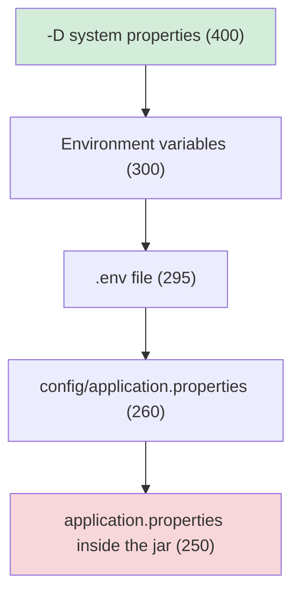

# 🧩 Lab 02 - Configuration and profiles

| ⏱️ Duration | 🚀 Quarkus | ☕ Java | 🧪 Type |
|---|---|---|---|
| 2 h | 3.40.1.1 LTS | 21 | A (starter + solution) |

## 📍 Where to run commands
Open a terminal **inside this lab's `starter/` folder** and check where you are before running anything:

```powershell
Get-Location
```

```bash
pwd
```

> [!NOTE]
> Commands are shown in PowerShell first (`.\mvnw.cmd`) and Bash second (`./mvnw`). In Git Bash, `./mvnw` may fail because of `JAVA_HOME`; use the system `mvn` instead. In PowerShell 5.1, `-Dx.y=z` arguments must be quoted.

## 🎯 Why it matters
The same application runs on your machine, in CI, in staging and in production, and each environment needs different values (URLs, credentials, texts, limits). In a real project you almost never run dev mode: you deploy **a jar or an image** and change its configuration from the outside (environment variables, ConfigMaps, secrets). This lab covers that whole journey, including the traps that waste the most time at work: not knowing **which value wins**, starting with invalid configuration, and changing at runtime properties that are only read at build time.

## 🧠 Concepts
- `@ConfigProperty`: required value, `defaultValue` and `Optional<T>`
- `@ConfigMapping`: typed configuration (nested groups, `List`, `@WithDefault`) and validation with Bean Validation
- Property expressions: `${other.property:default-value}`
- Profiles: `dev`, `test`, `prod` and custom ones (`%staging.`)
- Source precedence: `-D` > environment variables > `.env` > `config/application.properties` > the jar's `application.properties`
- **Build-time** properties (fixed when compiling) vs **runtime** properties (overridable)
- Overriding configuration in tests with `QuarkusTestProfile`
- Fail-fast: the application does not start with invalid configuration

## 📚 Documentation
- [Configuration reference](https://quarkus.io/guides/config-reference) (precedence, profiles, environment variables, expressions)
- [Mapping configuration to objects](https://quarkus.io/guides/config-mappings) (includes the Bean Validation section)
- [Testing in Quarkus](https://quarkus.io/guides/getting-started-testing) (test profiles)

## 🧭 Scenario
`starter/` has two endpoints that currently return fixed values:
- `GET /greeting` returns a greeting.
- `GET /info` returns application data (today it answers `TODO`) from an `AppConfig` that only has `name()`.

There are 11 tests; at the start, 10 fail. The one that checks the greeting defaults passes from the beginning and **must keep passing** (it is a regression guard).

### Configuration contract

| Property | Value / rule |
|---|---|
| `greeting.message` | `Hello` (already in the file) |
| `greeting.name` | Do **not** define it; it is optional. If missing, the greeting uses `world` |
| `greeting.punctuation` | Do **not** define it; default `!` in the code |
| `app.name` | `config-lab` (already in the file) |
| `app.version` | Do **not** define it; default `0.1.0` in the mapping |
| `app.tags` | `quarkus,config,lab` (list) |
| `app.contact.email` | `dev@lab.melostudy` (nested group, required, must be a valid email) |
| `app.base-url` | `https://<api.host>/api`, with `api.host` equal to `localhost` if it does not exist |
| `%staging.greeting.message` | `Hello from staging` |
| `%staging.app.name` | `config-lab-staging` |

Format of `GET /greeting`: `<message>, <name or world><punctuation>` → by default `Hello, world!`

Format of `GET /info`:

```text
config-lab v0.1.0 | tags=quarkus,config,lab | contact=dev@lab.melostudy | url=https://localhost/api
```

## ✅ Tasks

### Task 1 - `@ConfigProperty`
**Validated by:** `OverridesTest`, `GreetingResourceTest`.

- [ ] Make `GreetingResource` read `greeting.message` (required), `greeting.name` (optional) and `greeting.punctuation` (with a default value).

### Task 2 - `@ConfigMapping`
**Validated by:** `InfoResourceTest`.

- [ ] Complete `AppConfig`: version with a default, a list of tags, `baseUrl`, and a nested contact group with `email` and an optional `phone`.
- [ ] Inject it into `InfoResource` and return the format above.
- [ ] Add the properties to `application.properties` following the contract.

### Task 3 - Expressions
- [ ] Define `app.base-url` with an expression that takes `api.host` and falls back to `localhost` if it does not exist.

### Task 4 - Custom profile
**Validated by:** `StagingProfileTest`.

- [ ] Add the `%staging.` properties from the contract.
- [ ] Start dev mode with that profile and check the result:

```powershell
.\mvnw.cmd quarkus:dev "-Dquarkus.profile=staging"
```

```bash
mvn quarkus:dev -Dquarkus.profile=staging
```

### Task 5 - Fail-fast
**Validated by:** `AppConfigValidationTest`.

- [ ] Add the `hibernate-validator` extension and require `contact.email` to be non-blank and a valid email.
- [ ] Once the tests pass, test it by hand: set `app.contact.email=nope` in `application.properties`, start dev mode and read the error (`ConfigValidationException: Configuration validation failed`). Then restore the value.
- [ ] Think: what would happen in a real deployment if the application **did** start with that value?

### Task 6 - Run the jar and explore precedence (no tests)
**Goal:** this is how it runs in production: no dev mode, profile `prod`.

```powershell
.\mvnw.cmd package -DskipTests
java -jar target\quarkus-app\quarkus-run.jar
```

```bash
./mvnw package -DskipTests
java -jar target/quarkus-app/quarkus-run.jar
```

Stop the app with `Ctrl+C` between experiments, and query it from another terminal:

```powershell
curl.exe http://localhost:8080/greeting
```

```bash
curl http://localhost:8080/greeting
```

🔮 **Predict first:** write down what `/greeting` answers in each case before running it.

| # | Situation |
|---|---|
| a | Only the packaged `application.properties` |
| b | Environment variable `GREETING_MESSAGE=Env` |
| c | The previous environment variable **and** `-Dgreeting.message=Sys` |
| d | A `config/application.properties` file (a `config` folder next to where you run `java`, i.e. inside `starter/`) with `greeting.message=ConfigDir` |
| e | Case d **and** the environment variable |
| f | You add `%prod.greeting.message=Prod` to `application.properties` and package again |
| g | Case f **and** the `config/application.properties` from case d |
| h | Case g **and** the environment variable |

How to pass the values:

System property (in PowerShell the argument goes **in quotes**):

```powershell
java "-Dgreeting.message=Sys" -jar target\quarkus-app\quarkus-run.jar
```

```bash
java -Dgreeting.message=Sys -jar target/quarkus-app/quarkus-run.jar
```

Environment variable:

```powershell
$env:GREETING_MESSAGE = 'Env'
java -jar target\quarkus-app\quarkus-run.jar
# afterwards, clean it up:
Remove-Item Env:GREETING_MESSAGE
```

```bash
GREETING_MESSAGE=Env java -jar target/quarkus-app/quarkus-run.jar
```

> [!WARNING]
> Do not commit a `.env` file: it is where local secrets typically end up (it is already in `.gitignore`).

### Task 7 - Build-time vs runtime
**Goal:** discover that not every property can be changed after building.

With the jar already packaged, start it changing `quarkus.http.root-path`:

```powershell
java "-Dquarkus.http.root-path=/x" -jar target\quarkus-app\quarkus-run.jar
```

```bash
MSYS_NO_PATHCONV=1 java -Dquarkus.http.root-path=/x -jar target/quarkus-app/quarkus-run.jar
```

> [!NOTE]
> `MSYS_NO_PATHCONV=1` is only needed in Git Bash on Windows; without it `/x` is converted into a Windows path.

- [ ] Try `/greeting` and `/x/greeting`, and read the log. What does Quarkus say and why?
- [ ] Compare with `quarkus.http.port`, which can be changed at startup.
- [ ] In the configuration reference, find how build-time fixed properties are marked.

**Success criteria:** the 11 tests pass and you have done tasks 4 to 7 by hand.

```powershell
.\mvnw.cmd verify
```

```bash
mvn verify
```

## 🗺️ Precedence at a glance



Higher on the diagram wins. Inside a single source, the active profile (`%prod.`) beats the same property without a profile.

## 💼 In real projects
- **Secrets never go in the repository** (passwords, tokens, keys). In `application.properties` keep only safe development defaults; in production they arrive through environment variables or the orchestrator's secrets.
- **Configuration outside the artifact:** the same jar/image is promoted between environments and only the configuration changes (the *12-factor apps* principle). In Kubernetes, a ConfigMap mounted as a file usually ends up being the `config/application.properties` of Task 6, and a Secret is usually injected as an environment variable.
- **Use `%prod.` with care:** it is for non-sensitive defaults; do not put real URLs or credentials there. As you saw, any higher-priority external source overrides it, which is what you want.
- **Prefer `@ConfigMapping` over loose `@ConfigProperty`:** it groups, types and validates in a single place, and it can be tested without starting Quarkus (as in Task 5).
- **Fail-fast:** an application that starts misconfigured fails in production at 3 a.m.; one that refuses to start fails at deploy time, where the orchestrator stops the rollout and the previous version keeps serving.
- **Build-time vs runtime:** before promising "we'll change it with an environment variable in production", check that the property is not build-time.

## 🚀 Stretch goal
1. Extract `greeting.*` into a second `@ConfigMapping` (`GreetingConfig`) and remove the `@ConfigProperty` fields. What do you gain and what do you lose?
2. Show `contact.phone` in `/info` only when it exists, without breaking the tests.
3. Open the Dev UI in dev mode, find the configuration editor and change a value live.

## 💡 Hints
<details><summary>Hint 1 (direction)</summary>

- Task 1: three fields with `@ConfigProperty`; one of them is of a special type for values that may be absent.
- Task 2: in the *config mappings* guide look for nested groups and default values. Method names are converted to `kebab-case`.
- Task 3: the expression syntax with a default value is in the *Property expressions* section of the reference.
- Task 5: validation annotations go on the mapping's methods.
</details>

<details><summary>Hint 2 (more concrete)</summary>

- `@ConfigProperty(name = "...", defaultValue = "!")` and `Optional<String>`.
- `@WithDefault("0.1.0")`; a method that returns another interface creates the nested group; `List<String>` reads comma-separated values.
- A profile is activated with the `%name.` prefix on the property.
- Add the extension with the CLI or Maven, then use `@NotBlank` and `@Email` (package `jakarta.validation.constraints`):

```bash
quarkus extension add hibernate-validator
```

```powershell
.\mvnw.cmd quarkus:add-extension "-Dextensions=hibernate-validator"
```

```bash
./mvnw quarkus:add-extension -Dextensions=hibernate-validator
```
</details>

<details><summary>Hint 3 - if startup fails with <code>SRCFG00050 ... does not map to any root</code></summary>

Everything under the prefix of a `@ConfigMapping` must be mapped in the interface; otherwise Quarkus refuses to start. That is why the expression variable in Task 3 is called `api.host` and **not** `app.host`: it is outside the `app` prefix. It can also happen if you add `app.tags` to the file before declaring `tags()` in `AppConfig`.
</details>

## ✔️ Verified answers
<details><summary>Task 6 answers (open after predicting)</summary>

| # | Result of `/greeting` | Why |
|---|---|---|
| a | `Hello, world!` | There is only one value |
| b | `Env, world!` | Environment variables (300) > `application.properties` (250) |
| c | `Sys, world!` | `-D` (400) > environment variables (300) |
| d | `ConfigDir, world!` | `config/application.properties` (260) > the jar's (250) |
| e | `Env, world!` | Environment variable (300) > `config/` (260) |
| f | `Prod, world!` | Within the same file, `%prod.` beats the property without a profile |
| g | `ConfigDir, world!` | **Surprise:** the higher-priority source wins even if its property has no profile; the profile only breaks ties within a single source |
| h | `Env, world!` | Environment variable (300) above everything else |

(Verified by running every case against the jar with Quarkus 3.40.1.1. In dev mode the same rule applies: an environment variable beats even a `%dev.` property in the file.)
</details>

<details><summary>Task 7 answer</summary>

`quarkus.http.root-path` is fixed at build time: Quarkus ignores it at runtime and warns with `Build time property cannot be changed at runtime: quarkus.http.root-path is set to '/x' but it is build time fixed to '/'`. Routes stay at `/greeting` and `/x/greeting` returns 404. Quarkus optimizes at build time (it picks extensions, generates code, shortens startup), so not everything can be changed afterwards. `quarkus.http.port`, on the other hand, is a runtime property.
</details>

## 🎤 Self-assessment
Answer without looking at the code; you should be able to explain each one in an interview.

1. Why can't an expression variable be called `app.host` when there is a `@ConfigMapping(prefix = "app")`?
2. In Kubernetes you have a ConfigMap mounted as `config/application.properties` and an environment variable with the same key. Which one wins and why?
3. A teammate says "we'll change the context path in production with an environment variable". What do you answer?
4. Where would you store the production database password? And the development database URL?
5. What is the advantage of the application failing at startup over failing on the first request?

The complete solution is in `solution/`.

## 🔁 Retrospective
- Which precedence case did I not predict correctly, and why?
- When would I use `@ConfigProperty` and when `@ConfigMapping`?
- Which part of the journey (dev mode, tests, jar) felt closest to what I would do at work?
