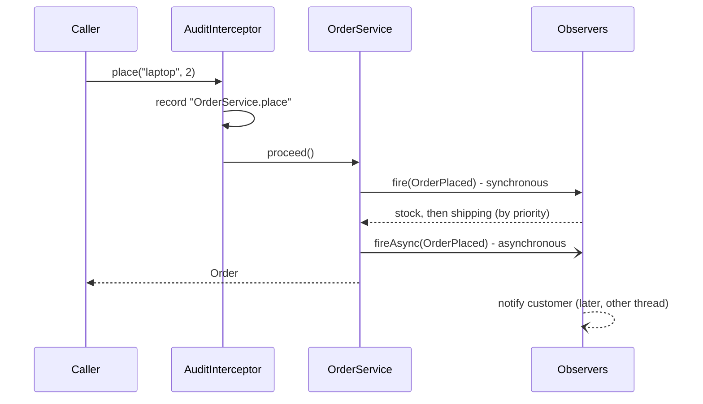

# 🧩 Lab 03 - CDI (dependency injection)

| ⏱️ Duration | 🚀 Quarkus | ☕ Java | 🧪 Type |
|---|---|---|---|
| 2 h | 3.40.1.1 LTS | 21 | A (starter + solution) |

## 📍 Where to run commands
Open a terminal **inside this lab's `starter/` folder** and check where you are before running anything:

```powershell
Get-Location
```

```bash
pwd
```

> [!NOTE]
> Commands are shown in PowerShell first (`.\mvnw.cmd`) and Bash second (`./mvnw`). In Git Bash, `./mvnw` may fail because of `JAVA_HOME`; use the system `mvn` instead.

## 🎯 Why it matters
Everything in Quarkus is a bean: resources, services, repositories, clients. Understanding **scopes, qualifiers, interceptors and events** prevents shared-state bugs, ambiguities and "disappearing beans". On top of that, Quarkus resolves injection **at build time** (ArC), not at runtime: that differs from Spring and is a classic interview topic.

## 🧠 Concepts
- Scopes: `@ApplicationScoped`, `@RequestScoped`, `@Singleton`, `@Dependent`; client proxies
- Constructor injection (recommended) and `Instance<T>` / `@Any`
- Qualifiers (with members) and ambiguous resolution
- Producers and `@DefaultBean`; replacing beans in tests with `@Alternative` + `@Priority`
- Interceptors (`@InterceptorBinding`, `@AroundInvoke`)
- Events: `Event<T>`, `@Observes`, `@ObservesAsync`, priority
- Unused bean removal and `@Unremovable`

## 📚 Documentation
- [CDI in Quarkus (introduction)](https://quarkus.io/guides/cdi)
- [CDI reference for Quarkus (ArC)](https://quarkus.io/guides/cdi-reference)

> [!NOTE]
> The public guides show the latest version; your project uses 3.40.1.1 (LTS), which matches.

## 🧭 Scenario
`starter/` is a small order system: `OrderService` places orders, there are notifiers per channel, counters and an exporter. Almost everything compiles and starts, but **11 of the 12 tests fail**. Each task fixes a group of tests. Work inside `starter/` and run the tests with:

```powershell
.\mvnw.cmd test
```

```bash
mvn test
```

What happens when an order is placed once you finish:



## ✅ Tasks

### Task 1 - Scopes
**Validated by:** `ScopesTest`.

`HitWriter` writes into a `HitCounter` and `HitReader` reads it; `DemoResource` returns an id per request.

| Scope | Instances | Lifetime | Proxy |
|---|---|---|---|
| `@ApplicationScoped` | one | the whole application | yes (client proxy) |
| `@Singleton` | one | the whole application | no |
| `@RequestScoped` | one per request | the HTTP request | yes (client proxy) |
| `@Dependent` | one per injection point | the owner bean's | no |

🔮 **Predict first:** with `HitCounter` as `@Dependent`, does `HitReader` see the hits that `HitWriter` writes? And what real class is the `HitCounter` object the test receives?

- [ ] Run `ScopesTest` and compare your prediction with the failure messages.
- [ ] Fix the scopes of `HitCounter` and `RequestContextInfo` so the 3 tests pass. Look at the class name of the injected object once it is fixed.

### Task 2 - Qualifiers and `Instance`
**Validated by:** `NotificationServiceTest`.

- [ ] In `NotificationService`, inject a single `Notifier` **through the constructor** (no qualifier) and build the project.

🔮 **Predict first:** what happens and in which phase?

```powershell
.\mvnw.cmd package -DskipTests
```

```bash
./mvnw package -DskipTests
```

- [ ] Read the full error: is it detected at build time or at runtime?
- [ ] Create a `@Channel` qualifier with an `enum Type { EMAIL, SMS }` member, and apply it to `EmailNotifier` and `SmsNotifier`.
- [ ] Inject `@Channel(EMAIL) Notifier` and `@Channel(SMS) Notifier` for `emailTo` / `smsTo`.
- [ ] Implement `broadcast` with `@Any Instance<Notifier>`.

> [!WARNING]
> Now that the beans carry `@Channel`, inject a `Notifier` **without** a qualifier again. Is the error still "ambiguous"? Explain the change.

### Task 3 - Producer and `@DefaultBean`
**Validated by:** `ClockProducerTest`.

`OrderService` uses `Instant.now()`: impossible to test. The test already brings a fixed `Clock` (`src/test/.../FixedClockProducer`).

- [ ] Create a producer of `java.time.Clock` (system clock, UTC) marked `@DefaultBean`.
- [ ] Inject the `Clock` into `OrderService` and use it for `createdAt`.
- [ ] Notice how the test replaces the clock without touching production code. Which two annotations make that possible?

### Task 4 - Interceptor
**Validated by:** `AuditInterceptorTest`.

- [ ] Create the `@Audited` binding (`@InterceptorBinding`) and the interceptor that records `Class.method` in `AuditLog` before running, then continues the invocation.
- [ ] Annotate `OrderService.place` with `@Audited`.

### Task 5 - Events
**Validated by:** `OrderEventsTest`.

- [ ] Inject `Event<OrderPlaced>` into `OrderService` and fire it both synchronously and asynchronously when an order is placed.
- [ ] In `OrderObservers`, make `shippingPrepared` and `stockReserved` synchronous observers, and make **stock run before shipping** even though it is declared later (use priority).
- [ ] Turn `customerNotified` into an asynchronous observer.

### Task 6 - Unused beans
**Validated by:** `UnusedBeanTest`.

- [ ] Run the test, read the message and find out why `LegacyExporter` "does not exist" even though it has `@ApplicationScoped`.
- [ ] Fix it without artificially injecting the bean anywhere.

### Task 7 - Experiments (no tests)
Do them in a temporary copy or revert afterwards.

🔮 **Predict first, in writing, before each one.**

- [ ] **Self-invocation:** add a public `@Audited void validate(String item)` method to `OrderService` and call it from `place` as `validate(item)`. How many entries appear in `AuditLog`?
- [ ] **Exception in a synchronous observer:** make `stockReserved` throw an exception. What happens to `place()`? Do the other observers run?
- [ ] **Exception in an asynchronous observer:** same with `customerNotified`. Does the caller of `place()` find out?
- [ ] **Request scope outside a request:** from a `new Thread(...)` inside a test, call `requestInfo.id()`. What happens?

**Success criteria:** the 12 tests pass inside `starter/` and you have done Task 7.

```powershell
.\mvnw.cmd verify
```

```bash
mvn verify
```

## 👀 What you should see
- After Task 1 the injected object is a proxy: `lab.melostudy.HitCounter_ClientProxy`.
- At the end, `ScopesTest`, `NotificationServiceTest`, `ClockProducerTest`, `AuditInterceptorTest`, `OrderEventsTest` and `UnusedBeanTest` are green (12 tests).

## 💼 In real projects
- **Constructor injection** (as in this lab): explicit dependencies, `final` fields, and unit tests can build the class without a container. Quarkus lets you omit `@Inject` when there is a single constructor.
- **Injection errors = build failures.** Ambiguous or unsatisfied dependencies are detected at `package` time, not in production. A CI that compiles already validates the bean graph.
- **`@ApplicationScoped` by default** for stateless services; **`@Singleton`** when you do not need a proxy (simpler and cheaper; it is what this lab's `Clock` producer uses); **`@Dependent`** only for short-lived objects tied to their owner; **`@RequestScoped`** for per-request data (user, correlation id). Mutable shared state in an `@ApplicationScoped` bean must be thread-safe.
- **Replacing beans in tests:** `@DefaultBean` in production + `@Alternative`/`@Priority` in `src/test`, or `@InjectMock` (lab 16).
- **Interceptors for cross-cutting concerns** (auditing, metrics, retries). Watch out: the interceptor code runs on every call; keep it cheap. Quarkus annotations such as `@Transactional` or `@Retry` are interceptors.
- **Events to decouple**, not for critical flows: a failing synchronous observer breaks whoever fires the event; an asynchronous one fails silently (log or handle the error inside the observer). If you need delivery guarantees, use messaging (lab 19).
- **In an interview (Spring vs Quarkus):** in Spring, self-invocation does not go through the proxy so aspects are not applied; in Quarkus (ArC) it is intercepted. And Quarkus does DI at build time: no reflection or classpath scanning at startup, which reduces memory and startup time (key for native, lab 27).

## 🚀 Stretch goal
Select the notifier **dynamically** by channel name (`String`) using `Instance.select(...)` with an `AnnotationLiteral<Channel>`. Hint: the literal must return the value of the qualifier's member.

## 💡 Hints
<details><summary>Hint 1 (direction)</summary>

- Task 1: think about how many instances the container creates per injection point in each scope.
- Task 2: the qualifier needs `@Qualifier`, runtime retention and an enum member.
- Task 3: look at `io.quarkus.arc.DefaultBean` and how a producer declares its scope.
- Task 6: look in the `cdi-reference` guide for the section on removing unused beans.
</details>

<details><summary>Hint 2 (more concrete)</summary>

- Scopes: `HitCounter` → `@ApplicationScoped`; `RequestContextInfo` → `@RequestScoped`.
- Qualifier:

```java
@Qualifier
@Retention(RUNTIME)
@Target({ TYPE, METHOD, FIELD, PARAMETER })
public @interface Channel {
    Type value();
    enum Type { EMAIL, SMS }
}
```

  In the constructor: `@Channel(Channel.Type.EMAIL) Notifier email`.
- Producer, inside a bean:

```java
@Produces @Singleton @DefaultBean
Clock clock() { return Clock.systemUTC(); }
```

- Interceptor: `@Audited @Interceptor @Priority(Interceptor.Priority.APPLICATION)` + a method with `@AroundInvoke` that receives an `InvocationContext` and calls `proceed()`.
- Events: `@Observes @Priority(1000)` (lower number = earlier); `@ObservesAsync`; `fire(...)` and `fireAsync(...)` are separate channels.
- Unused bean: `@io.quarkus.arc.Unremovable`.
</details>

## ✔️ Verified answers
<details><summary>Open only after finishing the tasks</summary>

Everything here was checked by running it on Quarkus 3.40.1.1.

- **Task 1:** with `@Dependent`, every injection point gets **its own instance**; `HitReader` sees 0 even though the writer writes. With `@ApplicationScoped` there is a single shared instance, and what gets injected is a **client proxy** (`HitCounter_ClientProxy`) that delegates to it. With `@RequestScoped` the id changes on every HTTP request.
- **Task 2 (no qualifier):** it fails at **build** time (`package`), not at runtime: `AmbiguousResolutionException: Ambiguous dependencies for type lab.melostudy.Notifier and qualifiers [@Default]`, listing both candidate beans.
- **Task 2 (warning):** qualifying the beans with `@Channel` makes them lose `@Default`. Injecting a `Notifier` without a qualifier becomes **unsatisfied**: `UnsatisfiedResolutionException: Unsatisfied dependency for type lab.melostudy.Notifier and qualifiers [@Default]`. It still fails, but for the opposite reason. `@Any Instance<Notifier>` does see them all.
- **Task 3:** `@Alternative` + `@Priority(1)`. An alternative with a priority beats normal beans and `@DefaultBean`s.
- **Task 4:** in this version the interceptor also works if `@Priority` is omitted; still, declare it to fix the order when several interceptors apply to the same method.
- **Task 6:** ArC removes beans that nobody injects or observes and that have no interceptors (`quarkus.arc.remove-unused-beans`, enabled by default). Programmatic lookup (`Arc.container().instance(...)`) does not count as usage. Fix: `@Unremovable`. Note that `OrderObservers` is not removed because it has observers.
- **Task 7 (self-invocation):** `[OrderService.place, OrderService.validate]`: **2 entries**. ArC does intercept self-invocation.
- **Task 7 (sync observer fails):** `place()` throws the exception to the caller (`IllegalStateException: sync boom`). Later observers (including the asynchronous one, fired afterwards) never run.
- **Task 7 (async observer fails):** `place()` **returns normally**; the failure does not reach the caller.
- **Task 7 (request scope):** `ContextNotActiveException: RequestScoped context was not active when trying to obtain a bean instance for a client proxy of CLASS bean [class=lab.melostudy.RequestContextInfo ...]`. It works in the test thread because `@QuarkusTest` activates the request context. Tasks in your own threads (executors, `@Scheduled`) do not have it: use `@ActivateRequestContext`.
</details>

## 🎤 Self-assessment
Answer without looking at the code; you should be able to explain each one in an interview.

1. What is the difference between `@ApplicationScoped`, `@Singleton` and `@Dependent`? What is a client proxy and why do normal scopes need it?
2. Two beans inject the same interface and the project does not compile. When does it fail (build or runtime) and how do you fix it in three different ways?
3. An `@ApplicationScoped` bean that nobody injects does not show up when looked up through `Arc.container()` or `CDI.current()`. Why does that happen and how do you fix it?
4. How do you replace a production bean with another one in a test without touching the main code? Name two mechanisms.
5. Compare `@Observes` and `@ObservesAsync` regarding execution thread, ordering and error propagation. When would you use messaging instead of CDI events?

The complete solution is in `solution/`.

## 🔁 Retrospective
- What did I understand about CDI in Quarkus?
- What was hard?
- What should I reinforce?
