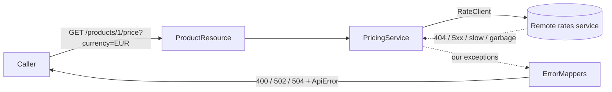

# 🔌 Lab 07 - REST Client

| ⏱️ Duration | 🚀 Quarkus | ☕ Java | 🧪 Type |
|---|---|---|---|
| 1-2 h | 3.40.1.1 LTS | 21 | A (starter + solution) |

## 📍 Where to run commands
Open a terminal **inside this lab's `starter/` folder** and check where you are before running anything:

```powershell
Get-Location
```

```bash
pwd
```

> [!NOTE]
> Commands are shown in PowerShell first (`.\mvnw.cmd`) and Bash second (`./mvnw`). In Git Bash, `./mvnw` may fail because of `JAVA_HOME`; use the system `mvn` instead.

## 🎯 Why it matters
Almost every service you will write at work calls another service. The call itself is one line; everything around it is the real work: where the URL lives, how long you are willing to wait, and what *your* callers see when the other side is slow, down, or wrong. A remote failure that leaks through untouched becomes a confusing bug in your API.

## 🧠 Concepts
- **Typed client:** an interface annotated with `@RegisterRestClient`; Quarkus generates the implementation. You inject it with the `@RestClient` qualifier.
- **`configKey`:** the name under which the client is configured (`quarkus.rest-client.<configKey>.url`, `.connect-timeout`, `.read-timeout`). The URL is configuration, never code (lab 02 applies: profiles and environment variables).
- **Two kinds of failure:** an HTTP error *response* (404, 500...) and a failure *without* a response (connection refused, timeout, unreadable body). They surface in different ways and need different handling.
- **Anti-corruption layer:** translate the remote world into your own exceptions and your own error contract (lab 05). Callers of *your* API must not need to know that a remote service exists.
- **Status codes for dependencies:** `502 Bad Gateway` (the dependency failed or answered garbage) and `504 Gateway Timeout` (it was too slow).

## 📚 Documentation
- [REST Client guide](https://quarkus.io/guides/rest-client) (exception handling, `@ClientExceptionMapper`)
- [Writing tests with `QuarkusTestResourceLifecycleManager`](https://quarkus.io/guides/getting-started-testing)

## 🧭 Scenario
The product catalog from lab 06 gets a new endpoint:

```
GET /products/{id}/price?currency=EUR
```

Prices are stored in USD. To convert them, the catalog asks a **remote exchange-rate service** (`GET /rates/{currency}` returns `{"currency":"EUR","rate":0.92}`). That service does not exist on the internet for this lab: the tests start a **stub** on a random local port (`RatesStubResource`, built on the JDK's own HTTP server, so no extra dependency and no network). The stub behaves according to the currency you ask for:

| Currency | What the remote does |
|---|---|
| `EUR`, `GBP` | Normal answer (rates `0.92`, `0.79`) |
| `XXX` | `404`: unknown currency |
| `ERR` | `500` |
| `SLO` | Answers after 3 seconds |
| `BAD` | `200` with a body that is not JSON |
| `ZER` | `200` with a rate of `0` (valid JSON, unusable value) |

Already provided in `starter/`: the endpoint in `ProductResource`, the `Rate` and `PriceQuote` records, the domain exceptions (`UnknownCurrencyException`, `RatesUnavailableException`, `RatesTimeoutException`) and their mappers in `ErrorMappers`. **Your job is the `RateClient` and everything in `PricingService.fetchRate`**, plus its configuration.



## ✅ Tasks

### Task 1 - Declare and call the client
**Goal:** `GET /products/1/price?currency=EUR` returns the converted price. **Validated by:** `PriceConversionTest.convertsThePriceWithTheRemoteRate`.

- [ ] Add the extension `quarkus-rest-client-jackson` (managed by the BOM, no version).
- [ ] Create `RateClient` with `@RegisterRestClient(configKey = "rates")`, `@Path("/rates")` and one method for `GET /rates/{currency}` returning `Rate`.
- [ ] Inject it into `PricingService` through the constructor and call it in `fetchRate`.
- [ ] Add the URL for the client in `application.properties` for the `dev` and `prod` profiles (the tests get theirs from the stub).

> [!WARNING]
> Forget something small and Quarkus tells you at build time or at the first call. Notice *when* each mistake is reported and what the message says.

🔮 **Predict first:** with only this task done (no error handling at all), what status and error `code` will `ERR`, `XXX` and `BAD` produce in **your** API? Write them down, then write a throwaway test or call the endpoint to check.

```powershell
.\mvnw.cmd test "-Dtest=PriceConversionTest"
```

```bash
./mvnw test -Dtest=PriceConversionTest
```

### Task 2 - Translate remote failures into your contract
**Goal:** a failing remote never changes *your* status codes or leaks its details. **Validated by:** the rest of `PriceConversionTest`.

- [ ] Remote `404` -> `UnknownCurrencyException` (`400 UNSUPPORTED_CURRENCY`).
- [ ] Any other remote error status -> `RatesUnavailableException` (`502 UPSTREAM_ERROR`).
- [ ] An answer the client cannot read (`BAD`) or a rate you cannot use (`ZER`) is also a `502`.
- [ ] The error body must not contain anything from the remote or its URL.

> [!WARNING]
> Look at the first prediction again. Which of those answers would have been *lies* to your caller?

### Task 3 - Timeouts
**Goal:** a slow dependency becomes a fast `504`, not a hung request. **Validated by:** `TimeoutTest`.

- [ ] Configure `connect-timeout` and `read-timeout` for the client (milliseconds).
- [ ] The test profile must use a short read timeout so the test is quick; the other profiles a realistic one.
- [ ] Catch the timeout and throw `RatesTimeoutException`.

🔮 **Predict first:** if you configure **no** timeouts at all and the remote hangs, how long does your caller wait before getting an answer? Write a number. (Do not wait to find out: read "Verified answers".)

### Task 4 - The remote is down, and configuration per environment
**Goal:** connection refused is a `502`, and you can point the same jar at any environment without rebuilding. **Validated by:** `UnreachableRemoteTest`.

- [ ] Handle the failure *without* a response (nobody is listening).
- [ ] Package the app and run the jar. Call the endpoint with the default `prod` URL, then override the URL with an environment variable and call it again.

```powershell
.\mvnw.cmd package
java -jar target\quarkus-app\quarkus-run.jar
```

In a second terminal:

```powershell
curl.exe -i "http://localhost:8080/products/1/price?currency=EUR"
```

To override the URL, stop the app and start it again with the environment variable (the name is derived from the property name; see lab 02):

```powershell
$env:QUARKUS_REST_CLIENT_RATES_URL = "http://localhost:1"
java -jar target\quarkus-app\quarkus-run.jar
```

```bash
QUARKUS_REST_CLIENT_RATES_URL=http://localhost:1 java -jar target/quarkus-app/quarkus-run.jar
```

Look at the **server log** after each call: which message shows that the override took effect?

**Success criteria:** `.\mvnw.cmd verify` inside `starter/` ends green.

```powershell
.\mvnw.cmd verify
```

## 👀 What you should see
With the solution's defaults, a packaged jar and nothing listening at the configured URL:

```
{"code":"UPSTREAM_ERROR","message":"A service this API depends on is not available"}   [502]
```

and in the log, a line that names the real cause (the caller never sees it):

```
WARN  [lab.melostudy.ErrorMappers] Rates service unavailable: The rates service could not be reached: ... Connection refused: ... localhost/127.0.0.1:1
```

## 💼 In real projects
- **Never trust defaults for timeouts.** Decide both timeouts deliberately for every client. A dependency that hangs eats your threads and turns its outage into yours.
- **Keep the translation in one place.** Business code should see your exceptions, not `WebApplicationException` or `ProcessingException`. Otherwise your generic mappers answer for the remote with the remote's status.
- **Do not leak the remote.** Hostnames, stack traces, and the remote's body stay in the log. Callers get a stable `code`.
- **The URL is environment configuration**, injected by the platform (environment variable, ConfigMap, secret store). Do not bake a production URL into the default profile of a library or service you hand to others; this lab leaves the default profile without a URL on purpose.
- **Retries, circuit breakers and caching** are the next layer (labs 13 and 23). Retry only idempotent calls such as this `GET`.
- **Propagate correlation ids** (`X-Request-Id`, trace headers) to the dependency so one incident can be followed across services.
- **Test with a stub you control** (a real HTTP server on a random port), not with the internet and not with a mocked interface: you want to exercise serialization, status codes and timeouts for real.

## 🚀 Stretch goal
Forward the caller's `X-Request-Id` header to the rates service so both logs share the id. Hint-free: decide whether it belongs in a client request filter or a header parameter, and how a request-scoped value reaches it.

## 💡 Hints
<details><summary>Hint 1 (direction)</summary>

For HTTP error *responses*, look at `@ClientExceptionMapper` in the REST Client guide. For failures *without* a response, look at what exception type the call throws and what its cause chain contains.
</details>

<details><summary>Hint 2 (more concrete)</summary>

`@ClientExceptionMapper` goes on a `static` method of the client interface, takes a `Response` and returns a `RuntimeException` (or `null` to let the next handler decide). Its package in this version is `io.quarkus.rest.client.reactive`. A timeout shows up as a `jakarta.ws.rs.ProcessingException` whose cause chain contains a `java.util.concurrent.TimeoutException`. An unreadable body is a `jakarta.ws.rs.WebApplicationException`.
</details>

## ✔️ Verified answers
<details><summary>Open only after finishing the tasks</summary>

Everything here was run on Quarkus 3.40.1.1.

**Task 1 prediction (client wired, nothing else).**

| Currency | Your API answered | Why it is wrong |
|---|---|---|
| `XXX` | `404`, `NOT_FOUND` | Says the *product* was not found, but it exists |
| `ERR` | `500`, `HTTP_500` | The remote's status passes through your generic `WebApplicationException` mapper |
| `BAD` | `400`, `MALFORMED_REQUEST` | Blames your *caller* for the remote's broken body |
| `SLO` (with a short read timeout) | `500`, `INTERNAL_ERROR` | A timeout is not an HTTP response, so nothing translates it |

The message of the first two even contains `when invoking REST Client method: 'lab.melostudy.RateClient#get'`: an internal class name in a public error. The reason: a 4xx/5xx *response* makes the client throw a `WebApplicationException` that carries the **remote** status; your own `WebApplicationException` mapper (lab 05) then keeps that status. `ZER` (valid JSON, rate 0) already gave `502` because the provided `PricingService` checks the rate.

**Mistakes and when they are reported.**
- Injecting the client **without** `@RestClient` fails the **build** (`Unsatisfied dependency for type lab.melostudy.RateClient and qualifiers [@Default]`; the bean is listed with qualifier `@RestClient`).
- A **missing URL does not fail startup**. The app boots and the first call fails with a `500`; the log says `Unable to determine the proper baseUrl/baseUri. Consider registering using @RegisterRestClient(baseUri="someuri"), @RegisterRestClient(configKey="orkey"), or by adding 'quarkus.rest-client.rates.url' or 'quarkus.rest-client.rates.uri' to your Quarkus configuration`. Unlike `@ConfigProperty` in lab 02, this is not fail-fast.

**Task 3 prediction.** With no timeouts configured, the call waited about **30 seconds** (measured: 31 s) before giving up. The caller waits 30 s for an answer your service cannot produce, and every waiting request holds resources.

**Task 4.**
- Connection refused is a `jakarta.ws.rs.ProcessingException` (cause `...AnnotatedConnectException: Connection refused`), **not** an HTTP response: `@ClientExceptionMapper` never sees it.
- With the default `prod` URL (`https://rates.example.com`, which does not resolve) the endpoint answered `502` and the log said `java.net.UnknownHostException: ... (rates.example.com)`.
- After `QUARKUS_REST_CLIENT_RATES_URL=http://localhost:1` the answer was still `502`, but the log now said `Connection refused ... localhost/127.0.0.1:1`: the override worked without rebuilding the jar. Against a real service returning `{"currency":"EUR","rate":0.92}` the same jar answered `200` with `{"productId":1,"currency":"EUR","rate":0.92,"amount":28.06}`.
- A timeout is also a `ProcessingException`; the solution detects it by walking the cause chain for a `TimeoutException`/`SocketTimeoutException`.
- A `200` whose body is not JSON is a `WebApplicationException` (`ClientWebApplicationException`) with a `JsonParseException` as cause: easy to confuse with an HTTP error. Without handling it, your own mapper turns it into `400 MALFORMED_REQUEST`.
</details>

## 🎤 Self-assessment
1. Where does a REST client get its URL and timeouts in Quarkus, and how do you change them per environment without rebuilding?
2. A remote service returns `500`. What does your caller see if you do nothing, and why? What should it see?
3. What is the difference between an HTTP error response and a failure without a response from the point of view of the client code? Give two examples of the second kind.
4. When do you answer `502` and when `504`? Why is `500` wrong for both?
5. Why is a stub HTTP server on a random port a better test double than a mocked interface for this code? What would you still not be testing?

The complete solution is in `solution/`.

## 🔁 Retrospective
- What did I understand?
- What was hard?
- What should I reinforce?
