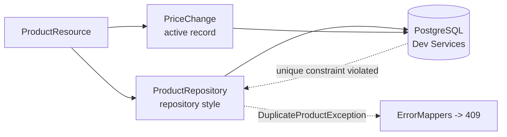

# 🗄️ Lab 08 - Hibernate ORM with Panache

| ⏱️ Duration | 🚀 Quarkus | ☕ Java | 🧪 Type |
|---|---|---|---|
| 2 h | 3.40.1.1 LTS | 21 | A (starter + solution) |

## 📍 Where to run commands
Open a terminal **inside this lab's `starter/` folder** and check where you are before running anything:

```powershell
Get-Location
```

```bash
pwd
```

> [!NOTE]
> Commands are shown in PowerShell first (`.\mvnw.cmd`) and Bash second (`./mvnw`). In Git Bash, `./mvnw` may fail because of `JAVA_HOME`; use the system `mvn` instead.

> [!IMPORTANT]
> **Docker (or Podman) must be running.** The tests start a real PostgreSQL in a container (Dev Services). The first run downloads the image, so it takes longer.

## 🎯 Why it matters
Until now the catalog lived in a `HashMap`: restart the app and everything is gone, two instances disagree, and "unique name" was a `synchronized` method. A real service keeps its data in a database, lets the database guard the rules that must never break, and keeps related writes atomic. Panache removes the boilerplate of JPA without hiding it.

## 🧠 Concepts
- **Entity:** a class mapped to a table (`@Entity`). Panache needs it to be a normal JPA entity.
- **Repository style** (`PanacheRepository<T>`): queries live in a separate bean. **Active record style** (`PanacheEntity`): the entity itself carries the queries (`PriceChange.list(...)`). Same engine, different place for the code.

| | Repository | Active record |
|---|---|---|
| Where the queries live | A `@ApplicationScoped` bean | Static methods on the entity |
| Injection / testing | Inject and mock it | Static calls, harder to replace |
| Id | You declare it | `PanacheEntity` gives you `id` (a sequence) |
| Fits | Real domain logic, teams used to layers | Small entities, quick CRUD |

- **Dev Services:** with a JDBC driver on the classpath and **no URL configured**, Quarkus starts a throwaway database container for dev and tests and wires the datasource.
- **Transactions:** `@Transactional` opens a transaction around a method; Hibernate writes to the database at *flush* time, which may be later than your line of code (more in lab 10).
- **Database-enforced rules:** a unique constraint is the only uniqueness check that survives concurrency.

## 📚 Documentation
- [Simplified Hibernate ORM with Panache](https://quarkus.io/guides/hibernate-orm-panache)
- [Hibernate ORM](https://quarkus.io/guides/hibernate-orm) (schema management, `import.sql`)
- [Dev Services for databases](https://quarkus.io/guides/databases-dev-services)

## 🧭 Scenario
The catalog API of labs 04-05 (REST, validation and the error contract) keeps working exactly the same from the outside, but `ProductRepository` stops being an in-memory map. Provided in `starter/`:

- `Product` is now a JPA entity (the API returns it directly; lab 12 separates entity and DTO). Its `nameKey` column holds the lower-cased name.
- `PriceChange` is an active-record entity that records price changes.
- `import.sql` seeds sample products in **dev mode only**.
- The tests: a `TestData` helper (plain SQL, so it does not depend on your code) puts the database in a known state before each test (the five sample products with ids 1-5, no history). The tests of labs 04-05 are carried over as regression guards.

Your job is `ProductRepository` and `PriceChange.historyOf`, plus one change in `Product`. The REST layer must not change.



## ✅ Tasks

### Task 1 - Read from the database
**Goal:** list (filter and page in the database) and get by id. **Validated by:** `ProductQueryTest`, and the `GET` tests of `ProductResourceTest`.

- [ ] Implement `page(category, page, size)`: ordered by id, category match ignoring case, total count for `X-Total-Count`.
- [ ] Implement `findOne(id)`.

> [!WARNING]
> Do not load everything and cut the list in Java: that works with 5 rows and fails with 5 million. Look at what `PanacheQuery` offers for paging and counting.

🔮 **Predict first:** before running anything, what do you think happens to the tables when you run the tests with **no** database configuration in `application.properties`? Where does the database come from?

```powershell
.\mvnw.cmd test "-Dtest=ProductQueryTest"
```

```bash
./mvnw test -Dtest=ProductQueryTest
```

### Task 2 - Write to the database
**Goal:** create, replace and delete. **Validated by:** `ProductResourceTest`, `ValidationTest`, `ErrorFormatTest`.

- [ ] `create` returns the product with the generated id (new products get 6, 7, ... after the sample data).
- [ ] `update` returns empty for an unknown id (that is a 404 above, and it must come **before** any uniqueness problem).
- [ ] `delete` returns `false` for an unknown id.
- [ ] Everything that writes runs in a transaction.

### Task 3 - Uniqueness is a database rule
**Goal:** duplicates are rejected by the database, in any case spelling, even under concurrency, and your API answers `409 CONFLICT`. **Validated by:** `UniqueNameTest`.

- [ ] Make `nameKey` unique in `Product`.
- [ ] Translate the database violation into `DuplicateProductException`.
- [ ] A product may be saved again with its own name (even changing the case).

> [!WARNING]
> Where does the exception come out: in your `create`/`update` method, or later? Try `update` first without any special handling and read the log carefully.

🔮 **Predict first:** if 8 requests create the same name at the same instant, how many answer `201`? Why would an `if (exists) throw ...` check before inserting not be enough?

### Task 4 - Active record and a second write in the same transaction
**Goal:** record price changes and read them back. **Validated by:** `PriceHistoryTest`.

- [ ] `PriceChange.historyOf(productId)`: newest first, using the static helpers inherited from `PanacheEntity`.
- [ ] In `update`, when the price changes, persist a `PriceChange` (helper `PriceChange.of`) in the same transaction. A failed update (409) must leave no history row.
- [ ] `delete` also removes the product's history.

### Task 5 - Outside the tests: the packaged jar
**Goal:** see what changes when Dev Services is not there. No test validates this task.

- [ ] Build and run the jar **without** any database configured. What happens?

```powershell
.\mvnw.cmd package
java -jar target\quarkus-app\quarkus-run.jar
```

- [ ] Start your own PostgreSQL and point the jar at it with environment variables (the names follow lab 02's rule).

```powershell
docker run -d --name lab08-pg -e POSTGRES_USER=shop -e POSTGRES_PASSWORD=pw -e POSTGRES_DB=shop -p 55432:5432 postgres:17.11
$env:QUARKUS_DATASOURCE_JDBC_URL = "jdbc:postgresql://localhost:55432/shop"
$env:QUARKUS_DATASOURCE_USERNAME = "shop"
$env:QUARKUS_DATASOURCE_PASSWORD = "pw"
java -jar target\quarkus-app\quarkus-run.jar
```

```bash
docker run -d --name lab08-pg -e POSTGRES_USER=shop -e POSTGRES_PASSWORD=pw -e POSTGRES_DB=shop -p 55432:5432 postgres:17.11
QUARKUS_DATASOURCE_JDBC_URL=jdbc:postgresql://localhost:55432/shop QUARKUS_DATASOURCE_USERNAME=shop \
QUARKUS_DATASOURCE_PASSWORD=pw java -jar target/quarkus-app/quarkus-run.jar
```

```powershell
curl.exe -i "http://localhost:8080/products"
```

- [ ] The call fails. Read the log. Then restart the jar adding `QUARKUS_HIBERNATE_ORM_SCHEMA_MANAGEMENT_STRATEGY=update` and try again, creating the same product twice with different case:

```powershell
curl.exe -i -X POST -H "Content-Type: application/json" -d '{\"name\":\"Refactoring\",\"category\":\"books\",\"price\":42.5}' "http://localhost:8080/products"
curl.exe -i -X POST -H "Content-Type: application/json" -d '{\"name\":\"REFACTORING\",\"category\":\"books\",\"price\":1}' "http://localhost:8080/products"
```

- [ ] Clean up when finished (stop the jar with Ctrl+C first):

```powershell
Remove-Item Env:QUARKUS_DATASOURCE_JDBC_URL, Env:QUARKUS_DATASOURCE_USERNAME, Env:QUARKUS_DATASOURCE_PASSWORD
docker rm -f lab08-pg
```

🔮 **Predict first:** with the database up but empty, what does `GET /products` return in the jar, and why? Is the sample data (`import.sql`) there?

**Success criteria:** `.\mvnw.cmd verify` inside `starter/` ends green.

```powershell
.\mvnw.cmd verify
```

## 👀 What you should see
In the jar, with a real database and the schema created for you (`update`), after creating the same product twice with different case:

```
HTTP/1.1 201 Created
{"id":1,"name":"Refactoring","category":"books","price":42.5}

HTTP/1.1 409 Conflict
{"code":"CONFLICT","message":"A product named 'REFACTORING' already exists"}
```

## 💼 In real projects
- **Dev Services is for dev and tests only.** In production the URL, user and password come from the platform (environment, secret store), never from `application.properties`. Production never generates the schema from entities: `schema-management.strategy=none`, and migrations create the tables (lab 11).
- **Test against the same database engine you run in production.** An in-memory H2 would have accepted things PostgreSQL rejects (and the other way round). Dev Services makes that cheap.
- **Rules that must always hold belong in the database** (unique, not null, foreign keys). Application checks are for friendly messages, not for correctness.
- **Never match a constraint by its generated name.** The names Hibernate generates differ between runs (see "Verified answers"); check the *kind* of violation, or name constraints explicitly in a migration.
- **Page in the database, always.** Return a total only if the client needs it: counting is another query.
- **Entities as API responses** are a shortcut for this lab. Any column you add later would leak; lab 12 separates them. `@JsonIgnore` on `nameKey` is the first symptom.
- **A test that leaves data behind couples the tests.** Reset the state in `@BeforeEach` and make every test class independent of execution order.

## 🚀 Stretch goal
Replace the `nameKey` column with a real case-insensitive unique index on `lower(name)` created by SQL. First find out what happens when you write `lower(name)` in an `@Index(columnList = ...)`, and decide where such an index should live in a project (hint: lab 11).

## 💡 Hints
<details><summary>Hint 1 (direction)</summary>

`PanacheRepository` already gives you `findAll(Sort)`, `find(query, Sort, params)`, `findByIdOptional`, `persist`, `delete`, `deleteById`, `flush`. `find(...)` returns a `PanacheQuery` that can `page(...)`, `count()` and `list()`. The Panache query language accepts `lower(category) = ?1`.
</details>

<details><summary>Hint 2 (more concrete)</summary>

For uniqueness, a violation reaches Java as a `jakarta.persistence.PersistenceException` somewhere in whose cause chain there is an `org.hibernate.exception.ConstraintViolationException` with `getKind()`. Writes are only sent to the database at flush: force it inside your method (`persistAndFlush`, `flush`) so you can catch the exception where you can translate it. For the active record, `PanacheEntity.list(query, Sort, params)` and `delete(query, params)` are static.
</details>

## ✔️ Verified answers
<details><summary>Open only after finishing the tasks</summary>

Everything here was run on Quarkus 3.40.1.1 with PostgreSQL via Dev Services.

**Task 1 prediction.** With no database configuration at all, the tests pass: with only the PostgreSQL driver and no URL, Dev Services starts a PostgreSQL container, and in dev/test Hibernate creates the tables for you. Nothing was configured for it.

**Task 3.**
- A duplicate **create** fails already at `persist(...)`: the id is an identity column, so Hibernate must `INSERT` immediately to know it. The failure is a Hibernate `ConstraintViolationException` ("duplicate key value violates unique constraint ...").
- A duplicate **update** is different. Without a flush in your method, the `UPDATE` is only sent when the transaction commits, after your method returned. The log shows `ARJUNA012125 ... beforeCompletion - failed` and `jakarta.transaction.RollbackException: ARJUNA016053: Could not commit transaction`, wrapped in an `ArcUndeclaredThrowableException`, and the API answers `500 INTERNAL_ERROR`. That is why the solution flushes inside the method.
- The concurrency test (8 threads, same name): exactly one `201`, seven `409`. An `exists` check before inserting is a race: all eight can see "no" before any of them inserts.
- Hibernate does **not** support a functional index through `@Index(columnList = "lower(name)")`: it generated DDL treating `lower(name)` as a column and PostgreSQL answered `column "lower(name)" named in key does not exist`. That is why this lab keeps a `name_key` column.
- Constraint names are not stable: the tests saw `product_name_key_key`, the jar with `strategy=update` created `uk4uflq7c3kouimop2r929u6h03`. Match on the violation kind, not the name.

**Task 5.**
- With no database configured the jar **does not start**: `Unable to find datasource '<default>' for persistence unit '<default>': Bean is not active` (Dev Services does not run outside dev and tests). `curl` cannot even connect.
- With the database up but empty and the production default (`strategy=none`): the app starts, and every call that touches the table fails with `500 INTERNAL_ERROR`; the log says `ERROR: relation "product" does not exist`.
- The strategy can be overridden at runtime: with `QUARKUS_HIBERNATE_ORM_SCHEMA_MANAGEMENT_STRATEGY=update` the table was created (id identity, `name_key` unique, `price numeric(9,2)`), `GET /products` returned `[]` (**`import.sql` is not loaded in production**), the first `POST` answered `201` and the second one with different case `409 CONFLICT`. `update` is a convenience for experiments, not a production strategy.

**A mistake to avoid in tests:** a `@QuarkusTest` class that does not reset the data passes or fails depending on which test class ran before it. A test class with its own test profile even boots a fresh application, against fresh data. All test classes here reset the data in `@BeforeEach`.
</details>

## 🎤 Self-assessment
1. What do you need to configure to get a PostgreSQL database in `quarkus:dev` and in tests? Why does the packaged jar not have one?
2. Repository or active record: give one reason to choose each, and the trade-off for testing.
3. Why can `existsByName` followed by `persist` still create duplicates? What guarantees uniqueness?
4. A duplicate `update` returned `500` while a duplicate `create` already worked. Why do they differ, and how do you fix it?
5. Why is `schema-management.strategy=drop-and-create` acceptable in tests and wrong in production? What replaces it?

The complete solution is in `solution/`.

## 🔁 Retrospective
- What did I understand?
- What was hard?
- What should I reinforce?
