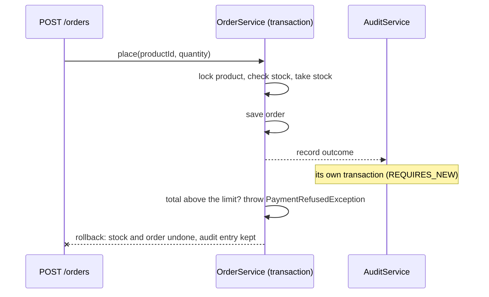

# 🔄 Lab 10 - Queries and transactions

| ⏱️ Duration | 🚀 Quarkus | ☕ Java | 🧪 Type |
|---|---|---|---|
| 2 h | 3.40.1.1 LTS | 21 | A (starter + solution) |

## 📍 Where to run commands
Open a terminal **inside this lab's `starter/` folder** and check where you are before running anything:

```powershell
Get-Location
```

```bash
pwd
```

> [!NOTE]
> Commands are shown in PowerShell first (`.\mvnw.cmd`) and Bash second (`./mvnw`). In Git Bash, `./mvnw` may fail because of `JAVA_HOME`; use the system `mvn` instead.

> [!IMPORTANT]
> **Docker (or Podman) must be running.** The tests start a real PostgreSQL in a container (Dev Services), as in labs 08 and 09.

## 🎯 Why it matters
Two things decide whether a service can be trusted with money or stock. The first is asking the database the right question: filters built safely, aggregates computed where the data lives. The second is what a *transaction* really guarantees. Code that "works" in a single-user test oversells under concurrency, keeps a half-finished order when a payment is refused, and loses its audit trail exactly when you need it. This lab builds an order flow and breaks it in each of those ways.

## 🧠 Concepts
- **Dynamic queries:** build the `WHERE` clause from the filters that are present, and pass every value as a *named parameter*. Never concatenate user input into the query text.
- **Aggregates and projections:** `group by` plus `count`/`sum`/`avg` in the database, returned straight into a record (`select new ...`). Loading every entity to count them in Java is the slow, wrong way.
- **`@Transactional` and rollback rules:** a transaction commits unless the method ends with an *unchecked* exception. A *checked* exception commits, unless you list it in `rollbackOn`.
- **Propagation:** `REQUIRED` (default) joins the caller's transaction; `REQUIRES_NEW` suspends it and runs in its own, committing independently.

| Propagation | Caller has a transaction | Caller has none |
|---|---|---|
| `REQUIRED` (default) | Joins it | Starts a new one |
| `REQUIRES_NEW` | Suspends it, starts a new one | Starts a new one |
| `MANDATORY` | Joins it | Fails |
| `NOT_SUPPORTED` / `NEVER` | Suspends it / fails | Runs without |

- **Concurrency:** a plain "read, change, write" loses updates when two requests interleave. Two answers: *pessimistic* locking (`SELECT ... FOR UPDATE`, others wait) or *optimistic* locking (`@Version`, the loser fails and retries).

## 📚 Documentation
- [Using transactions in Quarkus](https://quarkus.io/guides/transaction)
- [Simplified Hibernate ORM with Panache](https://quarkus.io/guides/hibernate-orm-panache) (queries, projections, locking)
- [Hibernate ORM in Quarkus](https://quarkus.io/guides/hibernate-orm)
- [CDI reference](https://quarkus.io/guides/cdi-reference) (interceptors and how Quarkus applies them)

## 🧭 Scenario
The catalog of lab 09 grows a stock and an order flow.

| Feature | Endpoint | Notes |
|---|---|---|
| Search | `GET /products?text=&minPrice=&maxPrice=` | Combines with the existing `category`, `label` and paging |
| Report | `GET /reports/categories` | Products, total stock and average price per category |
| Order | `POST /orders` `{productId, quantity}` | Takes stock, saves the order, asks the (simulated) payment provider |

Order outcomes: `201` placed · `404` unknown product · `409 OUT_OF_STOCK` · `402 PAYMENT_REFUSED` (an order total above `500.00`) · `400` invalid.



In `starter/`, the REST layer and the tests are complete, and `Product` has a `stock`. What is missing or wrong is in `ProductRepository` (task 1) and in `OrderService` and `AuditService` (tasks 2-4, each marked with a `TODO`).

Run the tests once before touching anything:

```powershell
.\mvnw.cmd test
```

```bash
./mvnw test
```

You should see 78 tests and 8 failures, in `SearchAndReportTest`, `OrderTest` and `ConcurrentOrdersTest`.

## ✅ Tasks

### Task 1 - Queries
**Goal:** the three new filters and the category report. **Validated by:** `SearchAndReportTest`.

- [ ] In `ProductRepository.page`, add `text` (the name contains it, ignoring case), `minPrice` and `maxPrice` (inclusive). All values as named parameters.
- [ ] In `categoryStats`, aggregate in the database and return `CategoryStats` rows ordered by category.

> [!WARNING]
> `text=%` must return **no** products (no name contains a percent sign). If it returns all of them, a character typed by the user is being interpreted as part of the query language.

🔮 **Predict first:** `LIKE` is the first thing most people reach for. What does `lower(name) like '%' || :text || '%'` do when `text` is `_`?

### Task 2 - All or nothing
**Goal:** a refused payment leaves no trace of the order and the stock is untouched. **Validated by:** `OrderTest.aRefusedPaymentUndoesTheStockAndTheOrder`.

- [ ] Run the test and read the failure: how much stock does the product have afterwards?
- [ ] Fix `OrderService.place`. Look at the exception that signals the refusal.

> [!WARNING]
> The service already "throws an exception on failure", so the transaction must roll back... or must it?

🔮 **Predict first:** the payment is refused by throwing `PaymentRefusedException`. The stock was decremented and the order persisted just before. Will the database contain them after the `402`?

### Task 3 - The audit trail
**Goal:** every attempt (placed, out of stock, payment refused) leaves an audit entry, **even the ones that roll back**. **Validated by:** `OrderTest.everyAttemptLeavesAnAuditEntryEvenWhenItIsRolledBack`.

- [ ] Run the test and compare the audit entries with what you expect.
- [ ] Fix `AuditService.record`.

🔮 **Predict first:** `OrderService` calls `audit.record(...)` and then throws. Is the audit row in the same transaction as the order? What happens to it on rollback?

### Task 4 - Concurrency
**Goal:** 8 buyers want 1 unit each of a product with 5 in stock: exactly 5 orders are accepted, 3 get `409`, and the stock ends at 0. **Validated by:** `ConcurrentOrdersTest`.

- [ ] Run the test. How many orders were accepted?
- [ ] Make concurrent orders for one product safe in `OrderService.place`.

> [!WARNING]
> The check `product.stock < quantity` and the update `product.stock -= quantity` are two steps. Another request can run between them.

🔮 **Predict first:** each of the 8 requests runs in its own transaction and its own connection. Both read `stock = 1`. What do they both decide?

## 👀 What you should see
Full suite of the solution:

```text
Tests run: 78, Failures: 0, Errors: 0, Skipped: 0
```

## 💼 In real projects
- **Keep transactions short and local.** Do not call remote services (lab 07) inside a transaction: you hold a connection and, here, a row lock while waiting for someone else's network. The payment check in this lab is simulated; with a real provider you would reserve stock, commit, call the provider, and compensate on failure.
- **Pessimistic or optimistic?** Pessimistic locks are simple and correct for hot rows (the last units of a popular product) but make requests queue. Optimistic locking (`@Version`) never blocks, but a conflicting request fails and the caller must retry, outside the transaction that failed.
- **Make orders idempotent.** A client that times out will retry. Without an idempotency key a retry places the order twice.
- **Audit and outbox.** `REQUIRES_NEW` is the quick way to keep a trail of failures. For events that other systems must see, write them in the same transaction as the data (an "outbox" table) so they cannot disagree.
- **Never trust user input in a query.** Named parameters protect against injection; they do not protect against wildcard characters, which is why this lab uses `locate` instead of `LIKE`.
- **Test concurrency.** A test with threads and a latch (`ConcurrentOrdersTest`) is the only thing that will ever catch a lost update before production does.

## 🚀 Stretch goal
1. Replace the pessimistic lock with an **optimistic** one: add a `@Version` field to `Product`, and retry an order that loses the race. Which exception do you get, where does it surface, and in which layer must the retry live? Keep `ConcurrentOrdersTest` green.
2. Add `POST /orders/{id}/cancel` that puts the units back in the stock. What must be true so that two cancellations of the same order do not return the stock twice?

## 💡 Hints
<details><summary>Hint 1 (direction)</summary>

- Task 1: Panache `find(query, sort, params)` for the filters; the report is a JPQL/HQL query with `group by` and a constructor expression (`select new ...`).
- Task 2: `@Transactional` has an attribute that lists exception types.
- Task 3: `@Transactional` has a `TxType`.
- Task 4: `findById` has an overload that takes a `LockModeType`.
</details>

<details><summary>Hint 2 (more concrete)</summary>

- Task 1: for the substring test, HQL has `locate(substring, string)`, which returns the 1-based position or 0.
- Task 2: `rollbackOn = PaymentRefusedException.class`.
- Task 3: `Transactional.TxType.REQUIRES_NEW`.
- Task 4: `LockModeType.PESSIMISTIC_WRITE`.
</details>

## ✔️ Verified answers
<details><summary>Open only after finishing the tasks</summary>

Everything here was checked by running it on Quarkus 3.40.1.1 (Hibernate ORM 7.4).

**Task 1 - `LIKE` and wildcards.** With `lower(p.name) like lower(:text)` and the value wrapped as `"%" + text + "%"`, `GET /products?text=%` answers `X-Total-Count: 5` (every product) instead of 0: the user's `%` is the SQL wildcard. The solution uses `locate(lower(:text), lower(p.name)) > 0`, which is a plain substring test. (`LIKE` can be made safe with an `escape` clause and escaping `%`, `_` and the escape character yourself.) The report uses a constructor expression:

```text
select new lab.melostudy.CategoryStats(p.category, count(p), sum(p.stock), round(avg(p.price), 2))
from Product p group by p.category order by p.category
```

With the five sample products it returns `books`: 3 products, stock 30, average 41.92; `games`: 2 products, stock 20, average 30.25.

**Task 2 - a checked exception commits.** With a plain `@Transactional`, the refused order (10 × 50.25 = 502.50) answers `402`, but the test finds the product's stock at **0** instead of 10: the transaction committed with the stock already taken. Only unchecked exceptions roll back by default. Two fixes: `@Transactional(rollbackOn = PaymentRefusedException.class)` (used here) or make the exception unchecked.

**Task 3 - audit lost with the rollback.** With a plain `@Transactional` on `AuditService.record` (`REQUIRED`, so it joins the caller's transaction), the assertion fails: the entries of the rejected attempts are missing (the first one reported missing is `REJECTED_STOCK`), because they were written inside the order transaction and rolled back with it. With `TxType.REQUIRES_NEW`, the audit commits on its own.

> [!NOTE]
> Does `REQUIRES_NEW` also work when the method is called on `this`, inside the same bean? In Quarkus it does. I moved `record` into `OrderService` (a public method with `@Transactional(REQUIRES_NEW)`), called it directly as `record(...)`, and the audit entries survived the rollback. Quarkus applies interceptors to calls on `this` for non-private methods (lab 03 shows the same with interceptors). Do not assume the behavior of other frameworks' proxies here.

**Task 4 - lost updates.** Without the lock (`findById(productId)`), `ConcurrentOrdersTest` fails with **8** accepted orders instead of 5: every buyer read a stock they were all allowed to take. With `findById(productId, LockModeType.PESSIMISTIC_WRITE)` the product row is locked (`SELECT ... FOR UPDATE`) until the transaction ends; the other requests wait and then read the updated stock: 5 accepted, 3 `409 OUT_OF_STOCK`, stock 0.

**Order of checks.** An unknown product is `404` before stock is looked at; validation failures (`400`) and unknown products are not audited, since no order was attempted.
</details>

## 🎤 Self-assessment
1. Which exceptions roll a `@Transactional` method back by default, and how do you change that?
2. What does `REQUIRES_NEW` do to the caller's transaction, and what is the risk of using it casually?
3. Explain a lost update with two requests and a stock of 1. Give two ways to prevent it and the trade-off of each.
4. Why is `like '%' || :text || '%'` with a named parameter still a problem, and what are two ways to handle it?
5. Why should a transaction not wrap a call to a remote service?

The complete solution is in `solution/`.

## 🔁 Retrospective
- What did I understand?
- What was hard?
- What should I reinforce?
