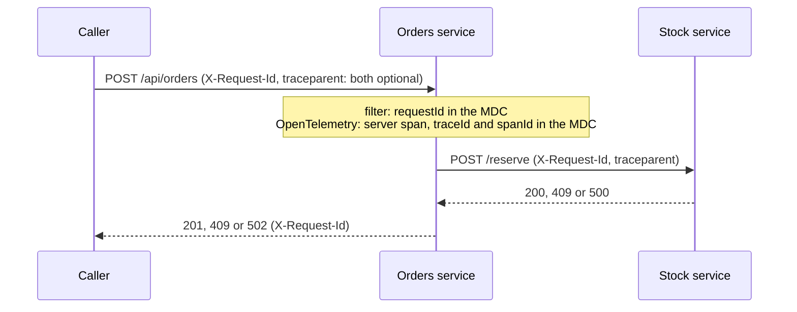

# 🔎 Lab 25 - Logging and tracing

| ⏱️ Duration | 🚀 Quarkus | ☕ Java | 🧪 Type |
|---|---|---|---|
| 2 h | 3.40.1.1 LTS | 21 | A (starter + solution) |

## 📍 Where to run commands
Open a terminal **inside this lab's `starter/` folder** and check where you are before running anything:

```powershell
Get-Location
```

```bash
pwd
```

> [!NOTE]
> Commands are shown in PowerShell first (`.\mvnw.cmd`) and Bash second (`./mvnw`). In Git Bash, `./mvnw` may fail because of `JAVA_HOME`; use the system `mvn` instead. No Docker is needed. The whole suite takes about 30 seconds: it starts the application twice (see Task 4) and each stop takes about 5 seconds once OpenTelemetry is in.

## 🎯 Why it matters
A customer writes "my order failed". Whoever is on call has the log lines of five pods and, if the team did its job, a trace backend. Two questions decide how long the night is: **which lines belong to this request?** and **where did the error or the time go across the services?** Logs answer the first only if they are structured and carry an id that follows the request everywhere. Traces answer the second only if the trace context crosses every boundary. This lab makes one service answerable: JSON logs, a correlation id that survives threads and calls, spans, and logs that tell the truth about failures without leaking what they must not.

## 🧠 Concepts
| Tool | Answers | Travels as | Who creates it |
|---|---|---|---|
| **Structured log record** | What happened, where, when | One JSON object per line | You (`Logger`) and the framework |
| **Correlation id** | Which lines belong to this request | Header `X-Request-Id` + the logging context | **You** (a filter). Works with or without tracing |
| **Trace and spans** | Where the time or the error went, across services | W3C header `traceparent` | OpenTelemetry, automatically for HTTP; you add business spans |

- **MDC** (mapped diagnostic context) is a small map attached to the current execution context. The log formatter prints it with every record, so a value put in once appears in every line the request writes. It belongs to *a context*, not to your code: work that continues somewhere else may not see it.
- A **trace** is the tree of **spans** (units of work) of one request. Each span knows its trace id, its own id and its parent. The extension puts `traceId`, `spanId` and `sampled` in the MDC, which is how a log line points at its trace.
- **Sampling** decides which traces are kept. A request that is not sampled still gets ids (and still prints them); it just records no spans.
- The request id and the trace id are not the same thing: the request id is yours, always present and easy to quote in a support ticket; the trace id exists only while OpenTelemetry is on.



## 📚 Documentation
- [Configuring logging](https://quarkus.io/guides/logging) (JSON format, MDC, levels)
- [OpenTelemetry](https://quarkus.io/guides/opentelemetry) (the extension, exporters, tests)
- [OpenTelemetry Tracing](https://quarkus.io/guides/opentelemetry-tracing) (spans, sampler, propagation)
- [Quarkus REST](https://quarkus.io/guides/rest) (request and response filters)
- [REST Client](https://quarkus.io/guides/rest-client) (providers on a client)
- [Context Propagation](https://quarkus.io/guides/context-propagation) (`ManagedExecutor`)
- [W3C Trace Context](https://www.w3.org/TR/trace-context/) (the `traceparent` header)
- [OpenTelemetry sampling](https://opentelemetry.io/docs/concepts/sampling/)
- [All configuration properties](https://quarkus.io/guides/all-config)

## 🧭 Scenario
A small **orders service**: `POST /api/orders` asks a **stock service** to reserve the goods (a REST client), stores the order, writes an audit line from another thread and answers `201`. A sold-out SKU is a `409`; a failing stock service is a `502`. `GET /api/orders/{id}` reads one.

Already written: the business code, the REST client (a `409` from the stock service becomes `OutOfStockException`, anything else that is not 2xx becomes `StockUnavailableException`), the audit log, the two exception mappers and the test infrastructure: a **fake stock service** (SKU `SOLD-OUT` answers 409, `BROKEN` answers 500, anything else 200) and `Logs`, a helper that reads back the JSON log file the tests switch on (the file handler is the way the tests see what the application logs). **Your job is everything that makes the service observable.**

| Task | What the service must do |
|---|---|
| 1 | Print JSON logs in production, plain text in dev and tests, MDC entries as top-level fields |
| 2 | Give every request a correlation id: keep a safe one from the caller, generate one otherwise, log it, return it |
| 3 | Send the id to the stock service, and keep it in the audit line that is written by another thread |
| 4 | Turn every request into a trace with a business span, named after the service |
| 5 | Keep the customer's email out of the log and report failures at the right level |

> [!IMPORTANT]
> Do the tasks **in order**: the tests of tasks 2 to 5 read the JSON log file, so they cannot pass before Task 1. Task 4 adds `quarkus-opentelemetry`; until then the tracing tests fail because there are no spans at all.

## ✅ Tasks

### Task 1 - Logs a machine can read
**Goal:** every log line is a JSON object, with the MDC entries as top-level fields. **Validated by:** `JsonLogsTest`.

- [ ] Add the `quarkus-logging-json` extension to `pom.xml` (a comment shows where).
- [ ] In `application.properties`: plain text in the `dev` and `test` profiles (JSON is for everything else, the packaged jar), and MDC entries as top-level fields (`flat-fields`) for **the console and the file handler**.
- [ ] Run the test class.

```powershell
.\mvnw.cmd test '-Dtest=JsonLogsTest'
```

```bash
./mvnw test -Dtest=JsonLogsTest
```

🔮 **Predict first:** you add only the dependency and run the tests. What does the console print, in the test profile? And where would an MDC entry such as `requestId` appear in a JSON record?

> [!WARNING]
> The console and the file handler have **separate** options (`quarkus.log.console.json.*` and `quarkus.log.file.json.*`). The tests read the file; production prints the console. If you configure only one of them, the other one tells a different story. A test reads the console options too.

### Task 2 - One id per request
**Goal:** every request has an id, it is in every line the request writes and in the response. **Validated by:** `RequestIdTest`.

- [ ] `RequestIdFilter.incoming`: use the caller's `X-Request-Id` if it matches `SAFE`, otherwise a random UUID. Put it in the MDC under `KEY` (`org.jboss.logging.MDC`) and keep it on the request for the response filter.
- [ ] `RequestIdFilter.outgoing`: send it back in the response header.
- [ ] Run the test class.

```powershell
.\mvnw.cmd test '-Dtest=RequestIdTest'
```

```bash
./mvnw test -Dtest=RequestIdTest
```

🔮 **Predict first:** two requests in a row are served by the same worker thread. Do you have to remove the id from the MDC when the first one ends, or the second one will see it?

> [!WARNING]
> The id comes from the caller and ends up in every line, in the log search and in dashboards. A caller can send a megabyte of markup. Look at what `SAFE` allows and at `anUnsafeIdIsReplacedAndNeverLogged`.

### Task 3 - The id follows the work
**Goal:** the stock service receives the id, and so does a line written by another thread. **Validated by:** `DownstreamTest`.

- [ ] `RequestIdClientFilter.filter`: copy the id of the request being served (it is in the MDC) to the same header of the outgoing call.
- [ ] Register the filter on `StockClient`.
- [ ] Run the test class. One test still fails: read its message, find out why the audit line has no id, and fix `AuditLog`.

```powershell
.\mvnw.cmd test '-Dtest=DownstreamTest'
```

```bash
./mvnw test -Dtest=DownstreamTest
```

🔮 **Predict first:** from which of these does a log line carry the `requestId`: the request thread, `CompletableFuture.runAsync`, an `Executors.newSingleThreadExecutor()`, an injected `ManagedExecutor`, a virtual thread started with `Thread.ofVirtual()`?

> [!WARNING]
> Forgetting to register the client filter is silent: the application compiles, every request works and the stock service never sees an id.

### Task 4 - A request becomes a trace
**Goal:** one request is one trace with the call to the stock service inside, a business span between them, the trace id in the logs and a service name. **Validated by:** `TracingTest` and `SamplingTest`.

- [ ] Add the `quarkus-opentelemetry` extension to `pom.xml`.
- [ ] Name the service `orders` (`quarkus.application.name`).
- [ ] `StockGateway.reserve`: make it a span named `reserve-stock` with the SKU as the attribute `order.sku`.
- [ ] Run the two test classes.

```powershell
.\mvnw.cmd test '-Dtest=TracingTest,SamplingTest'
```

```bash
./mvnw test -Dtest=TracingTest,SamplingTest
```

The tests collect spans with an in-memory exporter (a CDI bean in `SpanExporterProducer`, plus `opentelemetry-sdk-testing` in the `pom.xml`). `SamplingTest` runs with a different profile that keeps no traces; the sampler is a build-time setting, so Quarkus builds the application again for it.

🔮 **Predict first:** (a) with only the dependency, how many spans does one `POST /api/orders` produce, of which kinds, and what does the stock service receive? (b) with a sampler that keeps no traces, does the log line still show a trace id?

> [!WARNING]
> `%test.quarkus.otel.simple=true` is already in the properties. Without it the spans reach the exporter in batches every few seconds and the tests see none. In the same file, the name of the service is what a trace backend groups by: look at what it is when you do not set it.

### Task 5 - Logs you can trust
**Goal:** the log keeps the customer's email out and says what happened to a failed order, at the right level. **Validated by:** `HygieneTest`.

- [ ] `OrderService.create`: its first line logs more than the flow needs. Read what it prints and change it.
- [ ] `ErrorMappers`: a refusal because of stock is a normal outcome (an `INFO` line); the stock service failing is something somebody on call wants to see (a `WARN` line with the reason).
- [ ] Run the test class, then the whole suite.

```powershell
.\mvnw.cmd test '-Dtest=HygieneTest'
.\mvnw.cmd verify
```

```bash
./mvnw test -Dtest=HygieneTest
./mvnw verify
```

🔮 **Predict first:** send an order for the SKU `BROKEN` (the stock service answers 500). Before you change anything: what does the application write in the log about the failure?

> [!WARNING]
> Two ways in which a log lies: by what it prints (a record's `toString` includes every component) and by what it does not (an exception turned into a response by a mapper).

**Success criteria:** `.\mvnw.cmd verify` inside `starter/` ends green.

## 🏁 Outside the tests: the packaged jar
The tests use the file handler and a profile of their own. Production prints the console, so look at the real thing once. You need three terminals.

**Terminal 1** - the fake stock service, from the **lab folder** (`lab-25-logging-tracing/`; it needs only the JDK):

```powershell
java tools\StockStub.java 9998
```

```bash
java tools/StockStub.java 9998
```

**Terminal 2** - build and run the application, from `starter/` (once solved) or `solution/`:

```powershell
.\mvnw.cmd package -DskipTests
java "-Dquarkus.rest-client.stock.url=http://localhost:9998" -jar target\quarkus-app\quarkus-run.jar
```

```bash
./mvnw package -DskipTests
java -Dquarkus.rest-client.stock.url=http://localhost:9998 -jar target/quarkus-app/quarkus-run.jar
```

**Terminal 3** - from the lab folder, one good order and one that fails (the JSON comes from a file because PowerShell 5.1 mangles quotes in `curl.exe -d`):

```powershell
curl.exe -s -i -X POST http://localhost:8080/api/orders -H "Content-Type: application/json" -H "X-Request-Id: jar-1" --data-binary "@tools/order.json"
curl.exe -s -i -X POST http://localhost:8080/api/orders -H "Content-Type: application/json" -H "X-Request-Id: jar-2" --data-binary "@tools/order-broken.json"
```

```bash
curl -s -i -X POST http://localhost:8080/api/orders -H "Content-Type: application/json" -H "X-Request-Id: jar-1" --data-binary @tools/order.json
curl -s -i -X POST http://localhost:8080/api/orders -H "Content-Type: application/json" -H "X-Request-Id: jar-2" --data-binary @tools/order-broken.json
```

### 👀 What you should see
The responses carry `X-Request-Id: jar-1` (`201`) and `X-Request-Id: jar-2` (`502`). Terminal 2 prints JSON, one object per line, with `requestId`, `traceId`, `spanId` and `sampled` at the top level (ids and machine details differ in your run, `...` stands for what is cut):

```json
{"timestamp":"2026-11-03T09:42:26.0966332-05:00","sequence":115,"loggerClassName":"org.jboss.logging.Logger","loggerName":"lab.melostudy.OrderService","level":"INFO","message":"Creating an order for sku A1, quantity 2","threadName":"executor-thread-1","threadId":43,"spanId":"e0235435e0257329","requestId":"jar-1","traceId":"10bf7ddb5bf7bf608c4725bc3987f789","sampled":"true","ndc":"","hostName":"...","processName":"...","processId":...}
```

The audit line (`"loggerName":"lab.melostudy.AuditLog"`, another thread) has the same `requestId`, `traceId` and `spanId`. The failed order leaves one `"level":"WARN"` line from `ErrorMappers`. Terminal 1 shows what travelled to the stock service:

```text
stock: POST /reserve  X-Request-Id=jar-1  traceparent=00-10bf7ddb5bf7bf608c4725bc3987f789-f74e8b7b8e69837d-03
```

Wait a few seconds. On Windows a line like this appears in terminal 2, and it is not about your code:

```text
"loggerName":"io.quarkus.opentelemetry.runtime.exporter.otlp.sender.VertxGrpcSender","level":"WARNING","message":"Failed to export . The request could not be executed. Full error message: Connection refused: getsockopt: localhost/127.0.0.1:4317"
```

The jar sends its spans to an OpenTelemetry collector at `localhost:4317` (the default of `quarkus.otel.exporter.otlp.endpoint`) and there is none. Stop the application (`Ctrl+C`), then start it again with tracing switched off and repeat the two `curl.exe` calls:

```powershell
$env:QUARKUS_OTEL_SDK_DISABLED = 'true'
java "-Dquarkus.rest-client.stock.url=http://localhost:9998" -jar target\quarkus-app\quarkus-run.jar
```

```bash
QUARKUS_OTEL_SDK_DISABLED=true java -Dquarkus.rest-client.stock.url=http://localhost:9998 -jar target/quarkus-app/quarkus-run.jar
```

The lines keep their `requestId` and lose `traceId`, `spanId` and `sampled`; the stock stub prints `traceparent=null`; the export warning is gone. In PowerShell remove the variable afterwards (`Remove-Item Env:QUARKUS_OTEL_SDK_DISABLED`) and stop the stub with `Ctrl+C`.

## 💼 In real projects
- **The id is a contract with your callers and your support team.** An ingress or API gateway usually creates it; the service keeps a safe one and invents one only when it has none, returns it in every response (errors included) and prints it in every line. "Quote the request id" is the shortest sentence in a support process.
- **Where to log a failure:** once, where it stops being an exception. A business refusal is `INFO`; a failed dependency is `WARN` (or `ERROR` if the request cannot be served at all); an exception nobody mapped is logged by Quarkus at `ERROR` with an *error id* (and the request id in the line). A mapper that returns a `502` without a log line leaves nothing for the person on call.
- **What never goes in a log:** emails, names, tokens, passwords, whole request or response bodies. Logs are copied to a log platform, retained for months and read by more people than the database. A record or an entity in a `%s` prints every field; log the fields you need.
- **Default JSON fields:** every line carries `hostName`, `processName` (the full path of the JVM that started it), `processId`, `sequence` and `loggerClassName`. `quarkus.log.console.json.excluded-keys` drops the ones you do not want (seven of them were dropped in a run of the jar and nothing else changed).
- **In containers the application logs to the console**, and the platform ships the output; the file handler of the tests is a testing device.
- **Tracing every request is rarely affordable.** Production runs with a sampler (`traceidratio` or its parent-based variant; the sampler is fixed at build time, its ratio `quarkus.otel.traces.sampler.arg` is a runtime value). Tell the team: a `traceId` in a log line does **not** prove that the trace exists in the backend (`SamplingTest`).
- **The exporter is configuration, not code:** the collector address belongs to the environment (`QUARKUS_OTEL_EXPORTER_OTLP_ENDPOINT`); inside a pod `localhost` is not a collector. `QUARKUS_OTEL_SDK_DISABLED=true` is a runtime switch when the telemetry itself is the problem; the request id keeps working.
- **Trust boundary:** `aTraceStartedByTheCallerContinues` shows that a `traceparent` sent by a caller is adopted, so a caller chooses the trace id of your spans. Fine between your own services; at the public edge a gateway should decide.
- **Ids belong in logs and traces, never in metric tags** (lab 24: every distinct value is a time series).
- **Levels on a running service:** `DEBUG` can be switched on per category at runtime; `TRACE` cannot unless the build allowed it (see the stretch goal).

## 🚀 Stretch goal
1. **Levels on the jar.** `OrderService` has a `debugf` and a `tracef` line. Run the packaged jar with the category `lab.melostudy` at `DEBUG` and then at `TRACE` and compare. Then find in the log what Quarkus tells you, and make the `TRACE` line appear (it takes a build-time property and a rebuild).

   ```powershell
   $env:QUARKUS_LOG_CATEGORY__LAB_MELOSTUDY__LEVEL = 'DEBUG'
   java "-Dquarkus.rest-client.stock.url=http://localhost:9998" -jar target\quarkus-app\quarkus-run.jar
   Remove-Item Env:QUARKUS_LOG_CATEGORY__LAB_MELOSTUDY__LEVEL
   ```

   ```bash
   QUARKUS_LOG_CATEGORY__LAB_MELOSTUDY__LEVEL=DEBUG java -Dquarkus.rest-client.stock.url=http://localhost:9998 -jar target/quarkus-app/quarkus-run.jar
   ```

2. **A span inside the same bean.** Add `@WithSpan("note")` to a package-private method of `OrderService` and call it from `create`. Predict whether a span appears and check it with a test written like those of `TracingTest`.
3. **Another format.** `quarkus.log.console.json.log-format` accepts other formats besides `default`. Switch it, run the jar and compare the field names.

## 💡 Hints
<details><summary>Task 1 (direction)</summary>

The extension has two families of options, `quarkus.log.console.json.*` and `quarkus.log.file.json.*`. A property can be limited to a profile with the prefix `%dev.` or `%test.`. The test about the console reads `enabled` and `mdc.flat-fields`.
</details>

<details><summary>Task 1 (more concrete)</summary>

`quarkus.log.console.json.enabled=false` under `%dev.` and `%test.`; `quarkus.log.console.json.mdc.flat-fields=true` and `quarkus.log.file.json.mdc.flat-fields=true`.
</details>

<details><summary>Task 2 (direction)</summary>

`MDC.put(KEY, id)` is what makes the formatter print it; `request.setProperty(KEY, id)` is how the response filter finds it later. Both filters are already annotated.
</details>

<details><summary>Task 3 (direction)</summary>

The MDC belongs to the context of the request. Which thread runs the lambda of `CompletableFuture.runAsync`, and who set up its context? Quarkus has an executor that carries the context along: `org.eclipse.microprofile.context.ManagedExecutor`.
</details>

<details><summary>Task 3 (more concrete)</summary>

Inject `ManagedExecutor` into `AuditLog` and call `runAsync` on it. The client filter is registered with `@RegisterProvider(RequestIdClientFilter.class)` on the `StockClient` interface.
</details>

<details><summary>Task 4 (direction)</summary>

`io.opentelemetry.instrumentation.annotations.WithSpan` and `SpanAttribute` come with the extension. Put them on the method of `StockGateway`; `OrderService` already calls it.
</details>

<details><summary>Task 5 (direction)</summary>

`LOG.infof("... %s", request)` calls `toString()` of the record. Log `request.sku()` and `request.quantity()`. In the mappers use `LOG.info` for the refusal and `LOG.warnf` for the failure.
</details>

## ✔️ Verified answers
<details><summary>Open only after finishing the tasks</summary>

Everything here was checked by running it on Quarkus 3.40.1.1: in the tests, on the packaged jar, or by reading the extension's configuration model in its jar.

**Task 1 - the console and the MDC.** Adding only the dependency switches the console to JSON **everywhere**, tests included. The default record has `timestamp`, `sequence`, `loggerClassName`, `loggerName`, `level`, `message`, `threadName`, `threadId`, `mdc`, `ndc`, `hostName`, `processName` and `processId`. By default MDC entries are nested: `"mdc":{"requestId":"abc-123"}`; with `mdc.flat-fields=true` they are top-level fields (`"requestId":"abc-123"`). The `enabled` options have no default value: with nothing configured the console is JSON as soon as the extension is on the classpath.

**Task 2 - no clean-up needed.** In this application the second request does **not** inherit the id of the first, even when the same worker thread serves both (checked in the logs: `executor-thread-1` wrote lines with two different ids). In Quarkus the MDC belongs to the context of the request, not to the thread. `requestsDoNotShareTheirIds` keeps it that way. What does need care is the *value*: if the caller's id is used as it is, `anUnsafeIdIsReplacedAndNeverLogged` fails (`replaced: two words`).

**Task 3 - threads.** The `requestId` is present in the request thread and in an injected `ManagedExecutor`. It is **absent** (empty `mdc`) in `CompletableFuture.runAsync` (a `ForkJoinPool` thread), in a plain `Executors.newSingleThreadExecutor()` and in a thread started with `Thread.ofVirtual()`. With the `ManagedExecutor` the audit line also keeps `traceId` and `spanId` (seen in the jar output). Registering the client filter: without `@RegisterProvider`, `theStockServiceReceivesTheRequestId` fails and nothing else in the application changes.

**Task 4 - spans.** With only the dependency one `POST /api/orders` makes two spans in one trace: a `SERVER` span `POST /api/orders` and a `CLIENT` span `POST /reserve`, and the stock service receives `traceparent` with the trace id and the **client** span id (and the `X-Request-Id` of Task 3). With `@WithSpan` an `INTERNAL` span `reserve-stock` sits between them (server → `reserve-stock` → client). A `traceparent` sent by the caller is adopted: same trace id, and the server span's parent is the caller's span. The extension puts `traceId`, `spanId` and `sampled` in the MDC without any code. A `502` marks the server span `ERROR` (and the client span, and the `reserve-stock` span, with the exception recorded); a `409` does not mark the server span (the `reserve-stock` span is `ERROR`, the request is not). Without `quarkus.application.name` the service is called `logging-tracing-lab`, the `artifactId`.
With the sampler `traceidratio` and ratio `0.0`: no spans are exported, but the log line **still has a `traceId`**, with `"sampled":"false"`, and the `traceparent` sent to the stock service has the sampled bit off, so the next service does not record it either.
The default span processor exports in batches (`quarkus.otel.bsp.schedule.delay` defaults to 5 seconds): without `%test.quarkus.otel.simple=true`, 6 of the 8 tests of `TracingTest` failed (most of them because the span had not arrived yet).

**The jar.** After the first spans the jar warned `Failed to export ... Connection refused ... localhost:4317` (default endpoint `http://localhost:4317/`). The defaults read from the extension: traces enabled, metrics and logs of OpenTelemetry off. `QUARKUS_OTEL_SDK_DISABLED=true` at runtime: no trace fields in the log, no `traceparent` sent, no warning; the `requestId` stays.

**Task 5 - what the log said.** Before any change a `BROKEN` order wrote one line (`Creating an order: OrderRequest[sku=BROKEN, quantity=2, customerEmail=ana@example.com]`) and nothing about the failure: **a mapped exception is not logged by Quarkus**. The first part of that line is the other problem: a record's `toString` prints all its components, the email included. An exception that no mapper handles is logged by Quarkus at `ERROR` (`HTTP Request to ... failed, error id: ...`) with the `requestId` in the MDC.

**Stretch 1 - levels.** With the category at `DEBUG` the `debugf` line appears. With the category at `TRACE` on a jar built with the defaults, no `TRACE` line appears: `quarkus.log.min-level` defaults to `DEBUG` and is fixed at build time. It is **not** silent: at startup Quarkus logs a `WARN` that says `Log level TRACE for category 'lab.melostudy' set below minimum logging level DEBUG, promoting it to DEBUG` and names the property to set. Adding `quarkus.log.category."lab.melostudy".min-level=TRACE` to `application.properties`, rebuilding and running with the category at `TRACE` shows the `TRACE` line and no warning. Runtime levels: `quarkus.log.level` defaults to `INFO`.

**Stretch 2 - a span inside the same bean.** It appears: a package-private method annotated with `@WithSpan` and called from another method of the same bean produced its span (an `INTERNAL` span under the server span).

**What each piece protects (mutation table).** Each row is the solution with one thing removed:

| Removed from the solution | Test that fails |
|---|---|
| `quarkus.log.file.json.mdc.flat-fields` | `mdcEntriesAreTopLevelFields` |
| `%test.quarkus.log.console.json.enabled=false` | `theConsoleIsPlainInTestsAndFlatLikeTheFile` |
| `@RegisterProvider` on `StockClient` | `theStockServiceReceivesTheRequestId`, `aGeneratedIdTravelsToo` |
| `ManagedExecutor` in `AuditLog` (a `CompletableFuture` instead) | `theAuditLineWrittenByAnotherThreadKeepsTheId` |
| The `SAFE` check on the caller's id | `anUnsafeIdIsReplacedAndNeverLogged` |
| `MDC.put` in the filter | `everyLineOfTheRequestCarriesTheId`, `requestsDoNotShareTheirIds` |
| The response header | four tests of `RequestIdTest` |
| `quarkus.application.name` | `theServiceHasAName` (it was `logging-tracing-lab`) |
| `@WithSpan` | `theBusinessStepIsASpanBetweenTheRequestAndTheCall` |
| `%test.quarkus.otel.simple=true` | six tests of `TracingTest` |
| Logging the whole request | `theCustomersEmailNeverReachesTheLog` |
| The `WARN` in the mapper | `aFailureOfTheStockServiceLeavesAWarningThatPointsAtTheRequest` |
| The refusal logged as `WARN` | `aRefusalIsNotAWarning` |
</details>

## 🎤 Self-assessment
1. OpenTelemetry already gives every request a trace id. Why keep a request id of your own, and where does each of them end up?
2. A log line written from a `CompletableFuture` has no request id. Why, and how do you fix it? What would you check for virtual threads?
3. Your trace backend has no trace for the `traceId` you read in a log line. Give two different reasons.
4. A mapper turns an exception into a `502`. What must the log say, at which level, and what should it **not** say?
5. A caller sends `X-Request-Id` and `traceparent`. What do you do with each one before they reach your logs and your traces, and who decides at the edge of the system?

The complete solution is in `solution/`.

## 🔁 Retrospective
- What did I understand?
- What was hard?
- What should I reinforce?
