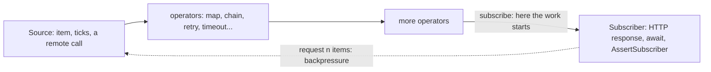

# 🌊 Lab 27 - Mutiny

| ⏱️ Duration | 🚀 Quarkus | ☕ Java | 🧪 Type |
|---|---|---|---|
| 2 h | 3.40.1.1 LTS (Mutiny 3.3.0) | 21 | A (starter + solution) |

## 📍 Where to run commands
Open a terminal **inside this lab's `starter/` folder** and check where you are before running anything:

```powershell
Get-Location
```

```bash
pwd
```

> [!NOTE]
> Commands are shown in PowerShell first (`.\mvnw.cmd`) and Bash second (`./mvnw`). In Git Bash, `./mvnw` may fail because of `JAVA_HOME`; use the system `mvn` instead. No Docker is needed. Most tests are **plain JUnit with no application running** (a pipeline is just code): they take seconds.

## 🎯 Why it matters
Lab 26 told you *where* code runs. Mutiny is how Quarkus lets you **describe** work that waits (a remote call, a timer, a stream of events) without holding a thread while it waits. A `Uni` is one result that will arrive; a `Multi` is many. Used well, a handful of threads serve thousands of waiting requests; used badly, nothing happens at all (a `Uni` that nobody subscribes to is a program that never ran), calls repeat when you expected one, or a fast producer buries a slow consumer. Every reactive Quarkus extension (REST client, messaging, Hibernate Reactive) speaks Mutiny, so this is the vocabulary of the rest of the course.

## 🧠 Concepts
| Idea | In one line |
|---|---|
| **`Uni<T>`** | At most one item (or a failure) that arrives later. `Multi<T>`: zero to many items, then completion or a failure |
| **Lazy** | Building a pipeline does nothing. Work starts when something **subscribes** (an endpoint returning it, `await()`, `subscribe()`) |
| **Cold** | Each subscription runs the whole pipeline again. To share one result: `memoize()` |
| **Eager vs lazy source** | `Uni.createFrom().item(value)` takes a value that already exists; `item(() -> value)` computes it per subscription |
| **Composition** | `chain` (one after another: the second needs the first), `Uni.combine()` / `Uni.join()` (all at the same time) |
| **Failures are values** | `onFailure().retry()`, `.recoverWithItem/Null`, `.transform`, and `ifNoItem().after(...)` for timeouts. **Order matters** |
| **Backpressure** | A `Multi` only emits what the subscriber asked for (`request(n)`). A source that cannot wait must say what to do with the surplus: `onOverflow().drop()`, `.buffer(n)`... |



## 📚 Documentation
- [Quarkus: Mutiny primer](https://quarkus.io/guides/mutiny-primer)
- [Mutiny documentation](https://smallrye.io/smallrye-mutiny/latest/) and the [Uni and Multi reference](https://smallrye.io/smallrye-mutiny/latest/reference/uni-and-multi/)
- [From imperative to reactive](https://smallrye.io/smallrye-mutiny/latest/guides/imperative-to-reactive/)
- [Quarkus REST](https://quarkus.io/guides/rest) (returning `Uni` and `Multi` from an endpoint)
- [Reactive Streams](https://www.reactive-streams.org/) (where the `request(n)` rule comes from)

## 🧭 Scenario
A small **price comparison** service. Three suppliers (`QuoteSource`) each answer a price for a SKU asynchronously, and the service answers with the cheapest. Around it: an audit trail, a table of exchange rates, a catalog that quotes many SKUs, and a sensor that reports every millisecond. Already written: the model, the three demo suppliers, the error mapping (no quote is a `503`), the endpoints and all the tests. **Your job is the pipelines.**

| Task | What must be true |
|---|---|
| 1 | Nothing is loaded until it is needed, one load serves everybody, and every request really writes the audit trail |
| 2 | The three suppliers are asked at the same time |
| 3 | A supplier that fails, is slow or never answers does not spoil the others |
| 4 | A catalog quotes many SKUs with a limit, and a slow subscriber cannot break a fast stream |

## ✅ Tasks

### Task 1 - Lazy and cold
**Goal:** the pipelines run when, and as often as, they should. **Validated by:** `LazinessTest` and `QuoteResourceTest#everyRequestIsRecordedInTheAuditTrail`.

- [ ] `RateTable` must satisfy three things: **nothing is loaded until somebody asks**, **five askers cause one load**, and **the (blocking) loader never runs on the thread that subscribes** (lab 26). Run `LazinessTest` and read which ones fail.
- [ ] `QuoteResource.best` is supposed to record every request in the audit trail before answering. Run `QuoteResourceTest`: the trail stays empty. Find out why and fix it.

```powershell
.\mvnw.cmd test '-Dtest=LazinessTest,QuoteResourceTest'
```

```bash
./mvnw test -Dtest=LazinessTest,QuoteResourceTest
```

🔮 **Predict first:** (a) after `new RateTable(loader)`, how many times has the loader been called? (b) after five subscriptions to a `Uni.createFrom().item(() -> ...)`, how many times has the supplier run? (c) a method calls `audit.record("...")`, which returns a `Uni<Void>`, and does not use the result: does the audit happen?

> [!WARNING]
> `Uni.createFrom().item(loader.load())` and `Uni.createFrom().item(loader::load)` look alike and are very different: the first calls the loader **now**, while building. And a `Uni` you do not return, chain or subscribe is a statement that never executes.

### Task 2 - All at the same time
**Goal:** the cheapest quote of three suppliers that take 200 ms each arrives in about 200 ms, not 600. **Validated by:** `CompositionTest`.

- [ ] `QuoteService.best` asks the suppliers one after another (look at how the loop chains them). Replace it so that all of them are asked together and the cheapest wins.

```powershell
.\mvnw.cmd test '-Dtest=CompositionTest'
```

```bash
./mvnw test -Dtest=CompositionTest
```

🔮 **Predict first:** with `chain` and with `Uni.combine().all()` (or `Uni.join()`), how long do three sources of 200 ms take? And what happens to the combined `Uni` if one of the three fails?

### Task 3 - When the suppliers misbehave
**Goal:** one bad supplier never decides the answer. **Validated by:** `FailureTest`, and in `QuoteResourceTest` the cases with a supplier down, a slow one and none at all.

| A supplier that... | The service must... |
|---|---|
| fails | ask it again **twice** (the first retry after 20 ms, the second after 40 ms: exponential back-off); if it still fails, ignore it |
| does not answer within `app.quotes.timeout-millis` (300 ms) | ignore it, and answer as soon as the timeout passes. The limit is for the **whole question, retries included** |
| (all of them) give no quote | fail with `NoQuoteException` naming the SKU (the error mapper already turns it into a `503` `NO_QUOTE`) |

- [ ] Add the handling for **one** source in a method of its own and apply it to each source before combining them.

```powershell
.\mvnw.cmd test '-Dtest=FailureTest,QuoteResourceTest'
```

```bash
./mvnw test -Dtest=FailureTest,QuoteResourceTest
```

🔮 **Predict first:** a source never answers. With the timeout written **before** the retry and with it written **after**, how many times is the source asked, and how long does the caller wait?

> [!WARNING]
> Failure handling in a pipeline is a **list of operators in order**, not a set of options. `recoverWithNull` also swallows what you did not expect: while writing this lab a test source that threw an `IllegalArgumentException` (a zero delay) made *every* quote disappear without a single line in the log. Whatever you swallow, say so.

### Task 4 - Streams
**Goal:** bounded concurrency, and a stream that survives a slow subscriber. **Validated by:** `StreamTest`.

- [ ] `CatalogService.bestOfAll` quotes the SKUs of a list. It must never have more than `MAX_IN_FLIGHT` (4) SKUs being quoted at any moment, and every SKU must still get its quote. Results do not have to keep the order of the input.
- [ ] `SensorService.readings` reports every millisecond. A subscriber that asked for 3 items must not make the stream fail; when it asks for more, it gets current readings.

```powershell
.\mvnw.cmd test '-Dtest=StreamTest'
```

```bash
./mvnw test -Dtest=StreamTest
```

🔮 **Predict first:** (a) `transformToUniAndMerge` over twenty SKUs: how many calls are in flight at the same time? And with `.transformToUni(...).merge(4)`? With `.concatenate()`? (b) a `ticks()` stream whose subscriber asked for three items: what does the fourth tick do?

> [!WARNING]
> Bounding concurrency with `merge(n)` gives up the order of the results. Sequential (`concatenate`) keeps it and gives up the speed. Decide which one the caller needs.

**Success criteria:** `.\mvnw.cmd verify` inside `starter/` ends green.

## 👀 What you should see
When Task 4 is red, the test reports the failure of the stream itself:

```text
io.smallrye.mutiny.subscription.BackPressureFailure: Could not emit tick 3 due to lack of requests
```

When Task 2 is red, the message says how long three suppliers took (`... took 6xx ms: they were asked one after another`). Through HTTP, a finished service answers:

```text
GET /quotes/A-1      ->  {"source":"alpha","cents":1xxx}
GET /readings?count=5 ->  [0,1,2,3,4]
```

## 💼 In real projects
- **Reactive does not mean faster.** It means few threads for a lot of waiting. Code written in blocking style on workers or virtual threads (lab 26) is a fine answer when your drivers are blocking and the load is moderate. Choose with the team and the libraries in your hands, not by fashion.
- **A `Uni` is a value you pass around, not a call.** Return it, chain it, combine it. Subscribing in the middle of a method ("fire and forget") is almost always a bug; when it is on purpose, say so in a comment.
- **Blocking code inside a pipeline** belongs on a worker (`runSubscriptionOn(Infrastructure.getDefaultWorkerPool())`, as `RateTable` does) or behind `@Blocking` on the endpoint (lab 26). Never `await()` inside an event-loop pipeline.
- **Timeouts on every remote call; retries only on what is safe to repeat** (the lesson of P2: a retry of a payment is safe only with an idempotency key). Mutiny's `retry` and the SmallRye Fault Tolerance annotations of lab 23 do similar jobs: use Mutiny's inside a pipeline, annotations on a plain method.
- **Bound the concurrency toward whoever you call.** `transformToUniAndMerge` over an input that can be big is a way of attacking your own dependency (twenty calls in flight in the exploration of this lab). `merge(n)` is the dial.
- **Choose the backpressure strategy from the data.** Latest readings: `drop()`. Events that must all arrive: a bounded `buffer(n)` and a plan for when it fills (it fails with `BackPressureFailure` in the exploration), or a source that waits. An unbounded buffer over an infinite source is a slow memory leak.
- **Log what you recover from.** A `recoverWithNull` with no `onFailure().invoke(...)` before it turns bugs into silence.
- **Test pipelines without the framework**: plain JUnit, `uni.await().atMost(Duration)`, `AssertSubscriber` for streams, and sources that count their subscriptions (`Probe`). Time-based assertions need wide margins and are the exception, not the rule.

## 🚀 Stretch goal
1. **Ordered and bounded.** Make `bestOfAll` return the quotes in the order of the input **and** keep at most four in flight. Predict which operators you need and write a test.
2. **A blocking call inside a `Uni`.** Add an endpoint whose pipeline calls `Thread.sleep(300)` in a supplier. Run it under the event loop of lab 26 and see the warning; then fix it with `runSubscriptionOn`.
3. **Collect every failure.** Read what `Uni.combine().all().unis(...).collectFailures()` and `Uni.join().all(...).andCollectFailures()` do when two sources fail, and when you would prefer that to `recoverWithNull`.
4. **Server-sent events.** Return `Multi<Long>` from an endpoint annotated `@RestStreamElementType` and read it with `curl.exe -N`.

## 💡 Hints
<details><summary>Task 1 (direction)</summary>

Two questions: *when* is the supplier of `Uni.createFrom().item(...)` evaluated, and *how many times*? There is an operator that remembers the result of the first subscription. For the thread: `runSubscriptionOn`.
</details>

<details><summary>Task 1 (audit)</summary>

`audit.record(...)` returns a `Uni<Void>`: a description. To make the endpoint do it, the endpoint must return something that **includes** it: `chain` the quote after it.
</details>

<details><summary>Task 2 (direction)</summary>

`Uni.join().all(list).andFailFast()` takes a list of `Uni`s and gives a `Uni` of the list of their results, all subscribed together. Then take the cheapest.
</details>

<details><summary>Task 3 (direction)</summary>

For one source, in this order: retry with back-off, then the timeout, then turn a failure into "no quote" (`null`). Back in the combined result, leave the `null`s out. Operators: `onFailure().retry().withBackOff(...).atMost(...)`, `ifNoItem().after(...).fail()`, `onFailure().recoverWithNull()`.
</details>

<details><summary>Task 4 (direction)</summary>

`onItem().transformToUni(f)` followed by `.merge(n)` limits the concurrency. For the sensor: `onOverflow()` has the strategies.
</details>

## ✔️ Verified answers
<details><summary>Open only after finishing the tasks</summary>

Everything here was checked by running it on Quarkus 3.40.1.1 with Mutiny 3.3.0. Times are from one machine; the proportions are what matters.

**Task 1.** (a) `Uni.createFrom().item(loader.load())` called the loader **at construction** (one call before anybody asked); with `item(loader::load)` it was zero. (b) A lazy `item(() -> ...)` ran the supplier **twice** for two subscriptions; with `.memoize().indefinitely()` it ran **once**. (c) No: an `invoke` on a `Uni` that nobody subscribes to counted **0**; after a subscription, 1. Fix: `audit.record(...).chain(() -> service.best(sku))`. Without `runSubscriptionOn` the blocking supplier ran on the subscribing thread (`main` in a test); with the default worker pool it ran on a pool thread.

**Task 2.** Three sources of 200 ms: `Uni.combine().all().unis(...)` took **213 ms**, a `chain` of the three took **610 ms**. If one of them fails, the combined `Uni` fails with that failure (`java.lang.IllegalStateException: boom` in the exploration); `collectFailures()` and `Uni.join().all(...).andCollectFailures()` raise an `io.smallrye.mutiny.CompositeException` ("Multiple exceptions caught") instead.

**Task 3.** A timeout is an `io.smallrye.mutiny.TimeoutException` (no message). `retry().atMost(3)` on a source that fails twice and then works returned its third answer; `atMost(2)` on one that always fails asked it **three** times (one try, two retries) and re-threw the **original** failure: no wrapper, no "retries exhausted". With `withBackOff(100 ms)` and `atMost(3)` the four attempts took **741 ms** (100 + 200 + 400 ms of waiting): exponential. For a source that never answers: timeout **before** the retry gave **3 attempts in 614 ms** (each had its own 200 ms); timeout **after** the retry gave **1 attempt in 202 ms**: the limit covers the whole question. And `onFailure(IllegalStateException.class).recoverWithItem(...)` does not touch an `IllegalArgumentException`.
`delayIt().by(Duration.ofMillis(0))` throws `IllegalArgumentException: duration must be greater than zero`: the one that vanished into `recoverWithNull` while I wrote the tests.

**Task 4.** (a) Twenty SKUs: `transformToUniAndMerge` had **20** calls in flight (123 ms in all); `transformToUni(...).merge(4)` had **4** (474 ms, results **not** in order); `transformToUniAndConcatenate` had **1** (1782 ms, results in order). (b) A `ticks()` stream with a subscriber that asked for three items fails with `io.smallrye.mutiny.subscription.BackPressureFailure: Could not emit tick 3 due to lack of requests`. With `onOverflow().drop()` it kept going: the subscriber got `[0, 1, 2]`, and after `request(2)` two more, **5 in total** (the ticks that arrived while it was not asking were dropped). `onOverflow().buffer(5)` with a slow subscriber failed too (`The overflow buffer is full...`). A `Multi.createFrom().emitter(...)` with the default strategy **buffered** a thousand items and delivered them all once asked; with the `ERROR` strategy it failed (`Could not emit value due to lack of requests`).

**What each piece protects (mutation table).** Each row is the solution with one thing removed:

| Removed from the solution | What fails |
|---|---|
| `.memoize().indefinitely()` in `RateTable` | `manyAskersShareOneLoad` |
| the supplier (`item(loader.load())` instead of `item(loader::load)`) | `nothingIsLoadedUntilSomebodyAsksForTheRates` and `theBlockingLoaderDoesNotRunOnTheThreadThatAsks` |
| `runSubscriptionOn(...)` in `RateTable` | `theBlockingLoaderDoesNotRunOnTheThreadThatAsks` |
| the `chain` that includes the audit (the `Uni` is called and ignored) | `everyRequestIsRecordedInTheAuditTrail` |
| the timeout written **before** the retry | `theTimeoutLimitsTheWholeQuestionAndNotEachAttempt` and `aSourceThatNeverAnswersIsIgnoredAfterTheTimeout` |
| `recoverWithNull()` | five tests of `FailureTest` (the failure of one source reaches the caller: `IllegalStateException` instead of the other sources' answer) |
| one retry instead of two / no retry | `aFailingSourceIsAskedOnceAndRetriedTwice` and `aFlakySourceThatRecoversInTimeIsUsed` |
| `merge(MAX_IN_FLIGHT)` replaced by `transformToUniAndMerge` | `atMostFourSkusAreQuotedAtTheSameTime` |
| the same, replaced by `transformToUniAndConcatenate` | `atMostFourSkusAreQuotedAtTheSameTime` ("nothing ran concurrently") |
| `onOverflow().drop()` in `SensorService` | `aSubscriberThatAsksForLittleDoesNotMakeTheReadingsFail`: `BackPressureFailure: Could not emit tick 3 due to lack of requests` |
</details>

## 🎤 Self-assessment
1. A method builds a `Uni` with a side effect and returns `void`. Does the side effect happen? Why, and how would a test notice?
2. `Uni.createFrom().item(compute())` against `Uni.createFrom().item(() -> compute())`, and `memoize()`: how many times does `compute` run in each case with three subscriptions?
3. Three suppliers of 200 ms: how long with `chain`, how long with `combine`, and what does the combined result do when one fails?
4. You need "retry twice, but never wait more than 300 ms in total". In which order do you write the operators, and what is the difference if you swap them?
5. A fast `Multi` and a subscriber that asks for 3 items. Give two strategies for the surplus, and say which you would pick for sensor readings and which for orders.

The complete solution is in `solution/`.

## 🔁 Retrospective
- What did I understand?
- What was hard?
- What should I reinforce?
