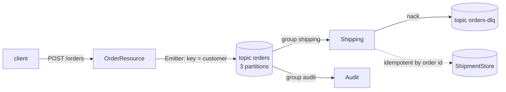

# 🧵 Lab 29 - Kafka *(elective)*

| ⏱️ Duration | 🚀 Quarkus | ☕ Java | 🧪 Type |
|---|---|---|---|
| 2 h | 3.40.1.1 LTS (SmallRye Reactive Messaging, Kafka client 4.2.1) | 21 | A (starter + solution) |

## 📍 Where to run commands
Open a terminal **inside this lab's `starter/` folder** and check where you are before running anything:

```powershell
Get-Location
```

```bash
pwd
```

> [!NOTE]
> Commands are shown in PowerShell first (`.\mvnw.cmd`) and Bash second (`./mvnw`). In Git Bash, `./mvnw` may fail because of `JAVA_HOME`; use the system `mvn` instead.

> [!IMPORTANT]
> **Docker must be running.** The tests start a real Kafka broker with Dev Services (the image `apache/kafka-native:4.2.0` is downloaded the first time). A test run takes about 45 seconds once the image is there. This lab is an elective: lab 28 already taught the vocabulary (channels, ack, nack, dead letters); here it meets a real broker.

## 🎯 Why it matters
Lab 28's channels lived and died with the process. Kafka keeps the messages **outside** the application: they survive a restart, several services can read the same ones, and the position of each reader is stored in the broker. That changes the questions you have to answer: *which key decides the partition* (and therefore the order), *which consumer group reads* (and therefore who gets a copy), *what happens to a message that keeps failing* (a consumer that stops, restarts and reads the same message again is a classic outage), and *what if the same event arrives twice* (Kafka delivers at least once). Those four are the four tasks.

## 🧠 Concepts
| Idea | In one line |
|---|---|
| **Topic and partition** | A topic is split in partitions. A partition is an ordered log; **order exists only inside a partition** |
| **Key** | The record key decides the partition (same key, same partition). Use the thing whose order matters (here the customer). No key means no ordering guarantee |
| **Consumer group** | Consumers with the same `group.id` **share** the partitions of a topic (each record goes to one of them). A different group gets **its own copy** of everything |
| **Offset and commit** | Each group stores how far it has read. A new group starts where `auto.offset.reset` says (`latest` by default: it skips what was already there; `earliest`: from the beginning). A record counts as read once it is acknowledged and the offset is committed |
| **At least once** | If a consumer dies after processing and before committing, the record comes again. The consumer must tolerate duplicates (idempotence) |
| **Failure strategy** | What a **nack** does to the channel: `fail` (stop the consumer: the default), `ignore` (log and go on, the record is lost), `dead-letter-queue` (send the record to another topic and go on) |
| **Poison message** | A record that fails every time. Two kinds: it deserializes but cannot be processed (nack), or it **cannot even be deserialized** (the consumer cannot move past it) |
| **Dev Services** | In dev and tests Quarkus starts a Kafka container and points the application to it. In production you configure `kafka.bootstrap.servers` yourself |



## 📚 Documentation
- [Quarkus: Apache Kafka reference guide](https://quarkus.io/guides/kafka)
- [Quarkus: Kafka Dev Services](https://quarkus.io/guides/kafka-dev-services)
- [Quarkus: Getting started with Kafka](https://quarkus.io/guides/kafka-getting-started)
- [SmallRye Reactive Messaging: Kafka connector](https://smallrye.io/smallrye-reactive-messaging/latest/kafka/kafka/) (consumer, producer, [handling failures](https://smallrye.io/smallrye-reactive-messaging/latest/kafka/receiving-kafka-records/))
- Lab 28 (channels, ack and nack), lab 24 (health: the Kafka channels appear in it), lab 10 (transactions: the outbox idea at the end)

## 🧭 Scenario
A **shipping service**. A client posts an order; the service publishes it to the topic `orders` (the key is the customer) and answers once the broker has it. Two consumer groups read the topic: `shipping` ships the order and `audit` counts orders per customer. Orders that cannot be shipped must not be lost and must not stop shipping.

| Answer of `POST /orders` | When |
|---|---|
| `202` + `{id}` | the **broker acknowledged** the record. The order is not shipped yet |
| `422 INVALID_ORDER` | customer missing, quantity not positive, unknown sku |
| `502 BROKER_REJECTED` | the broker (or the client) refused the record, for example one larger than `max.request.size` |
| `504 NO_ACK` | nobody answered within `app.orders.ack-timeout-millis` |

Also `GET /shipments/{id}`, and the health checks (`/q/health/ready`, `/q/health/live`) that report the state of every channel.

Already written: the model, validation, `ShipmentStore`, `Audit`, the error mapping, `PoisonPillHandler` (without its identifier) and **all the tests**. Dev Services and the number of partitions of `orders` are already configured in `application.properties`. **Your job is the code of the door and the configuration of the channels.**

| Task | What must be true |
|---|---|
| 1 | The order is published as JSON with the customer as key, and the answer waits for the broker |
| 2 | `shipping` and `audit` each get every order, and one customer's orders arrive in order |
| 3 | A message that fails is kept and does not stop the consumer; a record that is not JSON does not block its partition |
| 4 | The same event twice has the effect of one |

> [!IMPORTANT]
> All the tests share **one application and one broker**, and a consumer stopped by a failure (task 3) stays stopped for the rest of the run. The test classes are therefore ordered by task (`junit-platform.properties`). Work in order. The topics also keep what earlier tests published: every test uses its own ids and customers.

## ✅ Tasks

### Task 1 - Publish
**Goal:** the order reaches Kafka as JSON, with the customer as key, and the client is told only when the broker has it. **Validated by:** `ProducerTest`.

- [ ] `application.properties`: connect the channel `orders-out` to the topic `orders`.
- [ ] `OrderResource`: inject the emitter of `orders-out` for a `Record<String, Order>` (key and value), send it, and answer `202` with a `Placed` body when the stage completes. A refusal reaches `ErrorMappers` as the exception of the Kafka client; nobody answering in time is a `NoAckException`.

```powershell
.\mvnw.cmd test '-Dtest=ProducerTest'
```

```bash
./mvnw test -Dtest=ProducerTest
```

🔮 **Predict first:** (a) do you have to configure a serializer for `Order`? (b) two orders of the same customer: same partition or not? And two orders of different customers? (c) an order whose `note` is 1.2 MB: what does the emitter's stage do, and how long does it take?

> [!WARNING]
> `emitter.send(...)` without waiting for its stage answers `202` for records the broker never took. A test posts a record the broker cannot accept.

### Task 2 - Two consumer groups
**Goal:** `shipping` and `audit` both receive every order, and the orders of a customer are shipped in the order they were placed. **Validated by:** `ConsumerTest`.

- [ ] `application.properties`: connect the channels `shipping` (group `shipping`) and `audit` (group `audit`) to the topic `orders`. Think about where a **new** group starts reading.

```powershell
.\mvnw.cmd test '-Dtest=ProducerTest,ConsumerTest'
```

```bash
./mvnw test -Dtest=ProducerTest,ConsumerTest
```

🔮 **Predict first:** (a) you give both channels the **same** `group.id`: how many of 4 orders does `audit` see? (b) you forget `auto.offset.reset`: do the tests notice? Does it matter in production? (c) with three partitions, in which order does `shipping` see the 8 orders of one customer?

> [!WARNING]
> The tests cannot tell `latest` from `earliest` (the consumers are already running when the tests publish). Run the jar (below) to see the difference with your own eyes.

### Task 3 - Poison messages
**Goal:** a message that fails is neither lost nor stops the consumer, and a record that is not JSON does not block its partition. **Validated by:** `FailureTest`.

- [ ] Run `FailureTest` against the configuration of task 2 and read **the log and `/q/health/ready`** (there is a test for it).
- [ ] Configure the channel `shipping` so that a failing message goes to the topic `orders-dlq` and the consumer carries on.
- [ ] `PoisonPillHandler` is a `DeserializationFailureHandler`: give it the identifier `order-poison-pill` and link it to `shipping`. In `audit`, make a record that cannot be read just not fail.

```powershell
.\mvnw.cmd test '-Dtest=ProducerTest,ConsumerTest,FailureTest'
```

```bash
./mvnw test -Dtest=ProducerTest,ConsumerTest,FailureTest
```

🔮 **Predict first:** (a) with the default strategy, what happens to the orders **behind** the poison one, and what does the health check say? (b) a record that is not JSON, with no handler: what does the consumer do, and does a `dead-letter-queue` strategy on its own help? (c) with `ignore` instead of `dead-letter-queue`, where does the poison order end up?

> [!WARNING]
> Two kinds of poison, two different mechanisms. And the default strategy turns one bad message into a service that Kubernetes will restart, for ever.

### Task 4 - At least once
**Goal:** the same event delivered twice is shipped once. **Validated by:** `IdempotenceTest`.

- [ ] `Shipping.ship`: if the order id was already shipped, count the duplicate (`store.countDuplicate`) and do nothing else.

```powershell
.\mvnw.cmd test
```

```bash
./mvnw test
```

🔮 **Predict first:** where do duplicates come from in a real system (name two)? Is it enough to check `store.contains(id)` and then `store.record(order)` when the consumer has several threads? Why is it enough here?

**Success criteria:** `.\mvnw.cmd verify` inside `starter/` ends green (16 tests).

## 👀 What you should see
The log says what the failure strategy did. With `dead-letter-queue`:

```text
ERROR [io.smallrye.reactive.messaging.provider] (executor-thread-3) SRMSG00200: The method lab.melostudy.Shipping#ship has thrown an exception: lab.melostudy.Exceptions$UnknownSkuException: Unknown sku NOPE
INFO  [io.smallrye.reactive.messaging.kafka] (vert.x-eventloop-thread-29) SRMSG18202: A message sent to channel `shipping` has been nacked, sending the record to a dead letter topic orders-dlq
```

With the default strategy (`fail`), the consumer stops and the health check goes down:

```text
ERROR [io.smallrye.reactive.messaging.kafka] SRMSG18203: A message sent to channel `shipping` has been nacked, fail-stop
```

```text
GET /q/health/ready -> 503   "application-lab.melostudy.Shipping#ship": "[KO] - Unknown sku NOPE"
```

## 🏃 Run the jar
The same application as a packaged jar, against a broker that **you** start (Dev Services do not exist in production). Open a terminal inside `solution/`. The files of `samples/` are one level up.

**1. A broker, with the topics created on purpose** (a real team creates topics with their partitions and retention; this image has the command-line tools):

```powershell
docker run -d --name kafka-lab -p 9092:9092 apache/kafka:4.2.0
```

```powershell
docker exec kafka-lab /opt/kafka/bin/kafka-topics.sh --bootstrap-server localhost:9092 --create --topic orders --partitions 3
docker exec kafka-lab /opt/kafka/bin/kafka-topics.sh --bootstrap-server localhost:9092 --create --topic orders-dlq --partitions 1
```

**2. The application** (keep this terminal open):

```powershell
.\mvnw.cmd -q -DskipTests package
java -jar target\quarkus-app\quarkus-run.jar
```

```bash
./mvnw -q -DskipTests package
java -jar target/quarkus-app/quarkus-run.jar
```

**3. In a second terminal, also inside `solution/`:** place an order, read it back and look at the topic and the groups:

```powershell
curl.exe -s -i -H "Content-Type: application/json" --data-binary "@..\samples\order.json" http://localhost:8080/orders
```

```powershell
docker exec kafka-lab /opt/kafka/bin/kafka-console-consumer.sh --bootstrap-server localhost:9092 --topic orders --from-beginning --property print.key=true --property print.partition=true --timeout-ms 4000 2>$null
docker exec kafka-lab /opt/kafka/bin/kafka-consumer-groups.sh --bootstrap-server localhost:9092 --describe --all-groups 2>$null
```

Replace `<id>` with the id of the answer:

```powershell
curl.exe -s http://localhost:8080/shipments/<id>
```

**4. Poison messages.** The files are copied into the container because PowerShell 5.1 puts a byte-order mark in front of text piped to a program, and that changes the key:

```powershell
docker cp ..\samples\poison-order.txt kafka-lab:/tmp/poison-order.txt
docker cp ..\samples\not-json.txt kafka-lab:/tmp/not-json.txt
docker exec kafka-lab sh -c "/opt/kafka/bin/kafka-console-producer.sh --bootstrap-server localhost:9092 --topic orders --property parse.key=true --property key.separator=: < /tmp/poison-order.txt" 2>$null
docker exec kafka-lab sh -c "/opt/kafka/bin/kafka-console-producer.sh --bootstrap-server localhost:9092 --topic orders --property parse.key=true --property key.separator=: < /tmp/not-json.txt" 2>$null
```

```powershell
docker exec kafka-lab /opt/kafka/bin/kafka-console-consumer.sh --bootstrap-server localhost:9092 --topic orders-dlq --from-beginning --property print.headers=true --property print.key=true --timeout-ms 4000 2>$null
curl.exe -s -i http://localhost:8080/q/health/ready
```

**5. The two traps of configuration.** Stop the application (`Ctrl+C`), start it with a **new group** and the other offset policy, and ask for the first order you placed:

```powershell
$env:MP_MESSAGING_INCOMING_SHIPPING_GROUP_ID = 'shipping-latest'
$env:MP_MESSAGING_INCOMING_SHIPPING_AUTO_OFFSET_RESET = 'latest'
java -jar target\quarkus-app\quarkus-run.jar
```

```powershell
curl.exe -s -o NUL -w "%{http_code}\n" http://localhost:8080/shipments/<id>
```

Stop it again and repeat with `shipping-earliest` and `earliest`. Then with the **default strategy** and a new group, twice in a row (stop and start the application between the two):

```powershell
$env:MP_MESSAGING_INCOMING_SHIPPING_GROUP_ID = 'shipping-fail'
$env:MP_MESSAGING_INCOMING_SHIPPING_FAILURE_STRATEGY = 'fail'
$env:MP_MESSAGING_INCOMING_SHIPPING_AUTO_OFFSET_RESET = 'earliest'
java -jar target\quarkus-app\quarkus-run.jar
```

```powershell
curl.exe -s -o NUL -w "%{http_code}\n" http://localhost:8080/q/health/ready
```

```powershell
Remove-Item Env:\MP_MESSAGING_INCOMING_SHIPPING_GROUP_ID, Env:\MP_MESSAGING_INCOMING_SHIPPING_FAILURE_STRATEGY, Env:\MP_MESSAGING_INCOMING_SHIPPING_AUTO_OFFSET_RESET
```

```bash
MP_MESSAGING_INCOMING_SHIPPING_GROUP_ID=shipping-fail MP_MESSAGING_INCOMING_SHIPPING_FAILURE_STRATEGY=fail MP_MESSAGING_INCOMING_SHIPPING_AUTO_OFFSET_RESET=earliest java -jar target/quarkus-app/quarkus-run.jar
```

**6. Clean up** (removes only the container of this lab):

```powershell
docker rm -f kafka-lab
```

## 💼 In real projects
- **The key is a design decision, not a detail.** Choose the key by what must be ordered (the customer, the account, the aggregate). A hot key means a hot partition. Changing the number of partitions later changes which partition a key goes to: plan for it.
- **Partitions are the unit of parallelism.** A consumer group can have at most as many active members as partitions. The same group in several pods shares the work; a different group is a different reader (audit, search index, analytics).
- **Idempotence is not optional.** "Exactly once" in the broker does not cover your database or the HTTP call you make while processing. Give every event a stable id and make the effect of repeating it harmless (a unique key, an upsert, a table of processed ids).
- **Pick the failure strategy deliberately.** `fail` is right when you prefer to stop rather than skip (a ledger) and you have an alert; it is a crash loop when the cause is one bad record. `ignore` loses data silently. `dead-letter-queue` keeps the record, with the reason in headers, and needs someone to look at the topic and a way to replay it. Put an alert on its size.
- **A poison pill that cannot be deserialized is the one that stops a partition.** Prefer a format with a schema (Avro or JSON Schema with a registry) over free JSON, and always configure the deserialization failure handler.
- **Health checks show the channels.** A stopped consumer makes readiness (and liveness) fail, which is how the platform learns about it; make sure that is what you want before the platform restarts the pod into the same message.
- **Dev Services are for dev and tests.** In production nothing starts for you: bootstrap servers, authentication (SASL/TLS), topic creation, retention and replication are configuration and operations. Pin the image used by Dev Services to the version of your broker.
- **Do not publish to Kafka and write to the database as two separate steps** and hope both succeed: if one fails you have a lie. Write the event in the same transaction as your data (an *outbox* table) and publish from there (lab 10 taught the transaction). Reading it back is a good exercise for the stretch goal.
- **Tests with a real broker are slow but honest.** Use the companion for the broker side (`KafkaCompanion`) and Awaitility for everything asynchronous: a `Thread.sleep` is a flaky test.

## 🚀 Stretch goal
1. **Scale the group.** Add a second channel with the same group on the same topic (as in the exploration of this lab) and print the partitions each one gets. Then change the number of partitions of `orders` to one and see what happens to the second member.
2. **Replay.** Write a small class that reads `orders-dlq` and publishes the records back to `orders` once the cause was fixed. What makes replaying safe? (Task 4.)
3. **A serializer of your own.** Declare `value.deserializer` with a class of yours named `OrderDeserializer` and keep the dead-letter strategy. Read the error of the application at startup and explain it.
4. **The outbox.** Sketch (no code) how `POST /orders` would write the order and the event in one transaction and how a poller would publish it. What does it change about the answer `202`?

## 💡 Hints
<details><summary>Task 1 (direction)</summary>

For a channel that publishes to a topic, `mp.messaging.outgoing.<channel>.topic`. The payload type of the emitter is `io.smallrye.reactive.messaging.kafka.Record<K, V>`: `Record.of(key, value)`. `Uni.createFrom().completionStage(...)` and `ifNoItem().after(...)` as in labs 27 and 28.
</details>

<details><summary>Task 2 (direction)</summary>

`mp.messaging.incoming.<channel>.topic`, `.group.id` and `.auto.offset.reset`. A channel with `@Incoming` and no configuration is not an error: it is an in-memory channel nobody feeds (lab 28).
</details>

<details><summary>Task 3 (direction)</summary>

`failure-strategy`, `dead-letter-queue.topic`; and `value-deserialization-failure-handler` takes the `@Identifier` of a bean that implements `DeserializationFailureHandler`. For `audit`: `fail-on-deserialization-failure`. Do not configure a serializer for the dead-letter topic until the application asks for one.
</details>

<details><summary>Task 4 (direction)</summary>

Both consumers read the same partition for the same key, one record at a time: a check followed by a write is enough **here**. With several writers of the same id it would not be.
</details>

## ✔️ Verified answers
<details><summary>Open only after finishing the tasks</summary>

Everything here was checked by running it on Quarkus 3.40.1.1 with the Kafka image `apache/kafka-native:4.2.0` of Dev Services (and, for the jar, `apache/kafka:4.2.0`). Times are from one machine.

**Task 1.** (a) No: the JSON serializer for the value and the String serializer for the key were detected by Quarkus (the log says `Generating Jackson deserializer for type lab.melostudy.Order` on the consumer side, and a key/value pair published with `Record.of(...)` arrived as JSON). (b) Same customer, same partition; the records of one customer had increasing offsets in the order they were sent. In an exploration with three partitions `ana` and `cy` shared a partition and `bob` had another (it depends on the hash of the key, not on the order). A plain `Emitter<Order>` without a key put six records in one partition: no key, no order guarantee between partitions. (c) The stage failed after **134 ms** with `RecordTooLargeException: The message is 1200129 bytes when serialized which is larger than 1048576, which is the value of the max.request.size configuration`; the endpoint maps it to `502`. With a broker that cannot be reached and `max.block.ms=2000` the stage failed after **2017 ms** with `TimeoutException: Topic orders not present in metadata after 2000 ms`: configure the producer timeouts (`max.block.ms`, `delivery.timeout.ms`) as well as the one of the door.

**Task 2.** (a) With the same group `audit` and `shipping` **share** the partitions: two tests failed (`auditReadsEveryOrderToo` timed out: `audit` never saw all four orders; and the ordering test). Two consumers of one group on `orders` split the partitions in an exploration (one got partitions 0 and 1, the other partition 2); two groups each got all seven records. (b) The tests did not notice (the consumers were already assigned when they published). In the jar: a **new** group with `latest` answered `404` for the first order, one with `earliest` answered `200`. The default is `latest`: a new service version with a new group name silently starts at the end of the topic. (c) In the order they were placed (the key keeps one customer in one partition); a topic with one partition would pass that test too: partitions matter for parallelism, not for this assertion.

**Task 3.** (a) With the default strategy the consumer **stopped** at the first failing record: in an exploration `ok1, bad1, ok2, ok3` consumed only `ok1, bad1`; the log said `SRMSG18203: ... has been nacked, fail-stop`; readiness and liveness went down (`"f-fail": "[KO] - boom bad1"`). In the jar the readiness answered **503**, and after restarting the application the **same record was read again**, failed again and the readiness was 503 again: the offset of a failed record is never committed. (b) A record that is not JSON, with no handler: `SRMSG18249: Unable to recover from the deserialization failure (topic: ...), configure a DeserializationFailureHandler to recover from errors`, repeated every two seconds, and **nothing** was delivered from that partition (not even the valid record before it); a `dead-letter-queue` strategy alone did not help. With the handler (or with `fail-on-deserialization-failure=false`, in `audit`) the consumer went on. With the strategy `dead-letter-queue` the unreadable record also arrived in `orders-dlq` with its original bytes and the headers `deserialization-failure-cause` and `deserialization-failure-value-data`; the method `ship` was **not** called with a `null` payload (removing a `null` guard left the tests green). In `audit`, where the record is not nacked, the payload does arrive as `null`: removing its guard turned the tests red. (c) With `ignore` all four records were consumed and the failing one was only logged (`SRMSG18204: ... ignored failure is: boom bad1`): it is lost. With `dead-letter-queue` the record arrived in the dead-letter topic, keeping its key and value, with the headers `dead-letter-reason`, `dead-letter-exception-class-name`, `dead-letter-topic`, `dead-letter-partition` and `dead-letter-offset`. An application with its own deserializer class named `OrderDeserializer` and a dead-letter strategy did not start: `SRMSG18010: Unable to create an instance of lab.melostudy.OrderSerializer` (the serializer name is derived from the deserializer's). With the deserializer detected by Quarkus no serializer was needed.

**Task 4.** Duplicates come from a producer that retries after a lost acknowledgement, a consumer that restarts before committing, a replay from the dead letters or an upstream system that sends twice. The test publishes the same event twice: `Shipping` shipped once and counted one duplicate; `Audit` counted two (it is a different consumer with a different job).

**What each piece protects (mutation table).** Each row is the solution with one thing changed:

| Changed in the solution | What fails |
|---|---|
| the key is the order id instead of the customer | `anAcceptedOrderIsPublishedAsJsonWithItsCustomerAsKey` and `ordersOfTheSameCustomerShareAPartitionAndKeepTheirOrder` |
| `send` is not waited for (always `202`) | `aRecordTheBrokerRefusesIsNotAccepted` and `theDoorKeepsWorkingAfterARefusedRecord` |
| `audit` has the group of `shipping` | `auditReadsEveryOrderToo` and the ordering test of `ConsumerTest` |
| no `failure-strategy` (the default, `fail`) | all five `FailureTest` tests (the consumer is stopped, readiness is down) |
| `failure-strategy=ignore` | all five `FailureTest` tests (nothing in the dead-letter topic) |
| no `value-deserialization-failure-handler` | all of `FailureTest` (the partition is blocked) |
| the handler has another identifier | `aRecordThatIsNotJsonDoesNotBlockThePartition` |
| `audit` without `fail-on-deserialization-failure=false` | `aRecordThatIsNotJsonDoesNotBlockThePartition` and `theServiceStaysReadyAfterAPoisonOrder` (audit stops at the bad record and the health check goes down) |
| `audit` without its `null` guard | `aRecordThatIsNotJsonDoesNotBlockThePartition` and `theServiceStaysReadyAfterAPoisonOrder` |
| no duplicate check in `Shipping` | the two duplicate tests of `IdempotenceTest` |

**What the tests do not see** (checked and left as it is): `auto.offset.reset` (see the jar), the number of partitions of `orders` (ordering of one key holds with one partition too) and the serializer of the dead-letter topic (detected by itself).
</details>

## 🎤 Self-assessment
1. What decides the partition of a record, and what ordering does Kafka guarantee? What would you pick as the key for payments of an account?
2. Two services read the same topic. When do they use the same `group.id` and when different ones? What changes for each record?
3. A consumer throws on one message with the default failure strategy. What does the application do, what does the health check say, and what happens when Kubernetes restarts the pod?
4. Compare `fail`, `ignore` and `dead-letter-queue` for a payments ledger and for a stream of page-view events.
5. The same event arrives twice. Name two causes and two ways to make processing idempotent.

The complete solution is in `solution/`.

## 🔁 Retrospective
- What did I understand?
- What was hard?
- What should I reinforce?
