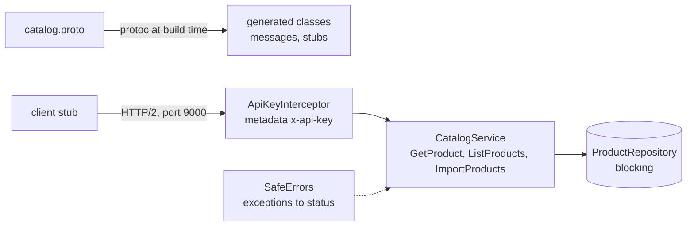

# 📡 Lab 30 - gRPC *(elective)*

| ⏱️ Duration | 🚀 Quarkus | ☕ Java | 🧪 Type |
|---|---|---|---|
| 2 h | 3.40.1.1 LTS (`quarkus-grpc`, protoc 4.35.0) | 21 | A (starter + solution) |

## 📍 Where to run commands
Open a terminal **inside this lab's `starter/` folder** and check where you are before running anything:

```powershell
Get-Location
```

```bash
pwd
```

> [!NOTE]
> Commands are shown in PowerShell first (`.\mvnw.cmd`) and Bash second (`./mvnw`). In Git Bash, `./mvnw` may fail because of `JAVA_HOME`; use the system `mvn` instead. The tests need no Docker; a test run takes about 15 seconds. The first build downloads the `protoc` compiler from Maven Central (so it needs the network once). Docker is used only in the optional jar tour, for the `grpcurl` tool.

## 🎯 Why it matters
REST (labs 04 to 07) describes resources with JSON over HTTP/1.1. gRPC describes **calls** with a contract (a `.proto` file), sends compact binary messages over HTTP/2, and gives you for free what you would build by hand with REST: generated clients and servers in many languages, streaming in both directions, deadlines that travel with the call and cancellation that reaches the server. Service-to-service traffic inside a company is where you meet it. It also moves some of REST's habits: the error is a **status code** of its own (not an HTTP status), metadata replaces headers, and a call that nobody limits can run for ever.

## 🧠 Concepts
| Idea | In one line |
|---|---|
| **`.proto` file** | The contract. `service` and `rpc` define the calls, `message` defines the data. Quarkus generates the Java classes when you build (`target/generated-sources/grpc`) |
| **Field numbers** | `string id = 1;` the **number** identifies the field on the wire, not the name. Never reuse or renumber one; adding a field with a new number is compatible |
| **Four kinds of rpc** | Unary (one request, one answer), server streaming, client streaming and bidirectional. This lab does the first three |
| **Mutiny stubs** | `MutinyCatalogGrpc.CatalogImplBase` to implement a service (`Uni` for one message, `Multi` for a stream) and `MutinyCatalogStub` to call it (lab 27) |
| **Status** | How a call ends: `OK` or a code (`NOT_FOUND`, `INVALID_ARGUMENT`, `UNAUTHENTICATED`, `DEADLINE_EXCEEDED`, `INTERNAL`...) plus a description. The code is what clients program against |
| **Metadata** | The headers of gRPC (`x-api-key`). A `ServerInterceptor` sees every call and can refuse it |
| **Deadline** | The time a client gives a call. It travels to the server; when it expires the call is cancelled on both sides |
| **Cancellation** | A client that stops listening to a stream cancels it, and the server should stop producing |

| gRPC status | Roughly the HTTP status of the REST labs |
|---|---|
| `INVALID_ARGUMENT` | 400 / 422 |
| `UNAUTHENTICATED` | 401 |
| `NOT_FOUND` | 404 |
| `RESOURCE_EXHAUSTED` | 429 (and "message too large") |
| `INTERNAL` | 500 |
| `UNIMPLEMENTED` | 501 |
| `UNAVAILABLE` | 503 |
| `DEADLINE_EXCEEDED` | 504 |



## 📚 Documentation
- [Quarkus: Getting started with gRPC](https://quarkus.io/guides/grpc-getting-started)
- [Quarkus: Implementing a gRPC service](https://quarkus.io/guides/grpc-service-implementation)
- [Quarkus: Consuming a gRPC service](https://quarkus.io/guides/grpc-service-consumption) (clients, interceptors, `ExceptionHandlerProvider`)
- [Protocol Buffers: the proto3 language guide](https://protobuf.dev/programming-guides/proto3/)
- gRPC: [status codes](https://grpc.io/docs/guides/status-codes/) and [deadlines](https://grpc.io/docs/guides/deadlines/)
- [grpcurl](https://github.com/fullstorydev/grpcurl) (curl for gRPC)
- Lab 26 (event loop and `@Blocking`), lab 27 (`Uni` and `Multi`), lab 5 (one error contract)

## 🧭 Scenario
A **product catalog** service with one gRPC service, `Catalog`, defined in `src/main/proto/catalog.proto`:

| rpc | Kind | What it does |
|---|---|---|
| `GetProduct(id)` | unary | the product, or `NOT_FOUND`; a blank id is `INVALID_ARGUMENT` |
| `ListProducts(count)` | server streaming | `count` products (1 to 1000), one every 10 ms, ids `n0`, `n1`... |
| `ImportProducts(stream Product)` | client streaming | stores the products and answers how many; **all or nothing** |

Already written: the `.proto`, the repository (a slow, blocking data source with a 30 ms lookup), `ServerStats` (what the server remembers about its own work, for the tests), the configuration, and **all the tests**, which are real gRPC clients against the real server (port 9001 in tests). The id `boom` makes the repository throw an unexpected exception on purpose. **Your job is the service and its hardening.**

| Task | What must be true |
|---|---|
| 1 | `GetProduct` answers with the product, `INVALID_ARGUMENT` or `NOT_FOUND` |
| 2 | The two streams work, a client that leaves stops the server, an import is all or nothing |
| 3 | The blocking lookup does not run on the event loop |
| 4 | An unexpected failure leaks nothing, every call needs a key in the metadata, and a deadline stops the server's work |

## ✅ Tasks

### Task 1 - A unary call and its status
**Goal:** the answer, or the status code that says why not. **Validated by:** `UnaryTest`.

- [ ] `CatalogService.getProduct`: return the product from the repository. A blank id fails with `Status.INVALID_ARGUMENT`, an unknown one with `Status.NOT_FOUND` (give them a description).

```powershell
.\mvnw.cmd test '-Dtest=UnaryTest'
```

```bash
./mvnw test -Dtest=UnaryTest
```

🔮 **Predict first:** (a) in the starter every rpc fails: with which status code? (b) what does the client receive if your code throws an `IllegalStateException("db password is hunter2")`?

> [!WARNING]
> Read (b) as a security question. It is the subject of task 4, but run it now and look at the description the client gets.

### Task 2 - Streams
**Goal:** a stream that stops when nobody listens, and an import that is all or nothing. **Validated by:** `StreamingTest`.

- [ ] `listProducts`: one product every 10 ms, `count` of them, ids `n0`, `n1`...; `count` outside 1 to 1000 is `INVALID_ARGUMENT`. Call `stats.productStreamed()` for each product sent and `stats.streamCancelled()` when the stream is cancelled (Mutiny has an operator for it).
- [ ] `importProducts`: a product without id or name fails the whole call with `INVALID_ARGUMENT`, and **nothing** from that call is stored; otherwise store them all and answer how many.

```powershell
.\mvnw.cmd test '-Dtest=UnaryTest,StreamingTest'
```

```bash
./mvnw test -Dtest=UnaryTest,StreamingTest
```

🔮 **Predict first:** a client asks for 1000 products and takes only 3, then leaves. How many products does the server produce, and does it know the client left? And for the import: if the bad product is the second of three, what does the client receive, and what is in the repository?

### Task 3 - Where it runs
**Goal:** the blocking lookup stays off the event loop. **Validated by:** `ExecutionTest`.

- [ ] `getProduct` must call `stats.getProductRanOn(Thread.currentThread().getName())` first. Run the test, read the thread name in the failure, and fix it (lab 26).

```powershell
.\mvnw.cmd test '-Dtest=UnaryTest,StreamingTest,ExecutionTest'
```

```bash
./mvnw test -Dtest=UnaryTest,StreamingTest,ExecutionTest
```

🔮 **Predict first:** which thread runs a gRPC method that returns a `Uni`? Does anything in the log warn you when it sleeps for 300 ms?

### Task 4 - Hardening
**Goal:** what a service owes to its callers and to itself. **Validated by:** `HardeningTest`.

- [ ] **No leaks.** Create a class that implements `io.quarkus.grpc.ExceptionHandlerProvider` as a CDI bean (see the consumption guide). A failure that is not already a gRPC status becomes `INTERNAL` with a fixed text and the real cause goes to the log; a status chosen on purpose (`NOT_FOUND`...) must go through untouched.
- [ ] **A key in the metadata.** `ApiKeyInterceptor` must apply to every call of every service. A call whose `x-api-key` is not the configured key ends with `UNAUTHENTICATED` and never reaches the service.
- [ ] Two tests are about things the framework already does (a deadline cancels the stream on the server; a message over 4 MiB is refused). Make sure you understand why they pass.

```powershell
.\mvnw.cmd test
```

```bash
./mvnw test
```

🔮 **Predict first:** (a) does the interceptor also protect the health and reflection services? (b) what does a client with a 150 ms deadline get from a stream of 1000 products, and what does the server do after that? (c) what happens when a client sends a 5 MB message?

**Success criteria:** `.\mvnw.cmd verify` inside `starter/` ends green (17 tests).

## 👀 What you should see
The status of a failed call is what a gRPC client (or `grpcurl`) prints:

```text
ERROR:
  Code: NotFound
  Message: No product nope
```

```text
ERROR:
  Code: Internal
  Message: Internal error
```

An unexpected exception without task 4 reaches the client like this (do not ship it):

```text
UNKNOWN | java.lang.IllegalStateException - secret internal detail: db password is hunter2
```

## 🏃 Run the jar
Not a test: the packaged application and a command-line gRPC client. Open a terminal inside `solution/`.

**1. The key is required configuration.** Build and try to start without it:

```powershell
.\mvnw.cmd -q -DskipTests package
java -jar target\quarkus-app\quarkus-run.jar
```

```bash
./mvnw -q -DskipTests package
java -jar target/quarkus-app/quarkus-run.jar
```

It stops at startup (exit code 1): `Failed to load config value of type class java.lang.String for: app.api-key`. Now give it the key, and switch on the reflection service (off by default; it lets tools ask the server which services it has):

```powershell
$env:APP_API_KEY = 'tour-key'
$env:QUARKUS_GRPC_SERVER_ENABLE_REFLECTION_SERVICE = 'true'
java -jar target\quarkus-app\quarkus-run.jar
```

```bash
APP_API_KEY=tour-key QUARKUS_GRPC_SERVER_ENABLE_REFLECTION_SERVICE=true java -jar target/quarkus-app/quarkus-run.jar
```

The application listens on **two ports**: 8080 (HTTP) and 9000 (gRPC).

**2. In a second terminal**, call it with `grpcurl` (it runs in a container; `host.docker.internal` is your machine). Every call carries the key:

```powershell
docker run --rm fullstorydev/grpcurl -plaintext -H "x-api-key: tour-key" host.docker.internal:9000 list
docker run --rm fullstorydev/grpcurl -plaintext -H "x-api-key: tour-key" host.docker.internal:9000 describe catalog.Catalog
```

```powershell
docker run --rm fullstorydev/grpcurl -plaintext -H "x-api-key: tour-key" -d '{\"id\":\"p1\"}' host.docker.internal:9000 catalog.Catalog/GetProduct
docker run --rm fullstorydev/grpcurl -plaintext -H "x-api-key: tour-key" -d '{\"id\":\"nope\"}' host.docker.internal:9000 catalog.Catalog/GetProduct
docker run --rm fullstorydev/grpcurl -plaintext -H "x-api-key: tour-key" -d '{\"id\":\"boom\"}' host.docker.internal:9000 catalog.Catalog/GetProduct
docker run --rm fullstorydev/grpcurl -plaintext -d '{\"id\":\"p1\"}' host.docker.internal:9000 catalog.Catalog/GetProduct
```

```powershell
docker run --rm fullstorydev/grpcurl -plaintext -H "x-api-key: tour-key" -d '{\"count\":3}' host.docker.internal:9000 catalog.Catalog/ListProducts
docker run --rm fullstorydev/grpcurl -plaintext -max-time 0.1 -H "x-api-key: tour-key" -d '{\"count\":1000}' host.docker.internal:9000 catalog.Catalog/ListProducts
```

```powershell
docker run --rm fullstorydev/grpcurl -plaintext -H "x-api-key: tour-key" -d '{\"id\":\"x1\",\"name\":\"Notebook\"} {\"id\":\"x2\",\"name\":\"Pen\"}' host.docker.internal:9000 catalog.Catalog/ImportProducts
docker run --rm fullstorydev/grpcurl -plaintext -H "x-api-key: tour-key" -d '{\"id\":\"y1\",\"name\":\"Fine\"} {\"id\":\"y2\"} {\"id\":\"y3\",\"name\":\"Fine\"}' host.docker.internal:9000 catalog.Catalog/ImportProducts
docker run --rm fullstorydev/grpcurl -plaintext -H "x-api-key: tour-key" -d '{\"id\":\"y1\"}' host.docker.internal:9000 catalog.Catalog/GetProduct
docker run --rm fullstorydev/grpcurl -plaintext -H "x-api-key: tour-key" host.docker.internal:9000 grpc.health.v1.Health/Check
```

```bash
docker run --rm fullstorydev/grpcurl -plaintext -H "x-api-key: tour-key" -d '{"id":"p1"}' host.docker.internal:9000 catalog.Catalog/GetProduct
```

Stop the application with `Ctrl+C` (and remove the variables with `Remove-Item Env:\APP_API_KEY, Env:\QUARKUS_GRPC_SERVER_ENABLE_REFLECTION_SERVICE`). The containers started by `docker run --rm` remove themselves.

## 💼 In real projects
- **The `.proto` is a public contract, so version and police it.** Put it in a package with a version (`catalog.v1`), never reuse a field number (mark removed fields `reserved`), and run a compatibility check in CI (tools such as `buf breaking`). Often the `.proto` files live in their own module or repository that producers and consumers both depend on (lab 31).
- **Every client call needs a deadline.** The default is "no deadline": a slow server then holds the client's resources for ever. Set `quarkus.grpc.clients.<name>.deadline` or use `withDeadlineAfter` per call, and choose the value from the SLO of the call.
- **Errors are part of the API.** Pick the status codes on purpose, put detail the client can use in the description, and never let an unexpected exception through: by default it arrives as `UNKNOWN` with its message (task 4). For richer errors gRPC has a standard error model (`google.rpc.Status` with details).
- **Authenticate in an interceptor, authorise next to the data.** The metadata key of this lab stands for a token (OIDC, labs 20 and 21) or mutual TLS. Remember that a global interceptor also guards the health and reflection services: probes and tools need credentials, or you exclude them on purpose.
- **Reflection and TLS.** Reflection is convenient in dev and a map of your API in production: decide with the team. The server speaks plain text here; in production use TLS (or a mesh that does it) and configure TLS on the server and on the clients (see the guides).
- **HTTP/2 connections are long-lived**, so a plain layer-4 load balancer sends all the calls of one client to one pod. Use a gRPC-aware balancer (a mesh, an L7 proxy) or client-side balancing.
- **Blocking code belongs on workers** (`@Blocking`, or virtual threads: lab 26). The same rule as REST, with the same blocked-thread warning.
- **Streams need an end.** Always bound or cancel them, and watch for slow consumers (backpressure, lab 27). `ListProducts` is bounded by `count` on purpose.
- **gRPC or REST?** gRPC for internal, high-volume, typed, streaming calls between services; REST (or gRPC-Web / a gateway) for browsers and public APIs where humans read the traffic.
- **Observe it.** OpenTelemetry (lab 25) instruments gRPC calls; add the status code to your metrics and alerts, not only the transport.

## 🚀 Stretch goal
1. **Bidirectional streaming.** Add `rpc Chat (stream Message) returns (stream Message)` to the proto (echo with a prefix) and implement it. How does a test close the call from the client side?
2. **Evolve the contract.** Add `string category = 4;` to `Product` and rebuild: do the old tests still pass? Then change the number of `price_cents` to 4 and explain, using the proto guide, why that breaks existing clients and adding a field did not.
3. **Client retries.** The client has `quarkus.grpc.clients.<name>.retry` (off by default). Switch it on for a client of your own, make `GetProduct` fail with `UNAVAILABLE` twice and read what is retried and what is not. What does retrying `ImportProducts` need? (P2's idempotency key.)
4. **One port.** Set `quarkus.grpc.server.use-separate-server=false`, start the jar and find out where the gRPC calls go now. What does it change for `grpcurl`, for the load balancer and for the health probes?

## 💡 Hints
<details><summary>Task 1 (direction)</summary>

`Status.NOT_FOUND.withDescription("...").asRuntimeException()` is a `StatusRuntimeException`: put it in `Uni.createFrom().failure(...)`. `repository.find(id)` returns an `Optional`.
</details>

<details><summary>Task 2 (direction)</summary>

`Multi.createFrom().ticks().every(...)`, `.select().first(n)`, and `.onCancellation().invoke(...)`. For the import: `request.onItem().invoke(...)` can throw the status to fail the call; collect the products into a list and store them in the last step, so that a failure before it stores nothing.
</details>

<details><summary>Task 3 (direction)</summary>

`io.smallrye.common.annotation.Blocking` on the method.
</details>

<details><summary>Task 4 (direction)</summary>

`ExceptionHandlerProvider` has `createHandler(...)` and `transform(Throwable)`. The documentation example shows both; `transform` is where "unexpected" becomes `INTERNAL`. For the interceptor: `io.quarkus.grpc.GlobalInterceptor`; a refused call is closed with `call.close(Status, new Metadata())` and an empty `ServerCall.Listener` is returned.
</details>

## ✔️ Verified answers
<details><summary>Open only after finishing the tasks</summary>

Everything here was checked by running it on Quarkus 3.40.1.1. Times are from one machine.

**Task 1.** (a) `UNIMPLEMENTED` is what the starter answers on purpose. (b) The client received status `UNKNOWN` with the description `java.lang.IllegalStateException - secret internal detail: db password is hunter2`: **the message of the exception travels to the caller**, also when it is thrown straight from the method (`UNKNOWN | java.lang.IllegalStateException - thrown straight from the method`). A deliberate status arrived unchanged (`NOT_FOUND | No product missing`, `INVALID_ARGUMENT | id is required`).

**Task 2.** A client that took 3 of 100000 products and left: the server emitted **3** and its `onCancellation` ran **once**: the cancellation travels to the server and the producer stops. A bad product in the middle of an import failed the call with `Status{code=INVALID_ARGUMENT, description=product bad has no name}`; with the store done in the last step nothing from that call was stored (`a1` and `a3` in the test, and `y1` through `grpcurl`, were `NOT_FOUND` afterwards). JSON from `grpcurl` shows `int64` fields as strings (`"price_cents": "1000"`), as the protobuf JSON mapping says.

**Task 3.** The method ran on `vert.x-eventloop-thread-0`, and a `Thread.sleep(300)` there simply worked, with no error and no warning: the blocked-thread check of lab 26 needs a much longer block, so a green call proves nothing about the thread. With `@Blocking` the thread was `executor-thread-N`.

**Task 4.** (a) Yes: with a global interceptor, `grpcurl list` without the key failed with `Unauthenticated ... failed to query for service descriptor: Missing or wrong x-api-key`; the health service answered `{"status": "SERVING"}` with the key. (b) `DEADLINE_EXCEEDED` after **311 ms** for a 300 ms deadline in an exploration; the server-side `Uni` of a 2-second call never completed (its counter stayed at 0 for 2.5 s): the deadline cancelled the work on the server. With `grpcurl -max-time 0.1` on a stream of 1000: `Code: DeadlineExceeded`. (c) `RESOURCE_EXHAUSTED | gRPC message exceeds maximum size 4194304: 5242890`: the default limit is 4 MiB (`quarkus.grpc.server.max-inbound-message-size` raises it, and so does the client's). Without `app.api-key` the jar did not start (exit code 1). `ExceptionHandlerProvider` and a global interceptor are CDI beans: the interceptor needs `@GlobalInterceptor`, otherwise it is just a bean nobody calls.

**What each piece protects (mutation table).** Each row is the solution with one thing changed:

| Changed in the solution | What fails |
|---|---|
| `@Blocking` removed | `theBlockingLookupDoesNotRunOnTheEventLoop`: `ran on vert.x-eventloop-thread-0` |
| `SafeErrors` removed | `anUnexpectedFailureIsInternalAndLeaksNothing` |
| `SafeErrors` turns every failure into `INTERNAL` (even a chosen status) | `aStatusChosenOnPurposeIsNotTurnedIntoInternal` |
| `@GlobalInterceptor` removed | the three tests about the key (`aCallWithoutTheKeyIsUnauthenticated`, `aCallWithTheWrongKeyIsUnauthenticated`, `theKeyIsCheckedOnStreamsToo`) |
| the interceptor only checks that a key exists | `aCallWithTheWrongKeyIsUnauthenticated` |
| the import stores each product as it goes | `anImportWithABadProductIsRefusedAndStoresNothing` |
| no limit on `count` | `aCountOutsideTheLimitsIsAnInvalidArgument` |
| no check of a blank id | `aMissingIdIsAnInvalidArgument` |
</details>

## 🎤 Self-assessment
1. What identifies a field in a protobuf message, and which changes to a `.proto` are compatible with clients already deployed?
2. Name the four kinds of rpc and give an example of when you would use each.
3. A service method throws an unexpected exception. What does the client receive by default, and what would you change?
4. A client asks for a stream of a million items and goes away after ten. What should happen on the server, and what tells it?
5. Where does a gRPC method run in Quarkus by default, and what do you do when it calls a blocking library?

The complete solution is in `solution/`.

## 🔁 Retrospective
- What did I understand?
- What was hard?
- What should I reinforce?
