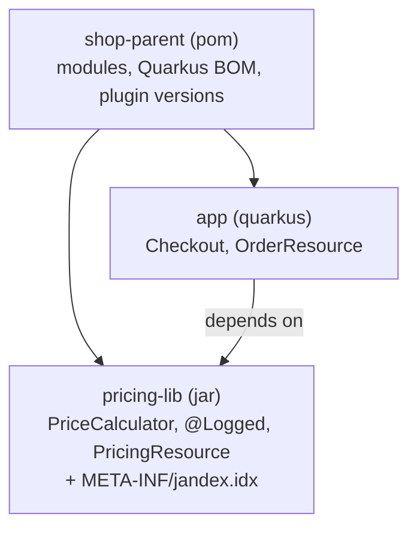

# 🧱 Lab 31 - Multi-module projects and Jandex

| ⏱️ Duration | 🚀 Quarkus | ☕ Java | 🧪 Type |
|---|---|---|---|
| 1.5 h | 3.40.1.1 LTS | 21 | A (starter + solution) |

## 📍 Where to run commands
Open a terminal **inside this lab's `starter/` folder** (the root of the multi-module project, where the parent `pom.xml` is) and check where you are before running anything:

```powershell
Get-Location
```

```bash
pwd
```

> [!NOTE]
> Commands are shown in PowerShell first (`.\mvnw.cmd`) and Bash second (`./mvnw`). In Git Bash, `./mvnw` may fail because of `JAVA_HOME`; use the system `mvn` instead. No Docker is needed; a full test run takes about 20 seconds. Lab 18 already used a two-module layout for two services; this lab is about the other common case: **an application and a library** that it depends on.

## 🎯 Why it matters
Sooner or later the same code is needed by two applications: a pricing rule, a security filter, a set of client classes, a shared `.proto`. The answer is a library module. And then three things that worked in a single module stop working by themselves: **the beans of the library are not found**, **versions drift** (each module decides its own), and **builds and dev mode get new rules** (what must be built first, what is rebuilt when). The first one fails silently and is the number one question about Quarkus and multi-module projects.

## 🧠 Concepts
| Idea | In one line |
|---|---|
| **Parent POM (aggregator)** | `packaging pom` with `<modules>`: builds the modules in dependency order (the *reactor*) and holds what is shared: versions, the Quarkus BOM, plugin versions |
| **BOM import** | `dependencyManagement` with the Quarkus BOM (`scope import`) decides the version of every Quarkus-managed dependency. Modules then write **no `<version>`** |
| **Bean discovery** | At build time Quarkus (ArC) looks for beans, endpoints, interceptors... in the **application's own classes and in the jars that have an index**. A jar without one is just a library of classes |
| **Jandex index** | `META-INF/jandex.idx` inside the jar: the list of its classes and annotations, written at build time. Three ways to give a jar one (below) |
| **Library module** | A plain `jar`. It can depend only on APIs (CDI, JAX-RS, MicroProfile Config), not on Quarkus extensions, and be unit-tested without Quarkus |
| **Reactor options** | `-pl app` (only this module), `-am` (also what it needs), `-amd` (also what needs it) |

| Way to make a jar's beans visible | Where | When |
|---|---|---|
| `jandex-maven-plugin` in the library | the library's `pom.xml` | **the library is yours**: the jar then carries its index for every application that uses it |
| an empty `META-INF/beans.xml` | the library's resources | also yours; quick, but a CDI marker, not a Quarkus feature |
| `quarkus.index-dependency.<name>.group-id` and `.artifact-id` | the **application's** `application.properties` | the library is **not yours** (a third-party jar you cannot change) |



## 📚 Documentation
- [Quarkus: CDI reference, "Bean discovery"](https://quarkus.io/guides/cdi-reference) (how to generate a Jandex index or use `quarkus.index-dependency`)
- [Quarkus: Maven tooling](https://quarkus.io/guides/maven-tooling) (multi-module, dev mode)
- [Maven: guide to working with multiple modules](https://maven.apache.org/guides/mini/guide-multiple-modules.html) (the reactor)
- [Jandex and its Maven plugin](https://smallrye.io/jandex/), [Maven Enforcer](https://maven.apache.org/enforcer/maven-enforcer-plugin/)
- Lab 3 (CDI and ArC), lab 18 (a two-module layout), lab 30 (a `.proto` shared between services is the natural next case)

## 🧭 Scenario
A shop with two modules, already written:

| Module | What it contains |
|---|---|
| `pricing-lib` (jar) | `PriceCalculator` (quantity times unit price plus tax; the rate is configuration with a default of 0.20), `@Logged` and its interceptor `LoggedInterceptor` that counts calls in `CallCounter`, and `PricingResource` with `GET /prices/total?quantity=&unit=` and `GET /prices/calls`. Its own plain unit tests |
| `app` (Quarkus) | `Checkout` (a bean marked `@Logged`, with the annotation coming from the library), `OrderResource` (`GET /orders/checkout`), and the tests |

The application **does not mention** the library's beans in its code: the library works behind the scenes, as a plugin would. Both modules inherit from `shop-parent`.

| Task | What must be true |
|---|---|
| 1 | The application serves the library's endpoints and the library's interceptor wraps the application's beans |
| 2 | The build decides versions in one place: no module repeats what the parent already decides |
| 3 | You know how to build and run a multi-module project (reactor options, the jar, dev mode). Validated by commands, not by tests |

## ✅ Tasks

### Task 1 - The library is invisible
**Goal:** the beans, the endpoint and the interceptor of `pricing-lib` become part of the application. **Validated by:** `DiscoveryTest` and `LibraryConfigTest` (in `app`).

- [ ] Run the tests and read **what fails and how**: no exception, no warning, just a `404` and a counter that does not move.
- [ ] Give the library an index with the `jandex-maven-plugin` (goal `jandex`, in the library's `pom.xml`). The plugin is **not** in the Quarkus BOM: the version belongs in the parent's `pluginManagement` (the version of the latest release is in the solution).
- [ ] Check the jar: it must contain `META-INF/jandex.idx`.

```powershell
.\mvnw.cmd clean test -fae
```

```bash
./mvnw clean test -fae
```

```powershell
.\mvnw.cmd -q -DskipTests package
jar tf pricing-lib\target\pricing-lib-1.0.0-SNAPSHOT.jar
```

🔮 **Predict first:** (a) the application starts and the tests run, but the library is not indexed: what does the `GET /prices/total` answer? And the interceptor? (b) now add `@Inject PriceCalculator calculator;` to `Checkout`: what happens, and when? (c) which other way(s) would make the tests pass, and which of them would you use if `pricing-lib` belonged to another team?

> [!WARNING]
> (b) is the loud version of the same problem. Try it, read the message, and remove the line.

### Task 2 - One place for the versions
**Goal:** the parent decides, the modules inherit. **Validated by:** `BuildStructureTest` (plain JUnit that reads the POM files).

- [ ] Find the copies of things the parent already decides: a property, versions on dependencies, a version on a plugin. Run `BuildStructureTest` and let each failure name the file.
- [ ] Remove them. The build must still work.
- [ ] Look at the surefire configuration: why does the parent manage only the **version** of the plugin and the application keeps its own `<configuration>`? (Verified answer below: move it to the parent and see.)

```powershell
.\mvnw.cmd clean test -fae
```

```bash
./mvnw clean test -fae
```

🔮 **Predict first:** a module sets `<version>4.1.0</version>` on a dependency that the BOM manages as `4.1.0`. Today it changes nothing. What changes the day the platform version is raised?

### Task 3 - Build it and run it
**Goal:** you know the commands. **Validated by:** running them (answers in the "Verified answers" section).

- [ ] Run the application module alone: `-pl app`. Read the error. Then add the option that fixes it.
- [ ] Print the build order the reactor chose.
- [ ] Look inside the packaged application for the library jar.
- [ ] Start dev mode from the root (`-pl app -am quarkus:dev`), change the default tax rate in the library's source, call the endpoint again and change it back.

```powershell
.\mvnw.cmd -q -pl app test
.\mvnw.cmd -q -pl app -am test
```

```powershell
.\mvnw.cmd -B -DskipTests package
Get-ChildItem app\target\quarkus-app\lib\main
```

```powershell
.\mvnw.cmd -pl app -am quarkus:dev
```

```bash
./mvnw -q -pl app -am test
./mvnw -B -DskipTests package
ls app/target/quarkus-app/lib/main
./mvnw -pl app -am quarkus:dev
```

🔮 **Predict first:** (a) why does `-pl app` alone fail on a machine that never built the library? (b) what does dev mode do with the parent and with the library module? (c) does a change in the library's source reach the running application?

**Success criteria:** `.\mvnw.cmd verify` inside `starter/` ends green (12 tests: two of them are plain unit tests of the library).

## 👀 What you should see
The silent failure of task 1:

```text
Expected status code <200> but was <404>.
```

The loud one (a bean of the application injects a bean of an unindexed library):

```text
jakarta.enterprise.inject.spi.DeploymentException: jakarta.enterprise.inject.UnsatisfiedResolutionException: Unsatisfied dependency for type lab.pricing.PriceCalculator and qualifiers [@Default]
```

The reactor, in the order it builds:

```text
[INFO] Reactor Build Order:
[INFO] shop-parent                                                        [pom]
[INFO] pricing-lib                                                        [jar]
[INFO] shop-app                                                       [quarkus]
```

## 💼 In real projects
- **Make the index part of the library's build, not of every application.** A library that forgets it works in its own tests and fails in the first application. A test in the application that exercises one bean, one endpoint and one interceptor of each library (as `DiscoveryTest` does) is the cheapest guard.
- **Keep libraries free of Quarkus extensions** when you can (CDI, JAX-RS and Config APIs only, `provided`), so they stay testable with plain JUnit and reusable. If a module needs an extension, it is closer to an application or to a real Quarkus extension (a different, bigger topic).
- **Put defaults of the library in the library, and let the application win.** The library's own `application.properties` and `META-INF/microprofile-config.properties` were both read, and the application's value won in both (see the answers). Prefer `META-INF/microprofile-config.properties` for libraries: it is the MicroProfile Config file for exactly this, with a lower priority than `application.properties`; two jars that both ship an `application.properties` are a conflict waiting to happen.
- **A company BOM beats copy and paste.** When several projects share versions, publish a BOM (a `pom` with only `dependencyManagement`) and import it as the Quarkus BOM is imported here. Enforce the rules (no repeated versions, dependency convergence) with the **Maven Enforcer plugin** in CI; `BuildStructureTest` shows the idea.
- **Plugin versions are not in the Quarkus BOM** (it manages dependencies). Pin them in `pluginManagement` of the parent. Anything outside the BOM deserves a sentence of justification, as in this lab's POM.
- **Do not copy the Quarkus application's surefire configuration into a shared parent.** A plain library's tests crash (task 2).
- **Do not create modules to look organized.** Packages are cheap, modules cost builds, versions and release steps. A module is worth it when two applications use it, when you need a hard boundary (the library cannot see the app) or when the pieces release at different speeds.
- **Releases and CI:** build with `-pl ... -am` to avoid compiling what you do not need, use `-T` for parallel modules once the tests are independent, and publish the library to your artifact repository (`mvn deploy`) when other repositories use it; inside the reactor, `-am` is enough.
- **A `.proto` module shared by a client and a server** (lab 30) follows exactly this pattern: generated classes in a library, the index so that Quarkus finds the generated beans, one version.

## 🚀 Stretch goal
1. **The other two ways.** Replace the plugin by an empty `META-INF/beans.xml` in the library, then by `quarkus.index-dependency` in the application only (and no index in the library). All three should pass the tests: what differs in who has to do what? Which would you choose for a library from another company?
2. **An API module.** Split `pricing-lib` into `pricing-api` (the interfaces) and `pricing-impl` (the beans), and make the application depend on the API at compile time and on the implementation at runtime. What does Quarkus need to find the implementation?
3. **The Enforcer plugin.** Add `maven-enforcer-plugin` with `banDuplicatePomDependencyVersions` and one more rule of your choice, and make `BuildStructureTest` shorter.
4. **Install it.** Run `.\mvnw.cmd install -DskipTests` and then `-pl app test`. It works now: why is that a trap when you edit the library afterwards? Remove the library from your local repository to leave your machine as it was.

## 💡 Hints
<details><summary>Task 1 (direction)</summary>

In the library's `pom.xml`, a `build/plugins/plugin` for `io.smallrye:jandex-maven-plugin` with an `execution` that runs the goal `jandex` . The version goes in the parent's `build/pluginManagement`, as a property.
</details>

<details><summary>Task 2 (direction)</summary>

Each failing assertion names the file and the artifact. For the property: the parent already defines `quarkus.platform.version` and uses it in the BOM import and in the Quarkus plugin. For a dependency: the BOM (or the parent's `dependencyManagement`, for `pricing-lib`) already knows its version.
</details>

<details><summary>Task 3 (direction)</summary>

`-am` is "also make": the modules that the selected one depends on. The jar of the application is a *fast-jar*: dependencies are in `lib/main`.
</details>

## ✔️ Verified answers
<details><summary>Open only after finishing the tasks</summary>

Everything here was checked by running it on Quarkus 3.40.1.1 and Maven 3.9.

**Task 1.** (a) The application started, and the library was simply not there: `GET /prices/total` answered `404` (`Expected status code <200> but was <404>`) and the counter of the interceptor did not move. Nothing in the log. (b) With `@Inject PriceCalculator` in `Checkout` the build of the application failed with `DeploymentException: jakarta.enterprise.inject.UnsatisfiedResolutionException: Unsatisfied dependency for type lab.pricing.PriceCalculator and qualifiers [@Default]` (with two injections of library beans, in an exploration, it said `Found 2 deployment problems`), and the whole module reported **no tests at all**, because JUnit could not even load the Quarkus test class (so a starter whose application cannot be built is not "red" for a checker that counts failed tests). (c) All three ways gave the same result in an exploration (total `2400` for 2 x 1000 at 20 %, the interceptor counted the call, the library's endpoint answered `200`): the jandex plugin in the library, an empty `META-INF/beans.xml` in the library, and `quarkus.index-dependency.pricing.group-id=lab.melostudy` plus `quarkus.index-dependency.pricing.artifact-id=pricing-lib` in the application. The last is the one that needs no change in the library. The packaged library contains `META-INF/jandex.idx`.

**Task 2.** The failures named: the Quarkus version repeated in the application, versions on the CDI and JAX-RS dependencies of the library, a version on the application's dependency on the library and on the Quarkus plugin. When the parent's `pluginManagement` of surefire carried the configuration the Quarkus application needs (`<argLine>@{argLine}</argLine>`), the tests of the **library** crashed: `Error: could not open '{argLine}'` and `The forked VM terminated without properly saying goodbye`: nothing in a plain module defines `argLine`, so the placeholder reaches the JVM as text. The configuration lives in the application's `pom.xml`; the parent manages only the version. If the platform version is raised, a copied `<version>` on a managed dependency keeps the old one: two versions of the same API in one build (the BOM no longer decides).

**Task 3.** (a) `-pl app` alone: `Could not find artifact lab.melostudy:pricing-lib:jar:1.0.0-SNAPSHOT` (the library had never been installed in the local repository; `-am` builds it in the same run). (b) The reactor order was `shop-parent`, `pricing-lib`, `shop-app`. The packaged application contains `lib/main/lab.melostudy.pricing-lib-1.0.0-SNAPSHOT.jar`. (c) `-pl app -am quarkus:dev`: the parent was skipped (`Type of the artifact is POM, skipping dev goal`), the library got `Skipping quarkus:dev as this is assumed to be a support library` and the application ran on `8080`. A change of the default tax rate in the library's source was compiled (`Invoking compiler:compile @ pricing-lib`) and the application restarted by itself (`Restarting quarkus due to changes in PriceCalculator.class`): the total of 2 x 1000 went from `2400` to `2600` and back to `2400` after restoring the file. My first try, one second after saving, still answered `2400`: give the watcher a moment or send the request again.

**Configuration of a library.** A `pricing.tax-rate=0.25` in the library's `application.properties` was read (total `2500`); the same in the library's `META-INF/microprofile-config.properties` was read too (`2500`); with `pricing.tax-rate=0.10` in the application's `application.properties` the total was `2200` in both cases: the application's own value won. The test profile of `LibraryConfigTest` overrides it the same way.

**What each piece protects (mutation table).** Each row is the solution with one thing changed:

| Changed in the solution | What fails |
|---|---|
| the library's `<build>` with the Jandex plugin removed | the three tests that need the library (`404`) |
| the application repeats `quarkus.platform.version` | `theQuarkusVersionIsDecidedInOnePlace` |
| the library pins the version of a dependency | `noModuleSetsTheVersionOfADependencyTheParentManages` |
| the application pins the version of the Quarkus plugin | `thePluginsOfTheModulesTakeTheirVersionFromTheParent` |
</details>

## 🎤 Self-assessment
1. A library has `@ApplicationScoped` beans and an application uses them. What does Quarkus need that a plain Java application with CDI would not, and name three ways to give it.
2. The application injects a bean of the library and the build fails with "Unsatisfied dependency". And if it does not inject anything, only the library has an endpoint: what do you see?
3. What does `mvn -pl app -am verify` do, and why does `-pl app` alone fail on a clean machine?
4. Where should the Quarkus version, the version of a plugin outside the BOM and the version of an internal library be decided, and what does each module write?
5. Why is the surefire configuration of a Quarkus application a bad thing to put in a shared parent?

The complete solution is in `solution/`.

## 🔁 Retrospective
- What did I understand?
- What was hard?
- What should I reinforce?
