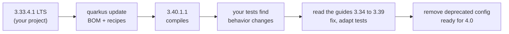

# 🔄 Lab 32 - Upgrading Quarkus

| ⏱️ Duration | 🚀 Quarkus | ☕ Java | 🧪 Type |
|---|---|---|---|
| 1.5 h | from 3.33.4.1 LTS to 3.40.1.1 LTS | 21 | A (starter + solution) |

## 📍 Where to run commands
Open a terminal **inside this lab's `starter/` folder** and check where you are before running anything:

```powershell
Get-Location
```

```bash
pwd
```

> [!NOTE]
> Commands are shown in PowerShell first (`.\mvnw.cmd`) and Bash second (`./mvnw`). In Git Bash, `./mvnw` may fail because of `JAVA_HOME`; use the system `mvn` instead. In PowerShell, arguments such as `-Drewrite=true` go in quotes. The update tool downloads its recipes from Maven Central, so it needs the network. The tests need no Docker; a full run takes about 30 seconds.

> [!IMPORTANT]
> You are going to **change the files of `starter/`** with a tool. Before you start, make sure you can undo it: commit or stash your work on your own branch (`git status` must be clean for this folder), and use `git diff` after each step to see exactly what changed.

## 🎯 Why it matters
Quarkus publishes a minor version every few weeks and a Long Term Support (LTS) version about twice a year: today 3.20, 3.27, 3.33 and 3.40. A team that stays on one LTS has to cross to the next before its support ends, and it crosses **seven minor versions at once**, with their migration guides. Done calmly, an upgrade is a routine afternoon with a good test suite. Done late, it is a risk: the things that change are mostly **not compile errors** but behavior (a thread, a metric, a header), and the dangerous ones fail silently. This lab is that afternoon.

## 🧠 Concepts
| Idea | In one line |
|---|---|
| **LTS and streams** | An LTS line (3.33, 3.40) gets fixes for a long time and micro versions such as `3.33.4.1`. The versions between two LTS lines are for people who want the newest features. Moving from LTS to LTS is the usual path |
| **`quarkus update`** | The CLI command (or the Maven goal `quarkus:update`) that suggests the new platform version and a set of OpenRewrite recipes, and can apply them. It is marked *experimental* by its own output |
| **Recipes** | Automatic edits (a dependency renamed, a package moved, a property renamed) that Quarkus ships for each version. Only what has a recipe is changed |
| **Migration guides** | One page per minor version in the Quarkus wiki. Items marked "⚙️ ✅" are handled by `quarkus update`; **everything else is for you** |
| **Behavior changes** | The migration guides' most important content: no compile error, a different result |
| **Deprecation, then removal** | A configuration property that is deprecated in 3.x is warned about, and removed in 4.0 (the 4.0 guide lists them). Cleaning deprecations is how you prepare |



## 📚 Documentation
- [Quarkus: Update Quarkus](https://quarkus.io/guides/update-quarkus) (the procedure and the options)
- [Quarkus wiki: Migration Guides](https://github.com/quarkusio/quarkus/wiki/Migration-Guides): [3.34](https://github.com/quarkusio/quarkus/wiki/Migration-Guide-3.34), [3.35](https://github.com/quarkusio/quarkus/wiki/Migration-Guide-3.35), [3.36](https://github.com/quarkusio/quarkus/wiki/Migration-Guide-3.36), [3.37](https://github.com/quarkusio/quarkus/wiki/Migration-Guide-3.37), [3.38](https://github.com/quarkusio/quarkus/wiki/Migration-Guide-3.38), [3.39](https://github.com/quarkusio/quarkus/wiki/Migration-Guide-3.39), [3.40](https://github.com/quarkusio/quarkus/wiki/Migration-Guide-3.40) and [4.0](https://github.com/quarkusio/quarkus/wiki/Migration-Guide-4.0)
- [Quarkus: support and LTS](https://quarkus.io/support/)
- [OpenRewrite](https://docs.openrewrite.org/) (the engine behind the recipes)
- [Quarkus: Micrometer](https://quarkus.io/guides/micrometer) and lab 26 (the threads), lab 24 (metrics)

## 🧭 Scenario
`tickets`: a small support-desk service written for Quarkus **3.33.4.1** and untouched since. It uses REST, Micrometer with Prometheus, JTA (`@Transactional`) and a few settings. All its tests pass on 3.33. The migration guides between 3.33 and 3.40 contain three things that touch it, and its configuration still uses names that Quarkus 4 removes.

| Test | Where | What it says |
|---|---|---|
| `TicketTest` (2) | `@QuarkusTest` | the service's own behavior (it must keep passing) |
| `UpgradeTest` (4) | plain JUnit | the POM is on `3.40.1.1`; the Quarkus plugin follows the property; no removed property is in use; the logging configuration is still there |
| `BehaviorAfterUpgradeTest` (2) | `@QuarkusTest` | a `@Transactional` endpoint that blocks runs on a worker thread; a meter with the same name can also be counted per region |
| `ReverseProxyIT` (2) | `@QuarkusIntegrationTest` (against the jar) | a request that a reverse proxy forwards with its public `Host` header is accepted |

| Task | What must be true |
|---|---|
| 1 | The project is on 3.40.1.1, updated by the tool, and you can say exactly what the tool changed |
| 2 | The suite is green again on 3.40.1.1, by fixing the code or the configuration the guides point to |
| 3 | The configuration uses no property that Quarkus 4 removes |

> [!WARNING]
> The tests tell you *that* something changed; the migration guides and the error messages tell you *why*. Do not "fix" a red test by changing what it asserts: the three behaviors are what the service has always promised.

## ✅ Tasks

### Task 1 - Plan and apply the update
**Goal:** the platform version, moved by the tool. **Validated by:** `UpgradeTest.theProjectIsOnTheTargetPlatformVersion` (and a guard that the plugin follows the property).

- [ ] Run the **update without applying it** and read the output: which versions, which extensions, which recipes.
- [ ] Apply it. Look at `git diff`: what did the tool change, and what did it leave?
- [ ] Run the tests and read what fails *before touching anything*.

```powershell
.\mvnw.cmd -B io.quarkus.platform:quarkus-maven-plugin:3.40.1.1:update -N '-Drewrite=false'
```

```powershell
.\mvnw.cmd -B io.quarkus.platform:quarkus-maven-plugin:3.40.1.1:update -N '-Drewrite=true'
git diff --stat .
```

```bash
./mvnw -B io.quarkus.platform:quarkus-maven-plugin:3.40.1.1:update -N -Drewrite=false
./mvnw -B io.quarkus.platform:quarkus-maven-plugin:3.40.1.1:update -N -Drewrite=true
git diff --stat .
```

> [!TIP]
> With the Quarkus CLI installed, `quarkus update` does the same and asks whether to apply the recipes. Without `-Drewrite`, the Maven goal asks the same question on the terminal.

🔮 **Predict first:** (a) which files will the tool change? (b) will it touch `application.properties`? (c) the project has a deprecated property; does 3.33 already complain about it?

### Task 2 - What the suite finds
**Goal:** green on 3.40.1.1. **Validated by:** `BehaviorAfterUpgradeTest` and `ReverseProxyIT`.

- [ ] For every red test, read the **error in the output first** (two of them tell you the fix), then find the item in the migration guides 3.34 to 3.39 and decide: change the code or the configuration.
- [ ] Integration tests run only when the unit tests of the module pass: run the whole `verify` once the rest is green.

```powershell
.\mvnw.cmd clean test
.\mvnw.cmd clean verify '-DskipITs=false'
```

```bash
./mvnw clean test
./mvnw clean verify -DskipITs=false
```

🔮 **Predict first:** (a) a `@Transactional` endpoint that returns a `Uni` and blocks: where does it run on 3.33, and where on 3.40? (b) two counters with the same name and different tag *keys*: what did 3.33 do with the second one, and what does 3.40 do? (c) the service listens on `localhost` behind a proxy that forwards `Host: tickets.example.com`: what changed?

> [!WARNING]
> The third change does not show in a `@QuarkusTest`: it only exists in the packaged application. That is why it is an integration test. And be careful with the fix: read what the property does to `localhost`.

### Task 3 - Prepare for Quarkus 4
**Goal:** no property that the 4.0 migration guide removes. **Validated by:** `UpgradeTest.noPropertyThatQuarkus4RemovesIsStillInUse` and `UpgradeTest.theLoggingConfigurationIsStillThere`.

- [ ] Open the "Config" table of the [4.0 migration guide](https://github.com/quarkusio/quarkus/wiki/Migration-Guide-4.0) and rename what `application.properties` still uses, **keeping the values**.

```powershell
.\mvnw.cmd clean verify '-DskipITs=false'
```

```bash
./mvnw clean verify -DskipITs=false
```

🔮 **Predict first:** the console is switched off with `quarkus.log.console.enable=false`. On Quarkus 4, what happens to that line?

**Success criteria:** `.\mvnw.cmd verify '-DskipITs=false'` inside `starter/` ends green (10 tests: 8 unit and 2 integration).

## 👀 What you should see
The plan the tool prints:

```text
Suggested Quarkus platform BOM updates:
 ~       io.quarkus.platform:quarkus-bom:pom:[3.33.4.1 -> 3.40.1.1]
...
Resolving recipes from 'io.quarkus:quarkus-update-recipes':
 * matching recipes directory 'core' found:
     - '3.37.alpha1.yaml' (3.33.4.1 -> 3.40.1.1)
     - '3.38.alpha1.yaml' (3.33.4.1 -> 3.40.1.1)
     - '3.39.alpha1.yaml' (3.33.4.1 -> 3.40.1.1)
 => 3 specific recipes found
```

Two of the failures on 3.40, with their fix written in them:

```text
io.quarkus.runtime.BlockingOperationNotAllowedException: @Transactional cannot start a JTA transaction within a reactive pipeline. If the annotated method is intended to be blocking, ensure it is executed on a worker thread, for example by annotating it with @Blocking.
```

```text
java.lang.IllegalArgumentException: Prometheus requires that all meters with the same name have the same set of tag keys. There is already an existing meter named 'tickets_opened_total' containing tag keys [channel].
```

And the warning that 3.33 and 3.40 both print for a deprecated property:

```text
WARN  [io.qu.config] The "quarkus.log.console.enable" config property is deprecated and should not be used anymore.
```

## 💼 In real projects
- **Upgrade on a schedule, not under pressure.** Put the end of support of your LTS in the team calendar and plan the next LTS two months before. A branch, one pull request, the tool's diff separate from your fixes.
- **LTS to LTS, reading every guide in between.** The guides are cumulative: going from 3.33 to 3.40 means 3.34 to 3.39 (3.40 is "the direct continuation of 3.39", with nothing manual). The tool applies the recipes of the versions you cross; read the rest.
- **The test suite is the real tool.** The three changes of this lab were caught by a test that exercised the behavior (a thread, a metric, a header). Tests on threads, metrics, headers and configuration are the ones worth having before an upgrade. Add a nightly build against the next Quarkus version (`-Dquarkus.platform.version=...`) so that the surprise arrives in small pieces.
- **Read the failure first.** Quarkus errors for known migrations often contain the fix. Then confirm it in the guide: sometimes the fix has a side effect (task 2).
- **The tool is a helper, not a promise.** It is experimental, it changes only what has a recipe, and the recipes lag the guides. Here it changed one line of the POM; everything else (three behaviors and the configuration) was for us.
- **Everything around Quarkus moves too:** dev-services images, REST Assured, Hibernate, Micrometer. The guides list them; dev-services changes only bite in dev and test, but they do bite.
- **Deprecation warnings are a to-do list.** Read the log of your tests: every `deprecated` is a change you must make before the next major version, when it will not be a warning any more.
- **Third-party extensions** (Quarkiverse and others) have their own versions and may lag behind the platform: check that every one you use supports the target version before the date, not after. This lab's project has none.
- **A shared parent POM (lab 31) makes the update cheaper:** the platform version lives in one file instead of seven.

## 🚀 Stretch goal
1. **Quarkus 4 beta.** Change the platform version of your finished project to `4.0.0.Beta2` and run the whole suite (the answers say what happened to the author's). Then read the 4.0 guide for what your project does not use yet.
2. **A dry run of the tool.** Run `quarkus:update` with `-DrewriteDryRun=true` and compare with `-Drewrite=false`: what does each produce?
3. **A wrong stream.** Run the update with `-Dstream=3.27` on a copy of the starter and read what it says: what is the tool's idea of "latest" for an LTS?
4. **`MeterProvider`.** Rewrite the regional counter so that it keeps the name `tickets.opened` and uses `MeterProvider` (see the 3.34 guide). When is that better than a new meter name?
5. **Your own recipe.** Read how OpenRewrite expresses "rename a property" and write the recipe that renames `quarkus.log.console.enable` in a copy of the project.

## 💡 Hints
<details><summary>Task 1 (direction)</summary>

The goal `update` takes `-N` (non-recursive) in a multi-module project; `-Drewrite=false` writes the recipe to `target\rewrite\rewrite.yaml` without applying it; `-Drewrite=true` applies it. `git diff` shows the result.
</details>

<details><summary>Task 2 (direction)</summary>

The thread: `io.smallrye.common.annotation.Blocking`. The meter: a meter name has one set of tag keys; a separate name is the simplest fix. The `Host` header: `quarkus.http.host-validation.allowed-hosts`, which takes a **list**; ask yourself which names the service must still answer to.
</details>

<details><summary>Task 3 (direction)</summary>

`quarkus.log.console.enable` becomes `quarkus.log.console.enabled`; `quarkus.log.console.async` becomes `quarkus.log.console.async.enabled`. The format property was never deprecated.
</details>

## ✔️ Verified answers
<details><summary>Open only after finishing the tasks</summary>

Everything here was checked by running it, with the Maven goal of the tool (the Quarkus CLI was not installed). Times are from one machine.

**Task 1.** (a)-(b) With `-Drewrite=false` the tool printed the plan in about 17 seconds and wrote `target\rewrite\rewrite.yaml`: the platform BOM `3.33.4.1 -> 3.40.1.1`, the four extensions "synced with BOM", and three recipe files found for this jump (`3.37`, `3.38`, `3.39`: the Panache Next to Quarkus Data rename, the Elasticsearch client and the Hibernate annotation processors, none of which this project uses). Without `-Drewrite` it stopped at the question `Do you want to apply the generated update recipes with OpenRewrite? ([y]es, [n]o, [d]ry-run + [Enter])`. With `-Drewrite=true` (about 48 seconds) **the only change was one line of `pom.xml`**: `quarkus.platform.version` from `3.33.4.1` to `3.40.1.1`. The compiler and surefire plugin versions, `application.properties` and the Java sources were untouched. (c) Yes: Quarkus 3.33 already printed `The "quarkus.log.console.async" config property is deprecated and should not be used anymore.` and the same for `quarkus.log.console.enable`; 3.40 printed the same two warnings. Right after the update the unit tests gave 4 red of 8: the two behavior tests (below) and the two about the configuration; the integration tests did not run, because Failsafe runs only when the unit tests of the module pass.

**Task 2.** (a) On 3.33 the endpoint ran on an `executor-thread-N`: `@Transactional` forced the dispatch to a worker. Since 3.35 that is no longer so: it follows the return type (a `Uni` means the event loop), and on 3.40 the call failed with `500`: `BlockingOperationNotAllowedException: @Transactional cannot start a JTA transaction within a reactive pipeline. If the annotated method is intended to be blocking, ensure it is executed on a worker thread, for example by annotating it with @Blocking`, next to `RuntimeExceptionMapper: A blocking operation occurred on the IO thread. This likely means you need to annotate lab.melostudy.TicketResource#slow() with @io.smallrye.common.annotation.Blocking`. Fix: `@Blocking` on the method. (b) On 3.33 the second meter was **silently dropped**: the endpoint answered `200` and `region="eu"` was never in `/q/metrics` (the test was red on 3.33 for that reason, a bug the old version hid). On 3.40 the same call is a `500`: `IllegalArgumentException: Prometheus requires that all meters with the same name have the same set of tag keys. There is already an existing meter named 'tickets_opened_total' containing tag keys [channel]`. Fix used: a separate meter name (`tickets.regional.opened`); `MeterProvider` (the 3.34 guide) is for the same name and the same keys with values known late. (c) With `quarkus.http.host=localhost`, 3.33 answered `200` to a request with `Host: tickets.example.com` and 3.40 answered **`400`** (`Expected status code <200> but was <400>`); a `@QuarkusTest` with the same request stayed at `200`, because the validation applies in dev and production modes, hence the integration test. The guide's three options are `quarkus.http.host-validation.allowed-hosts`, `quarkus.http.host-validation.require-localhost=false` or a proxy that does not forward the `Host`. With `allowed-hosts=tickets.example.com` **alone**, every request to `localhost` (including the ones of the tests) became `400` and four unit tests turned red; the list needs both names: `tickets.example.com,localhost`.

**Task 3.** On Quarkus **4.0.0.Beta2**, a project with the old names still started, but printed `Unrecognized configuration property quarkus.log.console.enable provided in PropertiesConfigSource[...]` and **ignored the line**: with `quarkus.log.console.enable=false` the console still printed (9 log lines in the test run), with `quarkus.log.console.enabled=false` it printed none (0). A setting that is silently ignored is how a log level or a switch stops doing what it did.

**Quarkus 4 beta, stretch 1.** The finished solution on `4.0.0.Beta2`, with only the platform version changed: the code compiled, `TicketTest`, `BehaviorAfterUpgradeTest` and `ReverseProxyIT` passed (6 of 6) and there was no deprecation warning; the only red test was the one that asserts the target version `3.40.1.1`.

**What each piece protects (mutation table).** Each row is the solution with one thing changed:

| Changed in the solution | What fails |
|---|---|
| `@Blocking` removed | `aTransactionalEndpointThatBlocksRunsOnAWorkerThread` |
| the regional counter uses the name of the first one again | `aMeterWithTheSameNameCanBeCountedPerRegion` |
| `allowed-hosts` removed | `ReverseProxyIT.aRequestThatArrivesThroughAReverseProxyIsAccepted` (`400`) |
| `allowed-hosts` without `localhost` | `TicketTest` (2) and `BehaviorAfterUpgradeTest` (2) |
| `quarkus.log.console.enable` is back | the two configuration tests of `UpgradeTest` |
</details>

## 🎤 Self-assessment
1. What is an LTS version, and why do you usually upgrade from one LTS to the next and not to every minor version?
2. What does `quarkus update` change, what does it leave to you, and how do you know which is which?
3. Name a change between two Quarkus versions that does not break the build and breaks the application. How would a test have found it?
4. A deprecated configuration property still works today. What happens to it in the next major version, and what is the danger if its value was `false`?
5. How do you plan the next upgrade so that it is not an emergency?

The complete solution is in `solution/`.

## 🔁 Retrospective
- What did I understand?
- What was hard?
- What should I reinforce?
