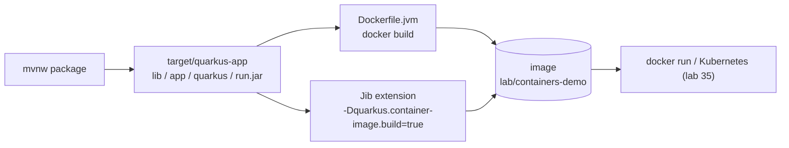

# 📦 Lab 33 - Containers

| ⏱️ Duration | 🚀 Quarkus | ☕ Java | 🧪 Type |
|---|---|---|---|
| 2 h | 3.40.1.1 LTS | 21 | B (guide: one project, `demo/`) |

## 📍 Where to run commands
Open a terminal **inside this lab's `demo/` folder** and check where you are before running anything:

```powershell
Get-Location
```

```bash
pwd
```

> [!NOTE]
> Commands are shown in PowerShell first (`.\mvnw.cmd`) and Bash second (`./mvnw`). In Git Bash, `./mvnw` may fail because of `JAVA_HOME`; use the system `mvn` instead. In PowerShell, `-Dx.y=z` arguments go in quotes.

> [!IMPORTANT]
> **Docker must be running.** The first build downloads the base image (`registry.access.redhat.com/ubi9/openjdk-21-runtime:1.24`, 390 MB). Containers and images created here are named `cdemo` and `lab/containers-demo:*`: remove only those at the end (last step). The guide uses ports 8080 only; if it is taken, change the left side of `-p 8080:8080`.

## 🎯 Why it matters
"It runs on my machine" ends at the container: the same image goes to the test environment, to staging and to production, in Kubernetes or in a plain Docker host. What matters for a Quarkus developer is not memorising Docker, but a few decisions that you will be asked about and that cost money when wrong: **what is in the image** (size, who it runs as), **how fast it rebuilds and pushes** (layers), **how the JVM behaves under the limits of the container** (memory and CPU), and **how it stops**. This lab runs each of those and measures it.

## 🧠 Concepts
| Idea | In one line |
|---|---|
| **Fast-jar** | The default Quarkus package: `target/quarkus-app/` with `lib/` (dependencies), `app/` (your classes), `quarkus/` (generated) and `quarkus-run.jar`. Built so that the parts that change least are separate files |
| **Image layers** | Every `COPY` or `RUN` of a Dockerfile makes a layer. Docker rebuilds from the first changed layer and registries upload only the layers they do not have. Order them from "changes least" to "changes most" |
| **Base image** | The operating system and the JRE under your files. It is most of the image (390 of 409 MB here) and the part you must keep patched |
| **Dockerfile build** | You write the recipe; Docker runs it. Needs a Docker daemon |
| **Jib** | Builds the image from Maven, **without a Dockerfile**, layering the fast-jar for you. Pushes straight to a registry without a daemon; with a local daemon it also loads the image there |
| **JVM in a container** | The JVM reads the limits of the container (memory, CPUs) and sizes itself: `-XX:MaxRAMPercentage` decides the share of the memory limit for the heap |
| **SIGTERM** | `docker stop` and Kubernetes ask the process to finish with SIGTERM and kill it after a grace period. Quarkus shuts down cleanly on SIGTERM |



## 📚 Documentation
- [Quarkus: Container images](https://quarkus.io/guides/container-image) (Jib, Docker, Podman, Buildpack, push, all the properties)
- [Jib](https://github.com/GoogleContainerTools/jib) and the [Red Hat UBI OpenJDK 21 runtime image](https://catalog.redhat.com/software/containers/ubi9/openjdk-21-runtime/6501ce769a0d86945c422d5f)
- [Docker: build best practices](https://docs.docker.com/build/building/best-practices/)
- [Quarkus: native executables](https://quarkus.io/guides/building-native-image) (lab 34) and [Kubernetes](https://quarkus.io/guides/deploying-to-kubernetes) (lab 35)

## 🧭 Scenario
`demo/` is a tiny Quarkus application with one interesting endpoint, `GET /info`, that reports what the application sees of the machine it runs on: the Java version, the **maximum heap**, the **number of CPUs**, the user and the host. Its message comes from configuration (`greeting.message`). The pom already includes the Jib extension (it does nothing until you switch the image build on), and `src/main/docker/` has two Dockerfiles. You will build the same application three ways and compare them.

## ✅ Steps

### Step 1 - Package and look inside
**Goal:** know what is in the fast-jar before it goes into an image.

```powershell
.\mvnw.cmd -q clean package -DskipTests
Get-ChildItem target\quarkus-app
```

```bash
./mvnw -q clean package -DskipTests
ls target/quarkus-app
```

- [ ] Which directory is the biggest? Which one holds *your* code?

🔮 **Predict first:** the sizes of `lib`, `app` and `quarkus`.

> [!NOTE]
> `package` built **no image**, although the Jib extension is in the pom: it needs `-Dquarkus.container-image.build=true`.

### Step 2 - Build the image with a Dockerfile
**Goal:** the classic way, and a look at its layers and its size.

Read `src/main/docker/Dockerfile.jvm` first: four `COPY` lines, one per kind of file.

```powershell
docker build -f src/main/docker/Dockerfile.jvm -t lab/containers-demo:dockerfile .
docker images lab/containers-demo
docker history lab/containers-demo:dockerfile --format "{{.Size}}`t{{.CreatedBy}}" | Select-Object -First 9
```

```bash
docker build -f src/main/docker/Dockerfile.jvm -t lab/containers-demo:dockerfile .
docker images lab/containers-demo
docker history lab/containers-demo:dockerfile --format "{{.Size}}\t{{.CreatedBy}}" | head -9
```

🔮 **Predict first:** the size of the image, and how much of it is your application.

### Step 3 - Run it and ask the JVM what it sees
**Goal:** the JVM adapts to the limits of the container, and the configuration comes from the outside.

```powershell
docker run -d --name cdemo -p 8080:8080 lab/containers-demo:dockerfile
curl.exe -s http://localhost:8080/info
docker rm -f cdemo
```

Now the same with limits, and with a different message from the environment:

```powershell
docker run -d --name cdemo -p 8080:8080 --memory 256m --cpus 1 lab/containers-demo:dockerfile
curl.exe -s http://localhost:8080/info
docker exec cdemo sh -c "tr '\0' ' ' < /proc/1/cmdline"
docker exec cdemo sh -c "id -u"
docker rm -f cdemo
docker run -d --name cdemo -p 8080:8080 -e GREETING_MESSAGE="Hello from the environment" lab/containers-demo:dockerfile
curl.exe -s http://localhost:8080/info
docker rm -f cdemo
```

```bash
docker run -d --name cdemo -p 8080:8080 --memory 256m --cpus 1 lab/containers-demo:dockerfile
curl -s http://localhost:8080/info
docker exec cdemo sh -c "tr '\0' ' ' < /proc/1/cmdline"
docker exec cdemo sh -c "id -u"
docker rm -f cdemo
```

🔮 **Predict first:** (a) `maxHeapMb` and `cpus` with no limit, and with `--memory 256m --cpus 1`. (b) Which flags does the image give to the JVM? (c) As which user does it run?

### Step 4 - Layers and the cache
**Goal:** see why the order of the layers is the whole point.

Add a comment inside `info()` in `InfoResource.java` (any change in the class), package again and rebuild:

```powershell
.\mvnw.cmd -q -DskipTests package
docker build -f src/main/docker/Dockerfile.jvm -t lab/containers-demo:v2 . 2>&1 | Select-String 'CACHED|COPY'
docker history lab/containers-demo:v2 --format "{{.Size}}`t{{.CreatedBy}}" | Select-Object -First 9
```

Undo the change. Then the **uber-jar** version (everything in one jar), changing the class once more between the two builds:

```powershell
.\mvnw.cmd -q -DskipTests clean package '-Dquarkus.package.jar.type=uber-jar'
docker build -f src/main/docker/Dockerfile.uberjar -t lab/containers-demo:uber1 .
docker history lab/containers-demo:uber1 --format "{{.Size}}`t{{.CreatedBy}}" | Select-Object -First 6
```

Make a change again, package again as an uber-jar, build `:uber2` and look at the new layer. Undo the change and rebuild the fast-jar (`clean package`).

🔮 **Predict first:** after changing one class, which layers does Docker rebuild with the fast-jar? How big is the new layer with the uber-jar?

### Step 4b - The build context
`docker build .` sends the folder to the daemon. `.dockerignore` says which files are not sent: here everything except the two jars the Dockerfiles use.

```powershell
function MB($p) { "{0:N1} MB" -f ((Get-ChildItem $p -Recurse -File -Force | Measure-Object Length -Sum).Sum / 1MB) }
MB .
MB target\quarkus-app
```

🔮 **Predict first:** is the saving in megabytes the reason to have a `.dockerignore`?

### Step 5 - Jib: an image without a Dockerfile
**Goal:** the same image from Maven, and one setting that decides whether layers can be reused.

```powershell
.\mvnw.cmd -B clean package -DskipTests '-Dquarkus.container-image.build=true'
docker images lab/containers-demo
docker inspect lab/containers-demo:1.0 --format "user={{.Config.User}} entrypoint={{.Config.Entrypoint}} created={{.Created}}"
docker history lab/containers-demo:1.0 --format "{{.Size}}`t{{.CreatedBy}}" | Select-Object -First 6
```

```bash
./mvnw -B clean package -DskipTests -Dquarkus.container-image.build=true
docker images lab/containers-demo
docker inspect lab/containers-demo:1.0 --format "user={{.Config.User}} entrypoint={{.Config.Entrypoint}} created={{.Created}}"
```

Read the build log: what does it warn about? Then build the image **twice more without changing any code** and compare the layers of the two images, with and without the flag `-Dquarkus.jib.use-current-timestamp-file-modification=false`:

```powershell
function Layers($tag) { docker image inspect $tag --format '{{json .RootFS.Layers}}' | ConvertFrom-Json }
.\mvnw.cmd -B clean package -DskipTests '-Dquarkus.container-image.build=true' | Out-Null
docker tag lab/containers-demo:1.0 lab/containers-demo:jib-a
.\mvnw.cmd -B clean package -DskipTests '-Dquarkus.container-image.build=true' | Out-Null
$a = Layers 'lab/containers-demo:jib-a'; $b = Layers 'lab/containers-demo:1.0'
for ($i = 0; $i -lt $a.Count; $i++) { if ($a[$i] -eq $b[$i]) { 'same' } else { 'DIFF' } }
```

(Repeat with the flag, in quotes, after `-DskipTests`.) The layers, bottom to top: the two layers of the base image, the dependencies (18.7 MB), the jar, `app`, `quarkus`, an empty one.

🔮 **Predict first:** (a) is the Jib image the same as the Dockerfile one (user, entrypoint, layers)? (b) building the same code twice, how many layers are identical? Is the 18.7 MB layer one of them?

> [!WARNING]
> Jib's defaults put the **current time** in every file of the image. The consequence is invisible in the image and expensive in the pipeline.

### Step 6 - How small can it be?
**Goal:** a feeling for memory, measured, not guessed.

```powershell
docker run -d --name cmem -p 8080:8080 --memory 64m lab/containers-demo:v1
Start-Sleep -Seconds 5
curl.exe -s http://localhost:8080/info
docker stats cmem --no-stream --format "{{.MemUsage}} ({{.MemPerc}})"
docker rm -f cmem
```

Repeat with `--memory 48m`, `128m` and `256m` (`v1` is the first image you built; use `dockerfile` if you did not tag it).

🔮 **Predict first:** does a Quarkus application start in 64 MB? In 48 MB? How much does the container use when it is idle with plenty of room?

### Step 7 - How it stops
**Goal:** a container stops with a signal, and the application must handle it.

```powershell
docker run -d --name cdemo -p 8080:8080 lab/containers-demo:dockerfile
Start-Sleep -Seconds 3
docker stop cdemo
docker inspect cdemo --format "exit code {{.State.ExitCode}}"
docker logs cdemo 2>&1 | Select-Object -Last 1
docker rm -f cdemo
```

🔮 **Predict first:** the exit code of a Java process that stopped on `docker stop`, and what the log says.

### Step 8 - Clean up
Only what this lab created:

```powershell
docker rm -f cdemo cmem 2>$null
docker images lab/containers-demo --format "{{.Repository}}:{{.Tag}}" | ForEach-Object { docker rmi $_ }
```

**Success criteria:** you can answer the self-assessment without the guide, and `docker images lab/containers-demo` lists nothing.

## 👀 What you should see
```text
containers-demo 1.0.0-SNAPSHOT on JVM (powered by Quarkus 3.40.1.1) started in 0.646s. Listening on: http://0.0.0.0:8080
```

```text
{"message":"Hello from the jar","javaVersion":"21.0.13","maxHeapMb":183,"cpus":1,"user":"default","host":"c6a13538cf6e"}
```

```text
[WARNING] [io.quarkus.container.image.jib.deployment.JibProcessor] Base image 'registry.access.redhat.com/ubi9/openjdk-21-runtime:1.24' does not use a specific image digest - build may not be reproducible
```

## 💼 In real projects
- **Pin the base image by digest and rebuild on a schedule.** A tag such as `:1.24` moves (Jib says so in its warning); a digest does not. A fixed digest plus an automatic weekly rebuild gives you reproducible builds *and* security patches.
- **Run as a non-root user** (here 185, already in the image) and keep secrets out of the image: `docker history` shows every `ENV` of the Dockerfile, so a password there is public to anyone who can pull the image. Configuration and secrets arrive at run time (environment, mounted files, labs 2 and 22).
- **Layers decide the speed of the pipeline.** Dependencies change less than code: keep them in their own layer, and in CI keep the Maven and the image caches between runs. With Jib, switch off the current-timestamp option for the file modification times, so that the dependency layer is the same in every build and a registry only receives the small layers.
- **Size the JVM from the container limit, not from the machine.** The image sets `-XX:MaxRAMPercentage=80.0`; heap is only part of the memory of a JVM (metaspace, threads, native memory). Leave headroom: a limit equal to the heap is an out-of-memory kill waiting for a busy day. Measure with the real load, not with an idle `docker stats`.
- **CPU limits change the JVM too:** with `--cpus 1` the JVM saw one processor (fewer GC and compiler threads, a different default pool); in Kubernetes a CPU *request* and a CPU *limit* are different things (lab 35).
- **Let the platform stop you politely:** SIGTERM, then the grace period (30 s by default in Kubernetes), then SIGKILL. An exit code of 143 after a stop is normal; one of 137 means somebody killed the process (often out of memory).
- **Pick the build tool for the pipeline you have.** Jib: no daemon, perfect for CI that cannot run Docker, straight to the registry (`quarkus.container-image.push`). Dockerfile: full control (extra packages, certificates, a different base). Native (lab 34): a different image, the micro base, and a very different build.
- **Multi-architecture:** developers on ARM and servers on x86 need an image for both (`quarkus.jib.platforms`), or a build on each architecture.
- **A scanner in CI** (Trivy, Grype, your registry's) on every image, and a policy for what to do with its findings: the base image is where most of them live.
- **One process per container, logs on the console.** The orchestrator collects stdout; the JSON logs of lab 25 are made for it.

## 🚀 Stretch goal
1. **A smaller base.** Build the image on `eclipse-temurin:21-jre-alpine` (208 MB, already downloaded if you did the comparison) with your own Dockerfile. What do you gain, what do you have to take care of (the user, the `java` command, the JVM flags that the UBI image set for you)?
2. **A digest.** Look up the digest that Jib reported (`Using base image with digest: sha256:...`) and set `quarkus.jib.base-jvm-image` with it. Does the warning go away?
3. **Memory pressure.** Add an endpoint that allocates memory in a loop and find, with `--memory`, the point where the container is killed. What exit code and `OOMKilled` value do you get? And with the heap limit of the JVM lower than the container limit?
4. **Extra layers.** With Jib, add a file to the image (`quarkus.jib.*` has no property for it: use the `src/main/jib` folder) and see which layer it lands in.
5. **Podman.** If you have Podman, build the same image with it and compare.

## 💡 Hints
<details><summary>Step 4 (direction)</summary>

`docker build` prints `CACHED` for a layer whose inputs did not change. `docker history` lists layers newest first, with their size.
</details>

<details><summary>Step 5 (direction)</summary>

`docker image inspect <image> --format '{{json .RootFS.Layers}}'` lists the layers of an image by content hash: two images share a layer when the hash is the same.
</details>

## ✔️ Verified answers
<details><summary>Open only after finishing the steps</summary>

Everything here was run on Quarkus 3.40.1.1 with Docker Desktop on Windows. Times and sizes are from one machine.

**Step 1.** `lib` 19 MB, `quarkus` 600 kB, `app` 4 kB (a few KB of your classes). `package` built no image.

**Step 2.** The image is **409 MB**; the base image is 390 MB. The layers of the application: dependencies 18.7 MB, `quarkus` 606 kB, `app` 2.8 kB, the run jar 684 B. Your code is a rounding error of the image; the base is the cost (for comparison `eclipse-temurin:21-jre-alpine` is 208 MB).

**Step 3.** (a) With no limit: `maxHeapMb` 5362 and `cpus` 32 (the machine). With `--memory 256m --cpus 1`: 183 and 1; with 512 MB: 364; with 1 GB: 729. (b) `java -XX:MaxRAMPercentage=80.0 -XX:+UseParallelGC -XX:MinHeapFreeRatio=10 -XX:MaxHeapFreeRatio=20 -XX:GCTimeRatio=4 -XX:AdaptiveSizePolicyWeight=90 -XX:+ExitOnOutOfMemoryError -Dquarkus.http.host=0.0.0.0 -Djava.util.logging.manager=org.jboss.logmanager.LogManager -cp . -jar /deployments/quarkus-run.jar` (`run-java.sh` of the base image builds it from the environment). (c) User id `185`; the JVM calls it `default`. With `-e GREETING_MESSAGE=...` the message came from the environment. `/q/health/ready` answered `UP`; the application started in 0.65 s.

**Step 4.** After changing one class, `docker build` printed `CACHED` for the 18.7 MB dependencies layer and rebuilt the three small ones (jar, `app`, `quarkus`: about 0.6 MB in all); 3 of the 6 layers of the image were shared with the previous build. With the uber-jar the new layer was **17.9 MB** on every build (the 17 MB jar changes with any class). Step 4b: the whole folder was 18.7 MB and the filtered context 18.4 MB: in a project this small the saving is nothing; the reason for a `.dockerignore` is to keep `.git`, `.env` and local files out of the context (and of the image, if a `COPY .` exists).

**Step 5.** Jib built `lab/containers-demo:1.0` in 29 s the first time and 22 s the next (including the Maven build), 409 MB, with the same user (185), the same entrypoint (`/opt/jboss/container/java/run/run-java.sh`) and the same four application layers (18.7 MB, 684 B, 2.8 kB, 606 kB), but the files in `/home/jboss` instead of `/deployments`, and the JVM arguments reduced to the logging manager. The log warned: `Base image 'registry.access.redhat.com/ubi9/openjdk-21-runtime:1.24' does not use a specific image digest - build may not be reproducible`, and printed the digest it used. `quarkus.jib.use-current-timestamp` and `quarkus.jib.use-current-timestamp-file-modification` default to `true`: building the same code twice, **only the 2 base layers were identical** (the 18.7 MB layer differed every time). With `-Dquarkus.jib.use-current-timestamp-file-modification=false` the dependencies layer was identical in every build, also after `clean` and after changing a class; the jar, `app` and `quarkus` layers always differed (Quarkus writes them each time).

**Step 6.** All five limits started and answered `/info`: 48 MB (started in 1.0 s, heap 21 MB), 64 MB (heap 28, the container at 96% of its limit), 96 MB (heap 43), 128 MB (heap 57; 83 MiB used, 65%) and 256 MB (heap 183; 87 MiB used, 34%). An idle application is not a loaded one: the numbers say what it needs to start, not what you should set.

**Step 7.** `docker stop` took about 0.4 s, the exit code was **143** (128 + SIGTERM) and the last log line was `containers-demo stopped in 0.043s`: Quarkus handled the signal and shut down cleanly.
</details>

## 🎤 Self-assessment
1. Why does the Quarkus fast-jar put dependencies, your classes and generated files in separate directories, and how does a Dockerfile take advantage of it?
2. A teammate says "the image is 409 MB, the app is 19 MB": what is the rest, and what would you do about it (and not do)?
3. Your pipeline pushes 19 MB per build to the registry for a one-line change. Name two possible causes and the fix of each.
4. A container with `--memory 256m` runs a JVM: what heap does it get, why, and why is it dangerous to set `-Xmx` equal to the limit?
5. What happens, step by step, when Kubernetes stops your pod, and what exit code do you expect?

## 🔁 Retrospective
- What did I understand?
- What was hard?
- What should I reinforce?
