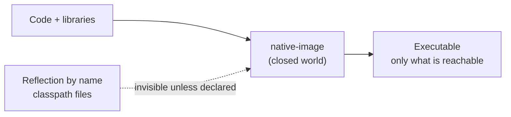

# ⚡ Lab 34 - Native executables *(elective)*

| ⏱️ Duration | 🚀 Quarkus | ☕ Java | 🧪 Type |
|---|---|---|---|
| 1.5 h (+ about 3 min of waiting per native build) | 3.40.1.1 LTS | 21 | B (guide: one project, `demo/`) |

## 📍 Where to run commands
Open a terminal **inside this lab's `demo/` folder** and check where you are before running anything:

```powershell
Get-Location
```

```bash
pwd
```

> [!NOTE]
> Commands are shown in PowerShell first (`.\mvnw.cmd`) and Bash second (`./mvnw`). In Git Bash, `./mvnw` may fail because of `JAVA_HOME`; use the system `mvn` instead. In PowerShell, `-Dx.y=z` arguments go in quotes.

> [!IMPORTANT]
> **A native build is heavy.** It compiles the whole application ahead of time inside a container: in the reference run it took about 1.5-2 min of `native-image` plus the rest of the build (2.5-3.5 min in total) and peaked at **4.4 GB of RAM** and all the CPUs. Close heavy programs first. You only need to build **twice** in this lab (steps 2 and 4). Docker must be running; the first build downloads the Mandrel builder image (about 1.3 GB) and the runtime base image.

> [!NOTE]
> Images and containers created here are named `ndemo` and `lab/native-demo:*`. Remove only those at the end.

## 🎯 Why it matters
A native executable starts in milliseconds and uses a fraction of the memory of a JVM: that is why it is chosen for functions, scale-to-zero and small pods. The price is paid elsewhere: a slow build, no JIT, and a **closed world** where everything must be known at build time. For a developer the question is not "how do I build one" (one flag) but **"what breaks, how do I notice, and when is it worth it"**. This lab breaks it on purpose.

## 🧠 Concepts
| Idea | In one line |
|---|---|
| **GraalVM / Mandrel** | `native-image` compiles your bytecode and the libraries to a machine-code executable. Mandrel is the Red Hat build of it for Quarkus (it ran as `MANDREL 25.0.5.0` here) |
| **Closed world** | The compiler keeps only what it can reach from `main`. What it cannot see is removed from the executable |
| **Reflection** | `Class.forName("...")` with a name built at runtime is invisible to the compiler: the class is not in the executable. Quarkus registers what its own extensions use; yours you register with `@RegisterForReflection` |
| **Resources** | A file read from the classpath is only inside the executable if it was included (`quarkus.native.resources.includes`) |
| **Container build** | `-Dquarkus.native.container-build=true` compiles inside a builder container, so you need no GraalVM installed. On Windows it produces a **Linux** executable, not an `.exe` |
| **`@QuarkusIntegrationTest`** | Runs the same tests against the packaged application: jar, native executable or container image |



## 📚 Documentation
- [Building a native executable](https://quarkus.io/guides/building-native-image)
- [Native applications tips](https://quarkus.io/guides/writing-native-applications-tips) (reflection, resources)
- [Testing native executables](https://quarkus.io/guides/building-native-image#testing-the-native-executable)

## 🧭 Scenario
The demo has three endpoints that work on the JVM: `/plugins/{name}` loads a class by name (`Class.forName`), `/rates` serves `rates.json` from the classpath, and `/info` says whether it runs as native. Your job is to build it as native, see what the JVM hid from you, and fix it.

## ✅ Steps

### 1. Run it on the JVM and read the tests
- [ ] Run the tests:

```powershell
.\mvnw.cmd test
```

```bash
./mvnw test
```

- [ ] Open `EndpointsTest` and `EndpointsIT`. The second one has no tests of its own: it **extends** the first and runs them against the packaged application.

🔮 **Predict first:** if you build the native executable now, which of the three tests will still pass? Write it down.

### 2. First native build (without any fix)
To see the failure, first remove the two fixes: delete `@RegisterForReflection` (and its import) from `EnglishPlugin` and `SpanishPlugin`, and remove the `quarkus.native.resources.includes` line from `application.properties`.

- [ ] Build the native executable and, from it, the image:

```powershell
.\mvnw.cmd verify "-Dnative" "-Dquarkus.native.container-build=true" "-Dquarkus.container-image.build=true"
```

```bash
./mvnw verify -Dnative -Dquarkus.native.container-build=true -Dquarkus.container-image.build=true
```

- [ ] Look at the report of `native-image` near the end: image size, number of reachable methods, peak RSS.
- [ ] Run the image and call the endpoints:

```powershell
docker run -d --rm --name ndemo -p 8080:8080 lab/native-demo:native
curl.exe -i localhost:8080/info
curl.exe -i localhost:8080/plugins/English
curl.exe -i localhost:8080/rates
```

```bash
docker run -d --rm --name ndemo -p 8080:8080 lab/native-demo:native
curl -i localhost:8080/info
curl -i localhost:8080/plugins/English
curl -i localhost:8080/rates
```

> [!WARNING]
> **Trap 1: the symptom is silent.** The build compiles, the application starts and `/info` answers `"nativeImage":true`. But `/plugins/English` and `/rates` answer **404**, the same answer an unknown plugin gives. On the JVM all three worked.

> [!WARNING]
> **Trap 2: the integration tests are the net.** `EndpointsIT` runs the same three tests against the native image. Read the failures in the Maven output: they are the only warning you get before production. Without that test you would find out from a user.

🔮 **Predict first:** why are `/plugins/English` and `/rates` the ones that fail and not `/info`?

### 3. Fix reflection and resources
- [ ] Restore `@RegisterForReflection` on both plugin classes (class-level annotation, import `io.quarkus.runtime.annotations.RegisterForReflection`).
- [ ] Restore `quarkus.native.resources.includes=rates.json` in `application.properties`.

<details>
<summary>Hint</summary>

The annotation goes on the classes that are created by name. The property takes a comma-separated list of patterns; `application.properties` and `META-INF/resources` are included on their own, any other file is not.
</details>

### 4. Second native build
- [ ] Repeat the build command of step 2. The integration tests now run against the image.
- [ ] Start the image again and call the three endpoints.

### 5. Measure
- [ ] Startup line in the log, and memory at idle:

```powershell
docker logs ndemo
docker stats --no-stream ndemo
docker images lab/native-demo
```

```bash
docker logs ndemo
docker stats --no-stream ndemo
docker images lab/native-demo
```

- [ ] Compare with the JVM image of lab 33 (409 MB, and startup in seconds).

### 6. Clean up
```powershell
docker stop ndemo
docker rmi lab/native-demo:native
```

```bash
docker stop ndemo
docker rmi lab/native-demo:native
```

> [!TIP]
> The Mandrel builder image (1.3 GB) stays in Docker for the next build. Remove it only if you need the disk.

## 👀 What you should see
The `native-image` report of the reference run (your numbers will differ slightly):

```
12,329 types, 16,921 fields, and 60,472 methods found reachable
55.61MB in total image size, 52.62MB in total file size
... Peak RSS: 4.44GB
```

And the running application:

```
native-demo 1.0.0-SNAPSHOT native (powered by Quarkus 3.40.1.1) started in 0.063s.
{"nativeImage":true,"vm":"Substrate VM","javaVersion":"25.0.5"}
```

## 💼 In real projects
- **Decide with numbers.** Native wins where startup and memory are the cost (functions, scale-to-zero, many small pods). It loses where the build time, the lack of JIT peak performance or the restrictions hurt. For a long-running service with enough memory, the JVM is often the right answer.
- **Keep a native build in CI**, not only on the developer's machine, and run `@QuarkusIntegrationTest` against it. A change that only breaks native (a new reflective use) must fail the pipeline, not production.
- **Prefer extensions** for libraries: they register reflection and resources for you. Manual `@RegisterForReflection` is for your own code that is loaded by name.
- **The base image must match the builder.** The executable links against the glibc of the builder image: the older `quarkus-micro-image:2.0` failed to start it (`GLIBC_2.34 not found`); `ubi9-quarkus-micro-image:2.0` works.
- **Keep the builder reproducible:** pin the builder image version when the team needs the same executable on every machine.

## 🚀 Stretch goal
- Add `quarkus.native.additional-build-args` with a flag of `native-image` and read the effect in the report. Do not rely on it without measuring.
- Compare the first-request latency and the memory under load against the JVM image with a simple load test (idle numbers do not predict peak behaviour).

## 💡 Hints
<details>
<summary>The tests pass on the JVM but the native image answers 404</summary>

Compare `EndpointsTest` (JVM) with `EndpointsIT` (image). The difference is the closed world: look for what the code reaches by a name built at runtime.
</details>

<details>
<summary>The build says the executable cannot be run</summary>

On Windows the container build produces a Linux executable: it cannot run on the host. Run the integration tests against the **image** with `-Dquarkus.container-image.build=true`.
</details>

## ✔️ Verified answers
<details>
<summary>Show answers (after trying)</summary>

**Step 1:** on the JVM all three tests pass (and so would the IT on a JVM).

**Step 2:** `/info` passes (it uses no reflection by name nor files). `/plugins/English` is 404: `EnglishPlugin` is never referenced from the code, so the compiler removed it and `Class.forName` finds nothing. `/rates` is 404: `rates.json` was not included in the executable. `EndpointsIT` fails on the plugin and rates tests; the unknown-plugin test passes by accident, for the wrong reason.

**Step 4:** with `@RegisterForReflection` and `resources.includes` the three tests pass in `EndpointsTest` and `EndpointsIT` (`Tests run: 3, Failures: 0` for both).

**Step 5 (reference run, one machine, Docker Desktop on Windows):** executable of 52.6 MB, image of **78.2 MB** (against 409 MB of the JVM image in lab 33), startup 0.06-0.09 s, **9.5 MiB** of memory at idle. The first native build took about 3.5 min, later ones 2.5 min.
</details>

## 🎤 Self-assessment
1. What is the closed-world assumption and what kinds of code does it break?
2. Why do `Class.forName` with a computed name and `getResourceAsStream` of an arbitrary file fail only in native?
3. What does `@RegisterForReflection` do, and when do you not need it?
4. Why can a native build on Windows with `container-build` not be run on the host, and how do you test it?
5. Give two reasons to choose native and two to stay on the JVM.

## 🔁 Retrospective
- Which failure would you have missed without `EndpointsIT`?
- Did the build time change how you would work with native day to day?
