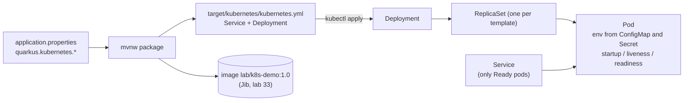

# ☸️ Lab 35 - Kubernetes and configuration

| ⏱️ Duration | 🚀 Quarkus | ☕ Java | 🧪 Type |
|---|---|---|---|
| 2 h | 3.40.1.1 LTS | 21 | B (guide: one project, `demo/`) |

## 📍 Where to run commands
Open a terminal **inside this lab's `demo/` folder** and check where you are before running anything:

```powershell
Get-Location
```

```bash
pwd
```

> [!NOTE]
> Commands are shown in PowerShell first (`.\mvnw.cmd`) and Bash second (`./mvnw`). In Git Bash, `./mvnw` may fail because of `JAVA_HOME`; use the system `mvn` instead. In PowerShell, `-Dx.y=z` arguments go in quotes.

> [!IMPORTANT]
> **You need a local Kubernetes cluster.** The guide was run on the one that comes with Docker Desktop (*Settings > Kubernetes > Enable Kubernetes*, single node, kubeadm). Check it before you start:
>
> ```powershell
> kubectl config current-context
> kubectl get nodes
> ```
>
> You should see the context `docker-desktop` and one node in `Ready`. A cluster uses about 2 GB of memory while it is on: **switch it off when you finish** (last step). Everything here lives in a namespace called `lab35` and in the image `lab/k8s-demo:1.0`; remove only those. Every `kubectl` command carries `-n lab35`, so nothing touches your other namespaces.
>
> This guide pushes no image to any registry. With a different local cluster (kind, minikube) the image you build is not visible to it by default: that cluster has its own image store, and its documentation says how to load an image.

## 🎯 Why it matters
Your service will not run on your laptop in the new job: it will run as a *pod* that somebody else's cluster starts, restarts, kills and replaces. The things that go wrong are almost never the Java code. They are the **seams**: the image the cluster cannot pull, the configuration that is not there when the container starts, the secret that exists but has the wrong key, the probe that sends traffic too early, the rollout that replaces a healthy pod with a broken one. This lab walks through those seams on purpose, one failure at a time, with the Quarkus Kubernetes extension generating the manifests for you.

## 🧠 Concepts
| Idea | In one line |
|---|---|
| **Pod** | One or more containers that run together. The unit that Kubernetes starts and kills. Pods are disposable: the name and the IP change when one is replaced |
| **Deployment** | "Keep N pods like this template running." It owns a **ReplicaSet** per version of the template and rolls from one to the next |
| **Service** | A stable name and port in front of the pods that match its *selector* **and are Ready** |
| **ConfigMap / Secret** | Configuration (and sensitive configuration) stored in the cluster, handed to a pod as environment variables or files. A Secret is encoded in base64, **not encrypted** |
| **Probes** | `startup` (has it finished starting?), `liveness` (restart it if it fails), `readiness` (send it traffic only while it passes). Quarkus gets them from SmallRye Health (lab 24) |
| **Requests and limits** | The *request* is what the scheduler reserves; the *limit* is where the container is throttled (CPU) or killed (memory). The JVM sizes its heap from the memory limit (lab 33) |
| **Quarkus Kubernetes extension** | At every `package` it writes `target/kubernetes/kubernetes.yml` from your `application.properties` (`quarkus.kubernetes.*`). It does not touch the cluster unless you ask (`quarkus.kubernetes.deploy=true`) |



## 📚 Documentation
- [Quarkus: Deploying to Kubernetes](https://quarkus.io/guides/deploying-to-kubernetes) (the extension, every `quarkus.kubernetes.*` property)
- [Quarkus: Kubernetes configuration](https://quarkus.io/guides/kubernetes-config) (Secrets and ConfigMaps as environment, or read through the API)
- [Kubernetes: Deployments](https://kubernetes.io/docs/concepts/workloads/controllers/deployment/), [ConfigMaps](https://kubernetes.io/docs/concepts/configuration/configmap/), [Secrets](https://kubernetes.io/docs/concepts/configuration/secret/) and [probes](https://kubernetes.io/docs/tasks/configure-pod-container/configure-liveness-readiness-startup-probes/)
- Labs 22 (secrets), 24 (health) and 33 (the image) are the pieces this lab puts together

## 🧭 Scenario
`demo/` is a tiny application: `GET /info` returns the message from configuration (`greeting.message`), the **length** of a token (`api.token`; the token itself is never returned), the maximum heap and the host name (inside Kubernetes: the pod). The token has **no default** in the packaged application: without `API_TOKEN` it refuses to start (lab 22). The pom already has `quarkus-kubernetes` (the manifest generator), `quarkus-smallrye-health` (the probes) and the Jib extension (the image). You will add `quarkus.kubernetes.*` lines to `src/main/resources/application.properties` one at a time, and each time the cluster will tell you what is still missing.

## ✅ Steps

### Step 1 - Build the image and read the manifest
**Goal:** know what the extension writes before it reaches a cluster.

```powershell
kubectl create namespace lab35
.\mvnw.cmd -q clean package -DskipTests "-Dquarkus.container-image.build=true"
docker images lab/k8s-demo
Get-ChildItem target\kubernetes
```

```bash
kubectl create namespace lab35
./mvnw -q clean package -DskipTests -Dquarkus.container-image.build=true
docker images lab/k8s-demo
ls target/kubernetes
```

Open `target/kubernetes/kubernetes.yml`. It has two objects, a `Service` and a `Deployment`.

- [ ] Which image name does the Deployment use? And its `imagePullPolicy`?
- [ ] Which probes are there, and which paths do they call? Who wrote those paths?
- [ ] Is there a ConfigMap, a Secret, a `resources` block?

🔮 **Predict first:** if you apply this file right now, will the pod start? If not, what status will `kubectl get pods` show?

### Step 2 - Apply it and read the failure
**Goal:** learn to ask the cluster why.

```powershell
kubectl -n lab35 apply -f target\kubernetes\kubernetes.yml
Start-Sleep 25
kubectl -n lab35 get pods
kubectl -n lab35 get events --field-selector reason=Failed
```

```bash
kubectl -n lab35 apply -f target/kubernetes/kubernetes.yml
sleep 25
kubectl -n lab35 get pods
kubectl -n lab35 get events --field-selector reason=Failed
```

- [ ] Read the message of the event. What did the cluster try to do, and where?
- [ ] Add this line to `application.properties`, build again and apply again:

```properties
quarkus.kubernetes.image-pull-policy=IfNotPresent
```

```powershell
.\mvnw.cmd -q clean package -DskipTests
kubectl -n lab35 apply -f target\kubernetes\kubernetes.yml
Start-Sleep 35
kubectl -n lab35 get pods
```

> [!WARNING]
> The image is built **again** by `package` only if you pass `-Dquarkus.container-image.build=true`; here you did not, because only the manifest changed. When the **code** changes, build the image too, or the cluster runs the old one.

### Step 3 - A pod that starts and dies
**Goal:** find out why with `logs`, not by guessing.

You now have a pod in `CrashLoopBackOff` (and the first pod, the one that never pulled, still there: the Deployment keeps it because the new one is not ready).

```powershell
$pod = kubectl -n lab35 get pods -l app.kubernetes.io/name=k8s-demo --field-selector=status.phase!=Pending -o name | Select-Object -First 1
kubectl -n lab35 logs $pod | Select-String "Failed to load config"
```

```bash
pod=$(kubectl -n lab35 get pods -l app.kubernetes.io/name=k8s-demo --field-selector=status.phase!=Pending -o name | head -1)
kubectl -n lab35 logs "$pod" | grep "Failed to load config"
```

- [ ] Which property is missing? Where in `application.properties` does it come from?
- [ ] Why does Kubernetes keep restarting a container that will never work? (`kubectl -n lab35 get pods` shows the counter and the growing wait between restarts.)

### Step 4 - ConfigMap and Secret
**Goal:** give the pod its configuration, and meet two more ways to fail.

Add to `application.properties` (the name of the ConfigMap and of the Secret are yours to choose; the manifest only *refers* to them):

```properties
quarkus.kubernetes.env.configmaps=k8s-demo-config
quarkus.kubernetes.env.secrets=k8s-demo-secret
quarkus.kubernetes.resources.requests.memory=128Mi
quarkus.kubernetes.resources.requests.cpu=100m
quarkus.kubernetes.resources.limits.memory=256Mi
```

Build and apply **before** creating them:

```powershell
.\mvnw.cmd -q clean package -DskipTests
kubectl -n lab35 apply -f target\kubernetes\kubernetes.yml
Start-Sleep 15
kubectl -n lab35 get pods
kubectl -n lab35 get events --field-selector reason=Failed | Select-String "not found"
```

🔮 **Predict first:** what is the status of the new pod? Is the application even started?

Now create the objects. The Secret has a typo in the key on purpose (`TOKEN`, not `API_TOKEN`):

```powershell
kubectl -n lab35 create configmap k8s-demo-config --from-literal=GREETING_MESSAGE="Hello from the ConfigMap"
kubectl -n lab35 create secret generic k8s-demo-secret --from-literal=TOKEN=s3cr3t-value-123
Start-Sleep 45
kubectl -n lab35 get pods
```

```bash
kubectl -n lab35 create configmap k8s-demo-config --from-literal=GREETING_MESSAGE="Hello from the ConfigMap"
kubectl -n lab35 create secret generic k8s-demo-secret --from-literal=TOKEN=s3cr3t-value-123
sleep 45
kubectl -n lab35 get pods
```

- [ ] The ConfigMap and the Secret exist now. Why is the pod still failing? (Same status as step 3: read the log again.)
- [ ] Fix the Secret (delete it, create it with `API_TOKEN`) and wait for the rollout:

```powershell
kubectl -n lab35 delete secret k8s-demo-secret
kubectl -n lab35 create secret generic k8s-demo-secret --from-literal=API_TOKEN=s3cr3t-value-123
kubectl -n lab35 rollout status deploy/k8s-demo --timeout=150s
kubectl -n lab35 get pods
```

> [!NOTE]
> You did **not** rebuild or re-apply anything: the pod that was crashing started again by itself, and this time the environment had the key. Kubernetes reads the Secret every time it starts the container.

### Step 5 - Look at it from the outside, and change the configuration
**Goal:** see what the pod sees, and what does *not* change while it runs.

```powershell
$pf = Start-Process kubectl -ArgumentList "-n","lab35","port-forward","svc/k8s-demo","18080:80" -PassThru -WindowStyle Hidden
Start-Sleep 4
curl.exe -s localhost:18080/info
```

```bash
kubectl -n lab35 port-forward svc/k8s-demo 18080:80 &
sleep 4
curl -s localhost:18080/info
```

- [ ] `message` comes from the ConfigMap, `tokenLength` from the Secret. What is `maxHeapMb`, and which limit explains it? (Lab 33, step 3.)

Change the ConfigMap, while the pod runs:

```powershell
kubectl -n lab35 create configmap k8s-demo-config --from-literal=GREETING_MESSAGE="Hello v2" --dry-run=client -o yaml | kubectl -n lab35 apply -f -
Start-Sleep 5
curl.exe -s localhost:18080/info
```

🔮 **Predict first:** which message does the application answer now? And the environment of the process (`kubectl -n lab35 exec deploy/k8s-demo -- env`)?

```powershell
kubectl -n lab35 exec deploy/k8s-demo -- env | Select-String "API_TOKEN|GREETING"
Stop-Process -Id $pf.Id
kubectl -n lab35 rollout restart deploy/k8s-demo
kubectl -n lab35 rollout status deploy/k8s-demo --timeout=120s
```

Open the port-forward again (it was tied to the old pod) and ask once more:

```powershell
$pf = Start-Process kubectl -ArgumentList "-n","lab35","port-forward","svc/k8s-demo","18080:80" -PassThru -WindowStyle Hidden
Start-Sleep 4
curl.exe -s localhost:18080/info
Stop-Process -Id $pf.Id
```

```bash
kubectl -n lab35 exec deploy/k8s-demo -- env | grep -E "API_TOKEN|GREETING"
```

In Bash, stop the background port-forward (`kill %1`) before the restart and start it again afterwards.

> [!WARNING]
> The `exec ... env` line also shows the secret **in clear text** to anyone who is allowed to exec into the pod. Who has that permission in your cluster is a security decision, not a detail.

How does the Secret look inside the cluster? Read it and decode it:

```powershell
$b64 = kubectl -n lab35 get secret k8s-demo-secret -o "jsonpath={.data.API_TOKEN}"
$b64
[Text.Encoding]::UTF8.GetString([Convert]::FromBase64String($b64))
```

```bash
kubectl -n lab35 get secret k8s-demo-secret -o jsonpath='{.data.API_TOKEN}' | base64 -d
```

### Step 6 - A rollout that must not take you down
**Goal:** see that readiness protects a healthy pod from a bad version, and how to go back.

Break the Secret (the key is now wrong) and roll the Deployment, as if a new version had a configuration mistake:

```powershell
kubectl -n lab35 delete secret k8s-demo-secret
kubectl -n lab35 create secret generic k8s-demo-secret --from-literal=OTHER=x
kubectl -n lab35 rollout restart deploy/k8s-demo
kubectl -n lab35 rollout status deploy/k8s-demo --timeout=60s
"exit code: $LASTEXITCODE"
kubectl -n lab35 get pods
```

🔮 **Predict first:** how many pods answer requests while the new one crashes? What does `rollout status` return, and after how long?

Go back and repair the Secret:

```powershell
kubectl -n lab35 rollout undo deploy/k8s-demo
kubectl -n lab35 rollout status deploy/k8s-demo --timeout=60s
kubectl -n lab35 delete secret k8s-demo-secret
kubectl -n lab35 create secret generic k8s-demo-secret --from-literal=API_TOKEN=s3cr3t-value-123
```

- [ ] Look at the strategy of the Deployment: `kubectl -n lab35 get deploy k8s-demo -o "jsonpath={.spec.strategy}"`. With one replica, what do `maxSurge` and `maxUnavailable` (25%) mean in whole pods?

### Step 7 - The manifest in Git: two traps of the generator
**Goal:** make `kubectl apply` of the same code a no-op, and a version bump safe.

**(a) A rebuild with no change.** Count the ReplicaSets (one per template), rebuild with the same code and apply:

```powershell
(kubectl -n lab35 get rs --no-headers | Measure-Object).Count
.\mvnw.cmd -q clean package -DskipTests
kubectl -n lab35 apply -f target\kubernetes\kubernetes.yml
Start-Sleep 3
(kubectl -n lab35 get rs --no-headers | Measure-Object).Count
```

🔮 **Predict first:** the code did not change. Does the count grow? Look at `app.quarkus.io/build-timestamp` in the manifest.

Switch the timestamp off, rebuild twice, apply twice, and count after each:

```properties
quarkus.kubernetes.add-build-timestamp=false
```

**(b) A new version.** Build with another application version and apply:

```powershell
.\mvnw.cmd -q clean package -DskipTests "-Dquarkus.application.version=1.0.1"
kubectl -n lab35 apply -f target\kubernetes\kubernetes.yml
kubectl -n lab35 get endpoints k8s-demo
```

🔮 **Predict first:** what does `apply` say about the Service, and about the Deployment? Does traffic still reach the pod?

Put things back (build with the default version and apply). Then fix the cause:

```properties
quarkus.kubernetes.add-version-to-label-selectors=false
```

A selector cannot be changed in an existing Deployment, so delete it once (`kubectl -n lab35 delete deployment k8s-demo`), then apply the versions `1.0.1` and `1.0.2` one after the other.

Two more tools for reviewing a change before it reaches the cluster:

```powershell
kubectl -n lab35 apply --dry-run=server -f target\kubernetes\kubernetes.yml
kubectl -n lab35 diff -f target\kubernetes\kubernetes.yml
```

### Step 8 - One command: build, image and deploy
**Goal:** the shortcut, and the trap in it.

```powershell
.\mvnw.cmd clean package -DskipTests "-Dquarkus.kubernetes.deploy=true" "-Dquarkus.kubernetes.namespace=lab35"
```

🔮 **Predict first:** the extension builds an image because you asked it to deploy. Where does it send it?

Now with the push switched off, so the image stays in your local Docker:

```powershell
.\mvnw.cmd clean package -DskipTests "-Dquarkus.kubernetes.deploy=true" "-Dquarkus.kubernetes.namespace=lab35" "-Dquarkus.container-image.push=false"
kubectl -n lab35 rollout status deploy/k8s-demo --timeout=90s
kubectl -n lab35 get pods
```

### Step 9 - Clean up
Remove only what this lab created:

```powershell
kubectl delete namespace lab35
docker rmi lab/k8s-demo:1.0
docker images lab/k8s-demo
```

```bash
kubectl delete namespace lab35
docker rmi lab/k8s-demo:1.0
docker images lab/k8s-demo
```

Then switch the cluster off if you do not use it: Docker Desktop > *Settings > Kubernetes* > untick *Enable Kubernetes* > *Apply*. Put `demo/src/main/resources/application.properties` back with `git restore` if you want to run the guide again.

## 👀 What you should see
The first failures (Steps 2 and 3):

```text
NAME                        READY   STATUS             RESTARTS   AGE
k8s-demo-785cb475f7-h9jwr   0/1     ImagePullBackOff   0          25s
```

```text
Failed to pull image "docker.io/lab/k8s-demo:1.0": Error response from daemon: pull access denied for lab/k8s-demo, repository does not exist or may require 'docker login': denied: requested access to the resource is denied
```

```text
Failed to load config value of type class java.lang.String for: api.token
```

The finished application, in the cluster:

```text
{"message":"Hello from the ConfigMap","tokenLength":16,"maxHeapMb":183,"host":"k8s-demo-5977b7cb77-7pgnh"}
```

## 💼 In real projects
- **Generate, review, commit the manifests, or use a template tool; do not hand-write YAML for a Quarkus service.** The extension is enough for one service. When you have environments with different values, teams usually move to Kustomize or Helm and keep the generated file as input, or use `quarkus.kubernetes.*` per profile (`%prod.`). Whatever you choose, the YAML that is applied must be reviewable in a pull request (see `--dry-run=server` and `diff`).
- **Never build `:latest`, never rely on a moving tag.** `IfNotPresent` is for a local cluster. In a real one the image lives in a registry (`quarkus.container-image.registry`, `push=true`), the tag is the commit or the version, and the pull policy is the default for that tag. Images are best referenced by digest (lab 33).
- **Secrets are not encrypted by being a Secret.** base64 is an encoding. What protects them is who can read them (RBAC for `get secret` and for `exec`), encryption at rest in the cluster, and an external store (Vault, a cloud secret manager, sealed or external secrets) that creates the Secret. Never commit one; this lab creates them with `kubectl` and leaves nothing in Git.
- **Environment from a ConfigMap is read at start.** A change needs a restart (`rollout restart`) or a mounted file that the application reloads. Many teams add a hash of the configuration to the pod template so that changing it triggers a rollout; with plain environment variables the rollout is yours to do.
- **Set requests and limits on every container, and think about the JVM.** Without a request the scheduler packs pods blindly; without a memory limit one pod can starve a node; a limit too close to the heap is an out-of-memory kill (exit code 137, lab 33). A CPU *limit* throttles the JVM and shows up as slow startup and latency: many teams set a CPU request and no CPU limit. Here only the memory limit is set, on purpose.
- **Probes are contracts.** `readiness` decides who gets traffic, `liveness` decides who gets restarted, `startup` protects a slow start from the liveness probe. Do not put a database or a remote dependency in the **liveness** check (a database outage would restart every pod; lab 24). The defaults generated here (a first check after 5 s, every 10 s, 3 failures) are a starting point: measure your startup.
- **Rolling updates only protect you if readiness is honest.** The bad rollout of step 6 was stopped because the new pod never became ready. Use at least two replicas in production, set `maxUnavailable: 0` if you cannot lose capacity, a `PodDisruptionBudget` for node maintenance, and a `terminationGracePeriodSeconds` longer than your slowest request (here 10 s; the application shuts down on SIGTERM, lab 33).
- **Read the status before you read the code.** `get pods` (status), `describe pod` and `get events` (what the cluster tried), `logs` (what the application said, `--previous` for the container that died). The status names are the diagnosis: `ImagePullBackOff` (the image), `CreateContainerConfigError` (a ConfigMap or Secret that does not exist), `CrashLoopBackOff` (the application starts and exits).
- **Do not deploy from a developer's laptop to production.** `quarkus.kubernetes.deploy=true` is a convenient local shortcut. The pipeline (lab 36) builds once, pushes the image, applies the manifests and waits for `rollout status`.
- **Namespaces and RBAC.** One namespace per team or environment, a service account per application with only the permissions it needs. The extension `quarkus-kubernetes-config` can read ConfigMaps and Secrets through the API instead of the environment; it needs a service account that is allowed to, which is one more thing to review.

## 🚀 Stretch goal
1. **Mount, do not inject.** Mount the ConfigMap as a file (`quarkus.kubernetes.config-map-volumes.*` and `quarkus.kubernetes.mounts.*`) and point `SMALLRYE_CONFIG_LOCATIONS` at it (lab 22 did it with a file). What changes in a running pod when you edit the ConfigMap now? How long does it take?
2. **Two replicas.** Set `quarkus.kubernetes.replicas=2` and run a loop of requests during a `rollout restart`. Do you see an error? What would make you see one (hint: the grace period and a slow request)?
3. **Probes.** Make the readiness check of lab 24 fail on purpose in a copy. Watch `kubectl get endpoints` and `get pods` while the Service loses its only endpoint. What is different from a failing liveness?
4. **A real exposure.** Add `quarkus.kubernetes.ingress.expose=true` or change the Service type, and decide what you need in the cluster for it to work.
5. **Kustomize.** Put the generated YAML in a `base/` and make an `overlay/` that changes the replicas and the ConfigMap name. `kubectl apply -k`.

## 💡 Hints
<details><summary>Step 2 (direction)</summary>

The Deployment asks the container runtime to pull `docker.io/lab/k8s-demo:1.0` every time (`Always`). Does that image exist in a public registry?
</details>

<details><summary>Step 4 (direction)</summary>

`envFrom` injects **every key** of the ConfigMap or Secret as an environment variable **with that name**. Which environment variable does `api.token=${API_TOKEN}` read?
</details>

<details><summary>Step 7 (direction)</summary>

`kubectl apply` compares the manifest with what the cluster has. Anything that differs creates a new revision; look at what the generator puts in the **pod template**, and at what the Deployment's `selector` contains.
</details>

## ✔️ Verified answers
<details><summary>Open only after finishing the steps</summary>

Everything here was run on Quarkus 3.40.1.1, Kubernetes v1.34.1 (Docker Desktop, one node) and Windows, in PowerShell. Names of pods change on every run.

**Step 1.** The image is 409 MB (the base of lab 33). `package` writes `kubernetes.yml` and `kubernetes.json`. The manifest has a `Service` (port 80 to the container's 8080, type `ClusterIP`) and a `Deployment` with `replicas: 1`; the image is `docker.io/lab/k8s-demo:1.0` with `imagePullPolicy: Always`. The `group`, `name` and `tag` you set for Jib became the image name, and the extension added `docker.io` in front. The three probes come from the health extension: `/q/health/live`, `/q/health/ready` and `/q/health/started`, all on port 8080 with `initialDelaySeconds: 5`, `periodSeconds: 10`, `timeoutSeconds: 10`, `failureThreshold: 3`. `terminationGracePeriodSeconds` is 10. There is no ConfigMap, no Secret and no `resources` block, and an annotation `app.quarkus.io/build-timestamp` in the Deployment and in the pod template. The only environment variable is `KUBERNETES_NAMESPACE`.

**Step 2.** `ImagePullBackOff`. The event: `Failed to pull image "docker.io/lab/k8s-demo:1.0": Error response from daemon: pull access denied for lab/k8s-demo, repository does not exist or may require 'docker login'`. `Always` makes the node look in the registry even when the image is in its local Docker. After `IfNotPresent` the new pod is created in `CrashLoopBackOff` (step 3) and the **first pod stays** in `ImagePullBackOff`: the Deployment does not remove the old pod until a new one is ready.

**Step 3.** The log says `Failed to load config value of type class java.lang.String for: api.token`. `api.token=${API_TOKEN}` has no default and there is no `API_TOKEN` in the container. The container exits, the kubelet restarts it with a wait that grows (the counter in `RESTARTS` goes 2, 3, 4...), hence `CrashLoopBackOff`. Restarting never fixes a configuration problem.

**Step 4.** With the ConfigMap and the Secret missing the pod is in `CreateContainerConfigError` and the application never starts: the events say `configmap "k8s-demo-config" not found` (and the same for the secret). The manifest has `envFrom` with a `secretRef` and a `configMapRef`, both `optional: false`, and a `resources` block with the requests and the memory limit (no CPU limit). With the Secret created with the key `TOKEN` the pod starts (the ConfigMap and the Secret exist) but crashes again with the log of step 3: `envFrom` made an environment variable called `TOKEN`, and the application reads `API_TOKEN`. After the Secret is recreated with `API_TOKEN`, the crashing pod started on its own at the next restart and `rollout status` ended with `successfully rolled out`; the old pod went to `Terminating`.

**Step 5.** `{"message":"Hello from the ConfigMap","tokenLength":16,"maxHeapMb":183,...}`: `s3cr3t-value-123` has 16 characters, and 183 MB is the heap of a JVM with `MaxRAMPercentage=80` under a 256 MB limit (the number of lab 33, step 3). After the ConfigMap was changed the application still answered `Hello from the ConfigMap` and `exec ... env` still showed `GREETING_MESSAGE=Hello from the ConfigMap`: the environment of a process is fixed when it starts. After `rollout restart` (a new pod, a new host name) it answered `Hello v2`. `exec ... env` printed `API_TOKEN=s3cr3t-value-123` in clear text. `get secret -o jsonpath` gives `czNjcjN0LXZhbHVlLTEyMw==`, and decoding it gives the value back.

**Step 6.** One pod, the old one, `1/1 Running` and serving, while the new one went `Error` and then `CrashLoopBackOff`. `rollout status` printed `Waiting for deployment "k8s-demo" rollout to finish: 1 old replicas are pending termination...` and, after 60 s, `error: timed out waiting for the condition` with exit code 1: a pipeline that waits for it fails, and the users never noticed. The strategy is `RollingUpdate` with `maxSurge: 25%` and `maxUnavailable: 25%`; with one replica both round to whole pods, so one extra pod may be created and the old one is not removed until the new one is ready. `rollout undo` restored the previous ReplicaSet. (The Secret is not part of the revision: you have to repair it yourself.)

**Step 7(a).** The count of ReplicaSets was 5; after a rebuild with no change and `apply`, 6: the build timestamp annotation is in the pod template, so every build is a different template and every `apply` is a rollout. With `quarkus.kubernetes.add-build-timestamp=false` the first apply still changes the template (the annotation disappears: 7), and the next rebuild and apply printed `unchanged` for both objects (still 7). The order of the labels in the generated YAML is not stable between builds (a diff of two files shows them moved), but Kubernetes compares meaning, not text. **(b)** With the version `1.0.1` the Service was `configured` and the Deployment failed: `The Deployment "k8s-demo" is invalid: spec.selector: Invalid value: {"matchLabels":{"app.kubernetes.io/name":"k8s-demo","app.kubernetes.io/version":"1.0.1"}}: field is immutable`. The Service had already taken the new selector, so `get endpoints k8s-demo` showed `<none>`: **no traffic reached the running pod** until the default version was applied again. With `add-version-to-label-selectors=false` (after deleting the Deployment once) the versions `1.0.1` and `1.0.2` both applied (`created`, then `configured`) and the rollout finished. `apply --dry-run=server` answers `configured (server dry run)` for both objects. `kubectl diff` needs a `diff` program: in PowerShell it failed with `error: failed to run "diff": executable file not found in %PATH%`; it worked in Git Bash, where it listed the changed lines (the memory limit and the version labels).

**Step 8.** The first command built an image (Jib, local) and then tried to **push** it: `Failed to authenticate with registry registry-1.docker.io/lab/k8s-demo because: 401 Unauthorized`, and the build failed. `quarkus.kubernetes.deploy=true` makes the image build and push; with `-Dquarkus.container-image.push=false` the log said `Applied: Service k8s-demo.` and `Applied: Deployment k8s-demo.`, `BUILD SUCCESS`, and the rollout finished with the new pod `1/1` (the old one `Terminating`).

**Step 9.** `kubectl delete namespace lab35` removes the Deployments, the Services, the ConfigMap and the Secret inside it.
</details>

## 🎤 Self-assessment
1. A pod is in `CreateContainerConfigError`, another in `CrashLoopBackOff`, a third in `ImagePullBackOff`. What does each tell you, and which command do you run first for each?
2. You change a ConfigMap that a pod uses as environment variables. Nothing changes in the running application. Why, and what are two ways to make it pick the change up?
3. A teammate says "our secrets are safe, they are in a Kubernetes Secret". What do you answer, and what would you check?
4. A new version of the service has a configuration mistake and crashes on start. With a Deployment of one replica, what happens to the users, and how do you know from the pipeline? What would change with two replicas and `maxUnavailable: 0`?
5. Why does applying the manifest generated from the same code twice cause a rollout (or an error) with the default settings, and what do you change? What does that have to do with the labels of the Service?

## 🔁 Retrospective
- What did I understand?
- What was hard?
- What should I reinforce?
