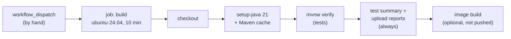

# 🤖 Lab 36 - CI with GitHub Actions

| ⏱️ Duration | 🚀 Quarkus | ☕ Java | 🧪 Type |
|---|---|---|---|
| 1.5 h | 3.40.1.1 LTS | 21 | B (guide: one project, `demo/`, and one workflow) |

## 📍 Where to run commands
Open a terminal **inside this lab's `demo/` folder** for the Maven commands, and at **the root of the repository** for the `git` and `gh` commands. Every step says which one. Check where you are before running anything:

```powershell
Get-Location
```

```bash
pwd
```

> [!NOTE]
> Commands are shown in PowerShell first (`.\mvnw.cmd`) and Bash second (`./mvnw`). In Git Bash, `./mvnw` may fail because of `JAVA_HOME`; use the system `mvn` instead. In PowerShell, `-Dx.y=z` arguments go in quotes.

> [!IMPORTANT]
> **This workflow never runs by itself.** It has only a manual trigger (`workflow_dispatch`): pushing, merging or opening a pull request starts nothing. It has one job with a 10-minute timeout, a read-only token, no secrets, and it pushes no image anywhere. You start it from the *Actions* tab or with the GitHub CLI, and you can switch it off:
>
> ```powershell
> gh workflow disable lab-36-ci.yml
> gh workflow enable lab-36-ci.yml
> ```
>
> You need the GitHub CLI (`gh`) signed in to the repository you work in (`gh auth status`) and Actions enabled there. **In a fork, Actions starts disabled**: enable it in the *Actions* tab first. Each run of this lab takes about a minute; a public repository does not pay for them, a private one uses its monthly minutes.

> [!NOTE]
> A workflow file can only live in `.github/workflows/` **at the root of the repository**, not inside the lab. This lab's file is `.github/workflows/lab-36-ci.yml`; it points at `labs/lab-36-ci/demo`. GitHub also needs a workflow to be on the **default branch** before it lets you start it.

## 🎯 Why it matters
"It passes on my machine" is not a result; "it passes on a clean machine, every time, for everybody" is. CI is that clean machine: it checks out the code, builds it from nothing and runs the tests, so a broken build, a missing file in Git or a test that only passes in your IDE is found by a robot in a minute, not by a teammate on Monday. For a Quarkus developer the interesting parts are small and specific: the Maven wrapper on Linux, the dependency cache, what is kept when the build fails, and how little permission the pipeline needs.

## 🧠 Concepts
| Idea | In one line |
|---|---|
| **Workflow** | A YAML file in `.github/workflows/`. It says *when* to run (`on:`) and *what* to run (`jobs:`) |
| **Trigger** | `push`, `pull_request`, `schedule`... or `workflow_dispatch`, a button/command that starts it by hand. This lab uses only the last |
| **Job and runner** | A job is a list of steps on one fresh virtual machine (the runner). Nothing survives between runs except what you cache or upload |
| **Action** | A reusable step (`uses: actions/checkout`). Third-party code that runs in your pipeline, so it is pinned and reviewed |
| **Cache** | Files saved under a key and restored in a later run. Here: the Maven repository (`~/.m2`), keyed by a hash of the `pom.xml` |
| **Artifact** | Files a run keeps for you to download (here: the test reports) |
| **`GITHUB_TOKEN` permissions** | What the run's token may do. Default to the least: `contents: read` |
| **Concurrency** | One group = one run at a time; a newer run can cancel the older one |



## 📚 Documentation
- [GitHub: Workflow syntax](https://docs.github.com/en/actions/writing-workflows/workflow-syntax-for-github-actions) and [events that trigger workflows](https://docs.github.com/en/actions/writing-workflows/choosing-when-your-workflow-runs/events-that-trigger-workflows)
- [GitHub: Security hardening for Actions](https://docs.github.com/en/actions/security-for-github-actions/security-guides/security-hardening-for-github-actions)
- [`actions/setup-java`](https://github.com/actions/setup-java) (the `cache` option) and [`actions/cache`](https://github.com/actions/cache)
- [GitHub CLI: `gh workflow`, `gh run`, `gh cache`](https://cli.github.com/manual/)
- [Quarkus: building applications with Maven](https://quarkus.io/guides/maven-tooling) and lab 33 for the image

## 🧭 Scenario
`demo/` is a tiny Quarkus service with three tests: two plain JUnit tests (`GreeterTest`) and one `@QuarkusTest` (`GreetingResourceTest`), plus the Jib extension from lab 33. The workflow builds and tests it on GitHub's machine. You will run it, break it on purpose in several ways on a **scratch branch** (so `main` stays clean), and read what the run tells you each time.

## ✅ Steps

### Step 1 - Green on your machine first
**Goal:** know the build passes before blaming the pipeline. Run from `demo/`.

```powershell
.\mvnw.cmd clean verify
```

```bash
./mvnw clean verify
```

- [ ] You should see `Tests run: 3, Failures: 0`.

### Step 2 - Read the workflow
**Goal:** be able to explain every line. Open `.github/workflows/lab-36-ci.yml` (at the root of the repository).

- [ ] What starts it? What does a `git push` do to it?
- [ ] What can the token do (`permissions`)? What would be the damage if one of the actions were compromised?
- [ ] Why are the actions written as a long hash with the version in a comment?
- [ ] What does `if: always()` change for the two steps that have it?
- [ ] Why is there a `cache-dependency-path`? (You will check it in Step 7.)

🔮 **Predict first:** the files of the lab were copied from another lab. Will the very first run pass? (Take a look at `git ls-files -s labs/lab-36-ci/demo/mvnw` before you answer.)

### Step 3 - A scratch branch, and the first run
**Goal:** run the pipeline without touching `main`. Run from the **root of the repository**.

```powershell
git switch -c ci-lab-scratch
git update-index --chmod=-x labs/lab-36-ci/demo/mvnw
git commit -m "scratch: mvnw not executable"
git push -u origin ci-lab-scratch
gh run list --workflow lab-36-ci.yml
```

```bash
git switch -c ci-lab-scratch
git update-index --chmod=-x labs/lab-36-ci/demo/mvnw
git commit -m "scratch: mvnw not executable"
git push -u origin ci-lab-scratch
gh run list --workflow lab-36-ci.yml
```

- [ ] The list is empty: pushing started nothing. That is the manual trigger.

Start it by hand, on your branch, and wait for it:

```powershell
gh workflow run lab-36-ci.yml --ref ci-lab-scratch
Start-Sleep 8
$id = gh run list --workflow lab-36-ci.yml --limit 1 --json databaseId --jq ".[0].databaseId"
gh run watch $id
gh run view $id --log-failed
```

```bash
gh workflow run lab-36-ci.yml --ref ci-lab-scratch
sleep 8
id=$(gh run list --workflow lab-36-ci.yml --limit 1 --json databaseId --jq '.[0].databaseId')
gh run watch "$id"
gh run view "$id" --log-failed
```

- [ ] Which step failed, with which message and exit code?
- [ ] Why did it work on your Windows machine?

> [!WARNING]
> Git stores a file mode, and a Windows checkout does not have one to lose. The fix is in Git, not in the workflow: `git update-index --chmod=+x`. (The lab checklist of this repository asks for it on every `mvnw`.)

### Step 4 - A red build: what do you get back?
**Goal:** a failing test must leave evidence. Fix the mode, break a test and run again.

```powershell
git update-index --chmod=+x labs/lab-36-ci/demo/mvnw
```

In `demo/src/test/java/lab/melostudy/GreetingResourceTest.java` change `Hello, Ana!` to `Hello, Ana?`, then:

```powershell
git commit -am "scratch: a failing test"
git push
gh workflow run lab-36-ci.yml --ref ci-lab-scratch
```

Wait for it as in Step 3 (set `$id` again to the new run), then look for the evidence:

```powershell
gh run view $id --log-failed
gh api "repos/{owner}/{repo}/actions/runs/$id/artifacts" --jq ".artifacts[] | [.name, .size_in_bytes] | @tsv"
gh cache list
```

🔮 **Predict first:** is there a test report? Did the red run leave a Maven cache for the next one?

### Step 5 - Green, cold and then warm
**Goal:** measure what the cache buys. Put the test back (`Hello, Ana!`), push, and run the workflow **twice** (wait for the first to finish before the second).

```powershell
git commit -am "scratch: fix the test"
git push
gh workflow run lab-36-ci.yml --ref ci-lab-scratch
```

For each run, read the time of every step and what the cache did:

```powershell
gh run view $id --json jobs --jq ".jobs[0].steps[] | [.name, .startedAt, .completedAt] | @tsv"
gh run view $id --log | Select-String "Cache (restored|saved)|Cache hit"
gh cache list
```

```bash
gh run view "$id" --json jobs --jq '.jobs[0].steps[] | [.name, .startedAt, .completedAt] | @tsv'
gh run view "$id" --log | grep -E "Cache (restored|saved)|Cache hit"
gh cache list
```

- [ ] How long did *Build and test* take in the first run and in the second?
- [ ] What did the first run save, and what did the second one do instead?

### Step 6 - Build the image on the runner
**Goal:** the last stage of a pipeline, without pushing anything.

```powershell
gh workflow run lab-36-ci.yml --ref ci-lab-scratch -f build-image=true
```

Read the last step of the run: the image from lab 33, built by Jib on the runner's Docker.

- [ ] The pipeline built `lab/ci-demo:1.0`. Where is that image now, and who can pull it?

### Step 7 - The cache key
**Goal:** see what a default can cost. Delete the `cache-dependency-path` line (and its comment) from the workflow **on your scratch branch**, push and run once more. Compare the key of the cache with the one of Step 5.

```powershell
gh cache list
```

🔮 **Predict first:** the code and the `pom.xml` of the lab are the same. Is the cache found?

### Step 8 - Two runs at once
**Goal:** see what `concurrency` does. Start the workflow twice, a few seconds apart, and list the runs.

```powershell
gh workflow run lab-36-ci.yml --ref ci-lab-scratch
Start-Sleep 6
gh workflow run lab-36-ci.yml --ref ci-lab-scratch
Start-Sleep 10
gh run list --workflow lab-36-ci.yml --limit 2
```

### Step 9 - Clean up
Remove only what this lab created, then go back to `main`:

```powershell
git switch main
git push origin --delete ci-lab-scratch
git branch -D ci-lab-scratch
gh cache delete --all
```

The runs stay in the *Actions* tab (the red ones too): that is the history of what you did, and it costs nothing. If you want them gone: `gh run delete <id>`.

## 👀 What you should see
The first failure (Step 3):

```text
./mvnw: Permission denied
##[error]Process completed with exit code 126.
```

The cache of a warm run (Step 5):

```text
Cache restored successfully
Cache restored from key: setup-java-Linux-x64-maven-0512d058cea5b43540e4ad81f0df27dffe27b603db6a2c14354f02b7a815ab91
Cache hit occurred on the primary key setup-java-Linux-x64-maven-0512d058cea5b43540e4ad81f0df27dffe27b603db6a2c14354f02b7a815ab91, not saving cache.
```

The image (Step 6):

```text
REPOSITORY    TAG   IMAGE ID       CREATED          SIZE
lab/ci-demo   1.0   1b13d4f09bbe   10 seconds ago   409MB
```

## 💼 In real projects
- **Run on pull requests and on the main branch, and make the check mandatory.** This lab is manual on purpose (it is a study repository). A team uses `pull_request` and `push` on the main branch, and a branch protection rule that requires the check before merging; a CI nobody has to obey is a suggestion.
- **Least privilege.** `permissions: contents: read` at the top of the file, widened per job only where needed (`packages: write` to publish an image, `id-token: write` to log in to a cloud without a stored key). `persist-credentials: false` on checkout keeps the token out of the `.git` config that later steps can read.
- **Third-party actions are code that runs with your token.** Pin them to a commit (as here) and let a bot (Dependabot supports `github-actions`) propose updates; prefer actions from `actions/*` or from vendors you already trust. Never `uses:` something because a blog post did.
- **Secrets.** Store them as repository or environment secrets, never in the YAML or the image (lab 22, lab 33). A workflow that runs for a pull request from a **fork** does not get your secrets, by design: do not "fix" that with `pull_request_target` unless you understand that it runs with the base repository's permissions on code you did not write.
- **Publish from one place only.** Build and test on every pull request; push the image from the main branch (or a tag) with a tag that is the commit or the version, and deploy through an *environment* with a required approval. A pipeline that pushes `:latest` from every branch is how an experiment reaches production.
- **Cache dependencies, not results.** The Maven repository is safe to cache because Maven checks what it uses. Caching `target/` hides stale-class bugs (lab 12). Remember that a failed job saves nothing: the first green run pays for the download.
- **Be explicit about the machine.** A fixed runner image (`ubuntu-24.04`) and a fixed Java version, as here; `ubuntu-latest` moves on a date you do not choose (the log of this lab's runs carried that warning). A matrix of Java versions or operating systems is cheap to add and worth it only for a library, not for a service that runs on one.
- **Keep the pipeline fast and cheap.** One job unless you need more, a `timeout-minutes` so that a hung test does not burn your hours, `concurrency` so that old runs of a branch are cancelled, `paths:` filters in a monorepo (this repository has 36 labs). Slow tests belong in a second job that runs on the main branch only.
- **Keep the evidence.** Upload test reports with `if: always()` (as here), put the one-line result in the job summary, and keep artifacts only a few days. For flaky tests, fix them: retrying until green teaches the team to ignore red.
- **A pipeline is code.** Review it like code, run the same commands locally (`./mvnw verify` is the whole pipeline here), and avoid logic that only exists in the YAML.

## 🚀 Stretch goal
1. **A second job.** Split the image build into its own job that `needs:` the first one and only runs when `inputs.build-image` is true. What do you lose (the checkout, the Maven cache) and how do you get it back (artifact of the jar)?
2. **A matrix.** Run the tests on Java 21 and on the next LTS. Which line of the workflow becomes `${{ matrix.java }}`? How does the cache key change?
3. **The same pipeline on a pull request** with a `paths:` filter for this lab only. What would you have to add so the check can be required, and what does it cost on a repository with 36 labs?
4. **Publish for real (in a private fork).** Give one job `packages: write`, log in to `ghcr.io` with `GITHUB_TOKEN` and push on the main branch only. Where does the image appear, and who can pull it?
5. **Run it locally.** Look at `act`, which runs workflows in containers. What of this lab works there, and what cannot (the cache, the token, the runner image)?

## 💡 Hints
<details><summary>Step 3 (direction)</summary>

`git ls-files -s <file>` shows the mode Git stored: `100755` is executable, `100644` is not. A runner is a Linux machine that executes `./mvnw` directly.
</details>

<details><summary>Step 4 (direction)</summary>

Which step comes after the failing one, and which condition makes it run anyway? The post-job step of `setup-java` is what saves the cache: look at what it logs.
</details>

<details><summary>Step 7 (direction)</summary>

`setup-java` hashes the files that match a glob to make the key. The default glob is `**/pom.xml`. How many `pom.xml` files does the checkout of this repository contain?
</details>

## ✔️ Verified answers
<details><summary>Open only after finishing the steps</summary>

Everything here was run on GitHub Actions (runner image `ubuntu-24.04`, Temurin 21.0.13, `actions/checkout` v7.0.1, `actions/setup-java` v6.1.0, `actions/upload-artifact` v7.0.2) from a scratch branch of this repository, with the workflow started by hand. Times are from one day and will change.

**Step 2.** The very first run fails: the `mvnw` of the lab was committed with mode `100644` (Windows has no executable bit; the files copied from the previous lab had it, the new ones had not). Only `workflow_dispatch` starts the workflow, so a push does nothing; the token is `contents: read`; the actions are pinned to a commit hash with the version in a comment, because a tag can be moved and a commit cannot. `if: always()` makes the summary and the upload run after a failed test step (without it they are skipped).

**Step 3.** After the push `gh run list --workflow lab-36-ci.yml` printed nothing: no run was started. The run failed in 17 seconds in *Build and test*: `./mvnw: Permission denied` and `Process completed with exit code 126` (126 is the shell's "found but cannot execute"). It works on Windows because Windows has no executable bit, so nothing checks it; Git recorded `100644` and the Linux runner honours it. `git update-index --chmod=+x` fixes it.

**Step 4.** With a failing test the job ended in 50 seconds with `Tests run: 3, Failures: 1`, `BUILD FAILURE` and `exit code 1`. The artifact `surefire-reports` (12.5 kB) was uploaded anyway and the summary listed the test lines, because both steps have `if: always()`. **`gh cache list` was empty**: the run had downloaded the dependencies and the failed job saved nothing; the post step of `setup-java` only printed `Post job cleanup.`

**Step 5.** First green run (no cache): 56 seconds in all, *Build and test* 40 s, and the post step of `setup-java` took 4 s to save: `Cache saved with the key: setup-java-Linux-x64-maven-0512d058...`. There are **two** caches: the Maven repository (75.94 MiB) and the Maven wrapper (8.70 MiB). Second run: 50 seconds in all, *Build and test* 30 s, `Cache restored successfully` twice and `Cache hit occurred on the primary key ..., not saving cache.` for each. The cache saved 10 seconds of 40 in *Build and test*; the rest is the build and the tests themselves, which no cache removes.

**Step 6.** With `-f build-image=true` the run took 54 seconds and the log said `Starting (local) container image build for jar using jib.`, `Created container image lab/ci-demo:1.0 (sha256:8df6045c...)` and `docker image ls` showed `lab/ci-demo 1.0 ... 409MB`. The image exists only on the runner's disk and disappears with the machine when the job ends: nothing was pushed (`quarkus.container-image.push=false`). Pushing needs a registry, a login and `packages: write`; none is configured here.

**Step 7.** Without `cache-dependency-path` the key became `setup-java-Linux-x64-maven-f4dd4cef...` instead of `...0512d058...`, the log said `maven cache is not found` and the run saved another 75.94 MiB. The default hashes every `pom.xml` of the checkout, which in this repository is the pom of every lab: any change in any other lab would change the key and start a cold build. (The wrapper cache was still found, since its key does not depend on the poms.)

**Step 8.** The second dispatch put the first run in `cancelled` while it was running and the second one finished normally.

**Disabling.** After `gh workflow disable lab-36-ci.yml`, trying to start it answered `could not create workflow dispatch event: HTTP 422: Cannot trigger a 'workflow_dispatch' on a disabled workflow`.

**Runner label.** A run on `ubuntu-latest` carried the annotation `The ubuntu-latest label will migrate to Ubuntu 26 beginning October 19, 2026`; the workflow uses `ubuntu-24.04`. `setup-java` also sets `MAVEN_ARGS=-ntp` by itself, so the `-ntp` in the command is redundant (it is there so that the command is the same as the one you would write by hand).
</details>

## 🎤 Self-assessment
1. A build passes on every developer's machine and fails on the runner with `Permission denied` for the Maven wrapper. What is wrong, where is the fix, and why did nobody see it before?
2. Why does the workflow ask only for `contents: read`, pin its actions to a commit and set `persist-credentials: false`? What is the attack each one reduces?
3. Your first build after a test failure is as slow as a build with no cache at all. Why, and what would you change (if anything)?
4. Someone says "cache `target/` as well, it will be faster". What do you answer?
5. A pull request from a fork needs to run the tests. What can its workflow not do, why is that a good thing, and how do you publish an image only from the main branch?

## 🔁 Retrospective
- What did I understand?
- What was hard?
- What should I reinforce?
