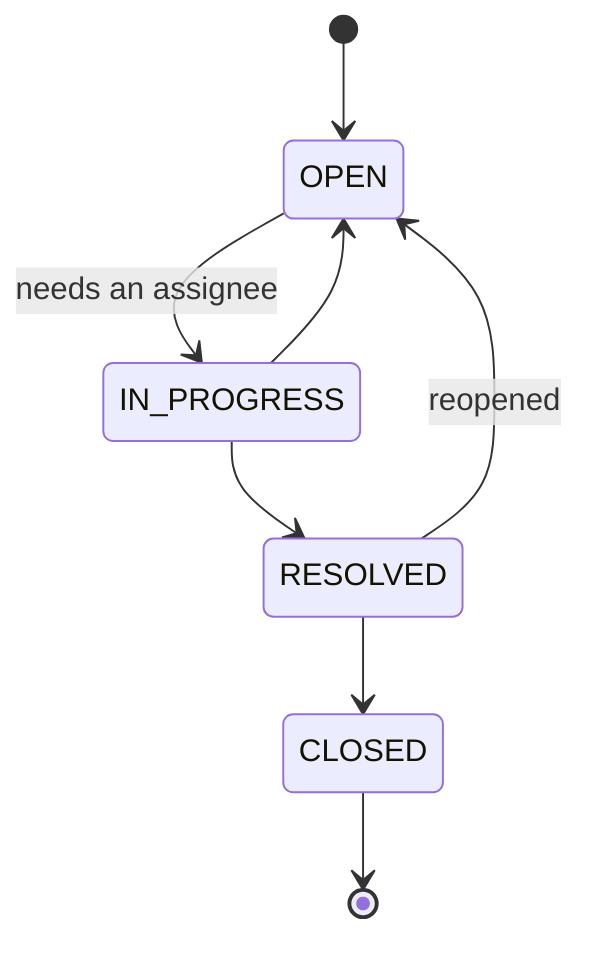

# 🧩 Project 1 - Issue tracker

| ⏱️ Review time | 🚀 Quarkus | ☕ Java | 🧪 Type |
|---|---|---|---|
| 1-2 h reading and poking | 3.40.1.1 LTS | 21 | Project (finished showcase, guided review) |

## 📍 Where to run commands
Open a terminal **inside this project's `app/` folder** and check where you are:

```powershell
Get-Location
```

```bash
pwd
```

> [!NOTE]
> Commands are shown in PowerShell first (`.\mvnw.cmd`) and Bash second (`./mvnw`). Docker must be running: tests and dev mode start a throwaway PostgreSQL (Dev Services, lab 08).

## 🎯 What this is
Block 5 closes with a small, complete service built the way a team would: **a finished application you read, run and challenge**, not an exercise. There is no starter and no TODO. Everything uses what blocks 1-5 taught (REST, validation and the error contract, Panache, relationships, transactions, Flyway, DTOs, HTTP preconditions, JSON strictness, tests).

Read [REVIEW.md](REVIEW.md) next: it is the guided tour (reading order, the reason behind each decision, the traps found while building it, and experiments to break it on purpose).

## 🧭 The domain
A mini issue tracker. A **project** has a code (`TRK`). Its **issues** are numbered per project (`TRK-1`, `TRK-2`...), move through a life cycle, can be discussed in **comments**, and every real change leaves a line in the issue **history**.



## 📜 Specification

### Endpoints
| Method and path | What it does | Success |
|---|---|---|
| `POST /api/projects` | Create a project (`code`: 2-5 capital letters, `name`) | 201 + `Location` |
| `GET /api/projects` | List projects, ordered by code | 200 |
| `GET /api/projects/{code}` | One project | 200 |
| `GET /api/projects/{code}/summary` | Issues by status, and open work by priority (zeros included) | 200 |
| `POST /api/projects/{code}/issues` | Open an issue (`title`, `type`, optional `description`, `priority`, `labels`) | 201 + `Location` + `ETag` |
| `GET /api/issues` | Search: `project`, `status`, `assignee`, `priority`, `label`, `text`, `sort`, `page`, `size` | 200 + `X-Total-Count` |
| `GET /api/issues/{key}` | One issue; honors `If-None-Match` | 200 / 304 + `ETag` |
| `PUT /api/issues/{key}` | Replace the editable part; **requires** `If-Match` | 200 + new `ETag` |
| `POST /api/issues/{key}/transitions` | Move the status (`{"to": "..."}`); **requires** `If-Match` | 200 + new `ETag` |
| `POST /api/issues/{key}/comments` | Add a comment (`author`, `body`) | 201 |
| `GET /api/issues/{key}/comments` | Comments, oldest first | 200 |
| `GET /api/issues/{key}/history` | Audit trail, oldest first | 200 |

### Rules
1. **Keys:** issue numbers start at 1 per project and never repeat, even under simultaneous requests. A key that cannot exist (`abc`, `TRK-0`) is a 404.
2. **Defaults and ownership:** a new issue is `OPEN`, priority `MEDIUM`. The client cannot send `status`, `version`, `key` or any other field the contract does not list (400).
3. **Life cycle:** only the moves in the diagram. Starting work (`IN_PROGRESS`) needs an assignee, and the assignee cannot be removed while the issue is in progress.
4. **Closed is final and read-only:** no edit (409 `ISSUE_CLOSED`), no comment (409 `ISSUE_CLOSED`), no transition (409 `INVALID_TRANSITION`).
5. **Concurrency:** the `ETag` of an issue is its version. `PUT` and transitions need `If-Match`: missing is 428, stale or unparseable is 412. Two writers with the same ETag: exactly one wins.
6. **`PUT` replaces:** what is absent (`description`, `assignee`, `labels`) is cleared. Status is not editable there.
7. **No-ops are free:** sending the same values again changes nothing (same version, same `updatedAt`, no history line).
8. **History:** one line per real change (creation, status, assignee, priority), written in the same transaction as the change. A refused request leaves no line.
9. **Order of checks:** exists (404) -> version (428/412) -> state (409). A stale client learns "reload" before anything else.
10. **Search:** every filter is optional and they combine; `text` is a case-insensitive substring of title or description (`%` and `_` mean themselves); `sort` is one of `created`, `updated`, `priority` (prefix `-` for descending; default `-created`; priority sorts by importance, not alphabetically); `size` 1-100 (default 20), `page` from 0. A value that makes no sense (`?status=DONE`, `?page=abc`) is a 400 that names the parameter.

### Error contract
Every failure has the same shape: `{"code": "...", "message": "...", "errors": [{"field", "message"}], "errorId": "..."}` (empty parts are omitted).

| Status | `code` | When |
|---|---|---|
| 400 | `VALIDATION_ERROR` | a field breaks a rule (`errors` lists them) |
| 400 | `MALFORMED_REQUEST` | broken JSON, unknown field, unknown enum value |
| 404 | `NOT_FOUND` | unknown project or issue, unknown route |
| 409 | `DUPLICATE_PROJECT`, `INVALID_TRANSITION`, `ASSIGNEE_REQUIRED`, `ISSUE_CLOSED` | the state of the world does not allow it |
| 412 / 428 | `PRECONDITION_FAILED` / `PRECONDITION_REQUIRED` | `If-Match` stale / missing |
| 405, 415 | `HTTP_405`, `HTTP_415` | wrong method / content type |
| 500 | `INTERNAL_ERROR` | a bug: generic body with an `errorId` that is also in the log |

## ▶️ Run it

Tests (72; the first run also downloads the PostgreSQL image):

```powershell
.\mvnw.cmd test
```

```bash
./mvnw test
```

Dev mode (live reload, sample data, Swagger UI at `http://localhost:8080/q/swagger-ui/`):

```powershell
.\mvnw.cmd quarkus:dev
```

```bash
./mvnw quarkus:dev
```

You should see Flyway apply `V1`, `V2` and the repeatable `dev sample data`, and `GET http://localhost:8080/api/issues` returns the four sample issues of project `TRK`.

Packaged jar against your own PostgreSQL (the credentials below are placeholders for a local throwaway database):

```powershell
.\mvnw.cmd package
$env:QUARKUS_DATASOURCE_JDBC_URL = "jdbc:postgresql://localhost:5432/tracker"
$env:QUARKUS_DATASOURCE_USERNAME = "tracker"
$env:QUARKUS_DATASOURCE_PASSWORD = "<your password>"
java -jar target\quarkus-app\quarkus-run.jar
```

```bash
./mvnw package
QUARKUS_DATASOURCE_JDBC_URL=jdbc:postgresql://localhost:5432/tracker \
QUARKUS_DATASOURCE_USERNAME=tracker QUARKUS_DATASOURCE_PASSWORD='<your password>' \
java -jar target/quarkus-app/quarkus-run.jar
```

A quick tour with `curl.exe` (in PowerShell 5.1 send JSON from a file, because inline quotes get lost). In dev mode project `TRK` already exists; against an empty database create it first with `POST /api/projects` and `{"code":"TRK","name":"Tracker"}`.

```powershell
Set-Content issue.json '{"title":"First issue","type":"BUG","labels":["demo"]}' -Encoding ascii
curl.exe -i -X POST -H "Content-Type: application/json" --data-binary "@issue.json" http://localhost:8080/api/projects/TRK/issues
curl.exe -i http://localhost:8080/api/issues
```

## 🧱 Stack
`quarkus-rest` + `quarkus-rest-jackson`, `quarkus-hibernate-orm-panache`, `quarkus-jdbc-postgresql`, `quarkus-flyway`, `quarkus-hibernate-validator`, `quarkus-smallrye-openapi`. All managed by the Quarkus BOM: **no library outside it** (mapping between entities and DTOs is written by hand, see the review).

## ✅ Definition of done of this project
`labs/verify.ps1 -Lab project-1-issue-tracker` runs the 72 tests and they are all green. There is no red variant: a showcase is meant to work.
