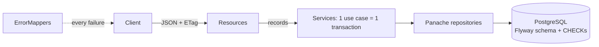

# 🔍 Project 1 - Guided review

This is the tour I would give a teammate who has to take over the service. Read it with the code open. Everything marked **verified** was reproduced by running it on Quarkus 3.40.1.1 (the experiments are in "Break it yourself").

> [!NOTE]
> Paths are relative to `app/src/main`. The package is `lab.tracker`.

## 🗺️ How to read it (about 90 minutes)

| Step | Open | Look for |
|---|---|---|
| 1 | `resources/db/migration/V1__core_schema.sql`, `V2__...sql` | What the **database** guarantees by itself |
| 2 | `Issue.java`, `Project.java`, `IssueEvent.java` | The mapping; `@Version`; the lazy collection and its batch size |
| 3 | `CreateIssueRequest.java`, `UpdateIssueRequest.java`, `IssueResponse.java` | The contract is not the entity |
| 4 | `Status.java`, `IssueKey.java` | Rules that are pure functions |
| 5 | `IssueService.java` | One transaction per use case, and the order of checks |
| 6 | `IssueRepository.java` | A dynamic query that stays safe |
| 7 | `IssueResource.java`, `ProjectResource.java` | A thin HTTP layer; ETag and `If-Match` |
| 8 | `ErrorMappers.java`, `TrackerException.java` | One error shape for everything |
| 9 | `app/src/test/...` (start with `LifecycleTest`, `ConcurrencyTest`) | What is tested and with which tool |

## 🧠 Decisions and why

| Decision | The alternative | Why this one | From |
|---|---|---|---|
| The schema is **Flyway** in every profile; Hibernate only `validate`s | Let Hibernate generate it in dev and test | Dev, tests and production run the same SQL; a drift fails at startup | lab 11 |
| CHECKs, UNIQUE and `NOT NULL` **also in the database** (priority values, `IN_PROGRESS` needs an assignee, `(project, number)` unique) | Trust the API validation only | The API is not the only door to the data (scripts, other services, bugs). `MigrationsTest` bypasses the API on purpose | lab 11 |
| V2 **adds** labels and indexes instead of editing V1 | Edit V1 while nobody has deployed | An applied migration must never change (Flyway checks its checksum). The habit matters more than the moment | lab 11 |
| Records as request and response; the entity never leaves the service | Return the entity | The client cannot choose `status` or `version`, lazy data cannot leak, the schema can change without breaking the API | lab 12 |
| **Hand-written mapping** (`IssueResponse.from`), no MapStruct | MapStruct | Six tiny mappings do not justify a dependency outside the BOM. At 30+ mappings, switch (lab 12 shows how) | lab 12 |
| `quarkus.jackson.fail-on-unknown-properties=true` | Ignore what is unknown | A misspelled field is a client bug that should be reported; it also blocks mass-assignment of `status` | lab 14 |
| ETag = the `@Version`; `PUT` and transitions **require** `If-Match` | Last write wins | Two people editing the same issue must not overwrite each other silently | lab 15 |
| `lockByCode` (`SELECT ... FOR UPDATE` on the project row) to hand out numbers | `max(number) + 1`; a global sequence | `max + 1` races. A sequence has gaps and is global. The lock serializes only creators of the same project. `UNIQUE (project_id, number)` is the safety net | lab 10 |
| `issues.flush()` **inside** the service method | Let the commit flush | The optimistic-lock failure surfaces where we can map it to 412 (see experiment B) | lab 10 |
| Status rules in an **enum** (`Status.next()`) | A rules table in the database | A pure function is unit-tested in milliseconds (`DomainRulesTest`) and read in ten seconds | - |
| Domain failures as one unchecked `TrackerException(status, code)` | One exception class per case | One mapper, no `throws` noise, and unchecked exceptions roll the transaction back | lab 10 |
| Enums and numbers in the **query string** arrive as validated text | `@RestQuery Status status` | JAX-RS answers **404** when it cannot convert a query parameter (verified: `?status=DONE` gives `NOT_FOUND`). A 400 naming the parameter is the honest answer | lab 05 |
| Sort from a **whitelist** mapped to fixed `ORDER BY` fragments; values only as named parameters | Build the query with the client's text | Injection-proof, and `priority` can sort by importance instead of alphabetically | lab 10 |
| `@BatchSize(50)` on the labels | `join fetch` the collection | A collection join fetch cannot be paged in the database. See experiment C | lab 09 |
| One `X-Total-Count` header, offset paging | A wrapper object, cursors | Simple and enough here. Cursors matter when pages are deep or data changes under the reader | lab 04 |

## 🪤 Traps I hit while building it

> [!WARNING]
> Each of these was a real failure in this project, not a hypothetical.

1. **`PUT` replaces.** My own test helper "assigned" an issue with a `PUT` that omitted `description` and `labels`, and silently erased them; four search tests failed for that reason. The API is correct (rule 6 of the spec) and the helper now sends the current values. A client of this API has the same problem: read, modify, send back everything.
2. **Query parameters that cannot be converted give 404**, not 400 (decision table above).
3. **A double-encoded `%25`.** RestAssured encodes the URL again, so `?text=%25` searched for the three characters `%25`. The search test turns encoding off and writes the query already encoded.
4. **Alphabetical priority.** Stored as text, `CRITICAL < HIGH < LOW < MEDIUM`. Experiment D shows what the wrong order looks like.
5. **My N+1 test proved nothing at first.** With 15 issues it stayed green even without `@BatchSize`, because Quarkus already batches lazy loading by default. The test now uses 40 issues, where the annotation makes the difference (experiment C).
6. **A no-op `PUT` that bumps the version.** Clearing and re-adding the same labels marks the collection as dirty, so the version moved from 1 to 2 (experiment E). The service compares first and touches the collection only when it really changed.

## 💥 Break it yourself

Copy the project to a scratch folder (never edit it in place), change one thing, run **the named test**, and read the failure. Then undo. Results are what I got.

| # | Change | Run | What happened (verified) |
|---|---|---|---|
| A | In `IssueService.create`, use `projects.findByCode` instead of `lockByCode` | `ConcurrencyTest#twentySimultaneousIssuesGetTwentyConsecutiveDistinctNumbers` | Red: a request answers **500** instead of 201. Two requests read the same `nextNumber`; the log shows `duplicate key value violates unique constraint "issue_project_id_number_key"`, the `UNIQUE (project_id, number)` of V1 stopping the second one |
| B | Remove `issues.flush()` in `IssueService.flushed` | `ConcurrencyTest#sixWritersWithTheSameEtagAndExactlyOneWins` | Red: statuses `[412, 200, 412, 412, 412, 500]`. The loser of the race gets a **500**, because the lock failure arrives at the commit, wrapped, where no mapper expects it |
| C | Delete `@BatchSize(size = 50)` from `Issue.labels` | `SearchTest#aPageOfIssuesDoesNotCostOneQueryPerIssue` | Red: **5** statements for 40 issues (Quarkus' default batching). With `@BatchSize(size = 1)`: **42** |
| D | In `IssueRepository`, sort `priority` by `i.priority` | `SearchTest#priorityIsSortedByImportanceNotAlphabetically` | Red: `sort=-priority` returns `MEDIUM, LOW, HIGH, CRITICAL` |
| E | In `IssueService.update`, replace the labels comparison with `if (true)` | `PreconditionsTest#sendingTheSameValuesAgainChangesNothing` | Red: the `ETag` is `"2"` instead of `"1"` after a `PUT` with the same values |

Also try without a copy: send `PUT /api/issues/TRK-1` from Swagger UI without `If-Match` (428), with `"9"` (412), then `GET` and use the `ETag` you get (200).

## 🚧 What this service does not have (on purpose)

| Missing | Why | Where it comes |
|---|---|---|
| Authentication, roles, who is the `author` of a comment | `author` is free text today; trusting it is not acceptable in production | block 6 (labs 19-22) |
| Health, metrics, structured logs, tracing | Nothing tells an operator what is happening | block 7 (labs 24-25) |
| Retries, timeouts on remote calls | There are no remote calls here | lab 23 and P2 |
| Container image, CI, Kubernetes manifests | Only the jar is checked | block 9 (labs 33-36) |
| Delete, archive, soft delete | Out of scope; closed issues stay forever | a product decision, not a technical one |
| Rate limits, request size limits tuned for production | Defaults only | gateway or lab 15 settings |
| Pagination by cursor, full-text search | `locate()` is a scan; fine for thousands of rows, not millions | when the data says so (`pg_trgm` or a search engine) |
| Dev Services pinned to an image | In dev and test Quarkus chooses the image (it started `postgres:18`); production should match what runs in production | lab 17 shows how to pin it |

**Observed in the packaged jar:** Swagger UI is **not** served (404) but the OpenAPI document at `/q/openapi` is (200). Decide on purpose whether your production API publishes its contract. The sample data of dev mode is not loaded: the `db/dev` location only exists in the `%dev` profile.

## 🧪 How the tests are built

| Class | Tool | What it protects |
|---|---|---|
| `DomainRulesTest` | plain JUnit, no Quarkus (milliseconds) | the state machine, key parsing |
| `ProjectApiTest`, `IssueCreationTest`, `LifecycleTest`, `PreconditionsTest`, `HistoryTest`, `SearchTest`, `CommentsAndSummaryTest`, `ErrorContractTest` | `@QuarkusTest` + RestAssured, raw JSON strings | the behavior of the spec, as a client sees it |
| `ConcurrencyTest` | threads + `CountDownLatch`, exact counts | numbering and optimistic locking under real races (ran 5 times in a row, green every time) |
| `MigrationsTest` | injected `Flyway` + raw SQL | the database defends itself without the API |

Conventions worth copying: every test starts from a clean database (`TestData.reset`); every negative test first proves the **valid** request works; nothing compares message text (only status, `code` and field names); the tests never import production DTOs, so you can rewrite the internals and keep them.

## ❓ Questions to challenge me (bring them to the feedback session)
1. Why does `GET` not need a lock but `create` does?
2. If two people comment at the same time, can anything go wrong? What would you test?
3. The history is written by the service. What changes if a second service also updates `issue` rows? (Triggers, outbox, event sourcing: when would each win?)
4. `PUT` clears what is absent. Would `PATCH` be better here? What does the client have to know in each case?
5. `locate()` search scans the table. At what size does it become a problem, and what is the first thing you would measure?
6. Which of the 72 tests would you delete first if the suite became too slow, and which never?
7. What breaks if the migrations run from two application instances at the same time?
8. Is the error `code` `NOT_FOUND` for an unknown **route** the same thing as for an unknown **issue**? Should it be?
