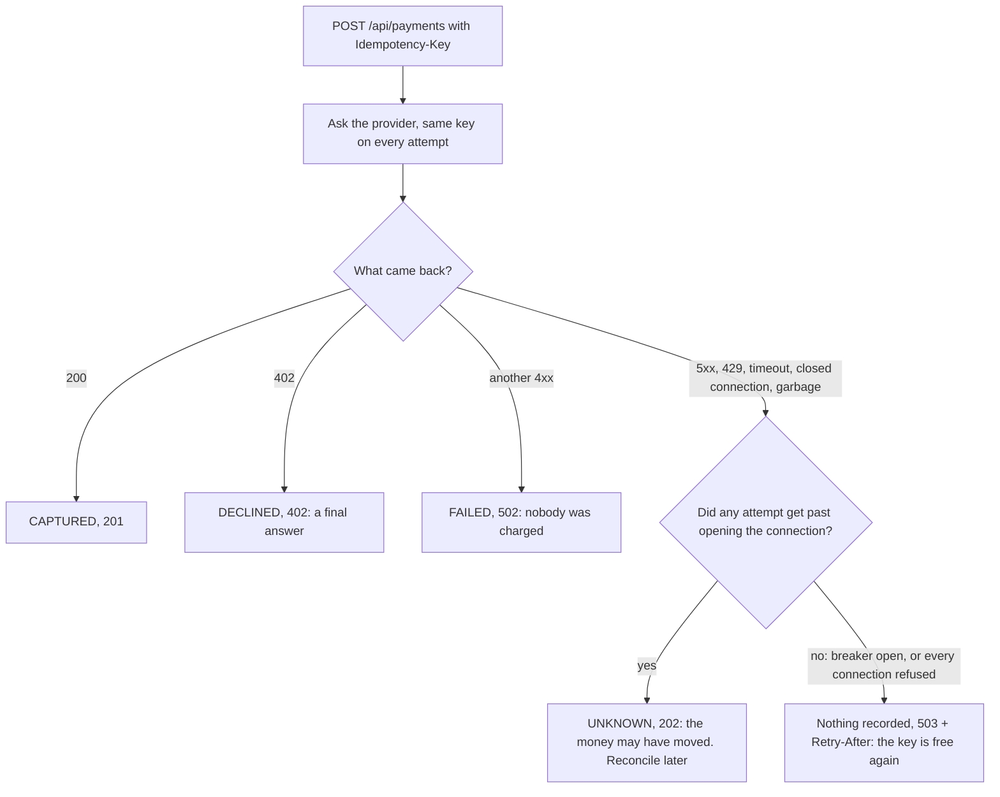
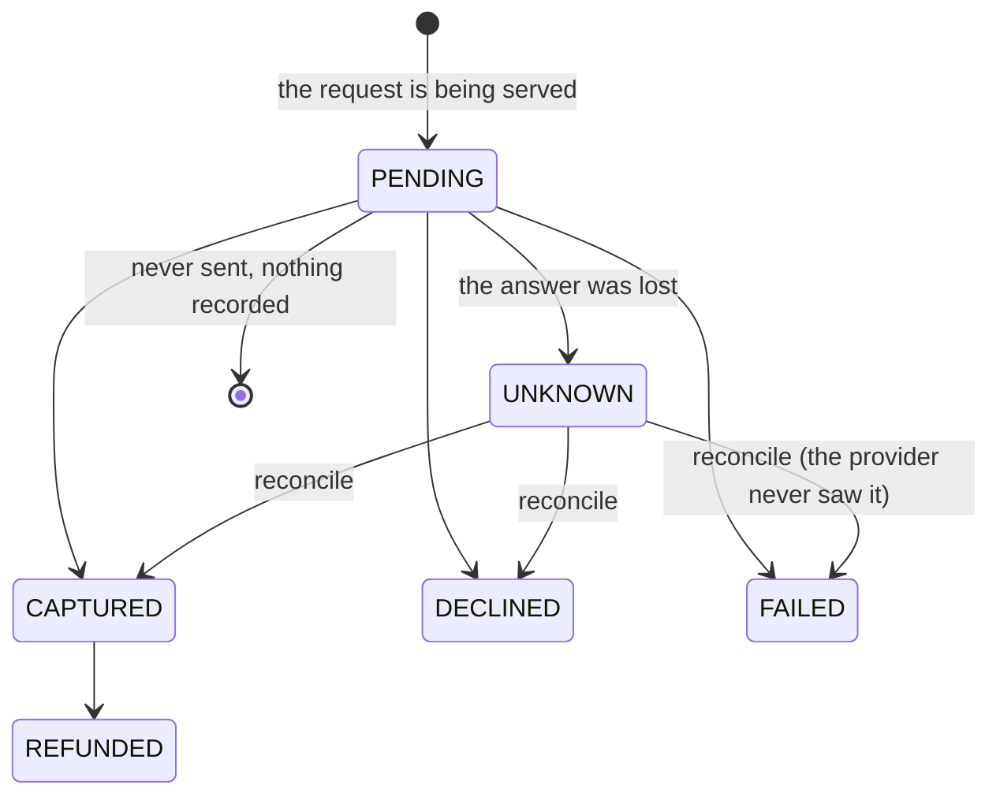

# 🧩 Project 2 - Payments gateway

| ⏱️ Review time | 🚀 Quarkus | ☕ Java | 🧪 Type |
|---|---|---|---|
| 1-2 h reading and poking | 3.40.1.1 LTS | 21 | Project (finished showcase, guided review) |

## 📍 Where to run commands
Open a terminal **inside this project's `app/` folder** to run the tests, and in the **project folder** (`project-2-payments-gateway/`, the one that holds `app/` and `tools/`) for the tour with `curl`. Check where you are:

```powershell
Get-Location
```

```bash
pwd
```

> [!NOTE]
> Commands are shown in PowerShell first (`.\mvnw.cmd`) and Bash second (`./mvnw`). **No Docker is needed**: the card provider is a fake that runs from one Java file, and the tests start their own copy.

## 🎯 What this is
Block 7 closes with a small, complete service built the way a team would: **a finished application you read, run and challenge**, not an exercise. There is no starter and no TODO. It puts together what blocks 6 and 7 taught (authentication and roles, JWT, secrets, fault tolerance, health, metrics, structured logs, correlation ids and traces) on top of the REST, validation and error-contract habits of the earlier blocks.

Read [REVIEW.md](REVIEW.md) next: it is the guided tour (reading order, the reason behind each decision, the traps found while building it, and experiments to break it on purpose).

## 🧭 The domain
A **payments gateway**. A customer pays with a card **token** (the provider's own form produced it; the card number never reaches us). The gateway asks an external **card provider** to charge it and tells the customer what happened. Finance can **reconcile** a payment whose outcome was lost and **refund** a captured one.

The whole project is about one question, asked after every failure: **can the customer's money have moved?**





## 📜 Specification

### Endpoints
| Method and path | Who | What it does | Success |
|---|---|---|---|
| `POST /api/payments` | `customer` | Create a payment: `amount`, `currency`, `cardToken`, optional `description`. **Requires** the header `Idempotency-Key` | 201 / 202 (see the outcomes below) |
| `GET /api/payments/{id}` | `customer` (own), `finance` (any) | One payment | 200 |
| `GET /api/payments?status=` | `customer` (own), `finance` (all) | List, newest first; `status` is optional | 200 |
| `POST /api/payments/{id}/reconcile` | `finance` | Ask the provider what it did with an `UNKNOWN` payment | 200 |
| `POST /api/payments/{id}/refund` | `finance` | Give back a `CAPTURED` payment | 200 |

Operations (management port 9000, never the public one): `GET /q/health/live`, `/q/health/ready`, `/q/metrics`.

### Rules
1. **Identity comes from the token, never from the body.** The token must be signed by the issuer's key, have the right issuer and audience and not be expired. The roles are `customer` and `finance`. A field the contract does not list (such as `customer`) is a 400, not an ignored field.
2. **Closed by default.** An endpoint nobody annotated answers 403 (401 without a token). Security is checked before the body is looked at: an invalid body from somebody who may not call is a 401 or 403, never a 400.
3. **Somebody else's payment does not exist.** A customer asking for another customer's payment gets the same 404 as for an id that never existed. Lists hold only what the caller may see.
4. **The idempotency key** is 1-64 characters from `A-Z a-z 0-9 . _ -`, chosen by the client and scoped to the customer. The same key with the **same content** returns the same payment (same status, same body, plus `Idempotent-Replayed: true`) and the provider is not asked again. The same key with **different content** is a 422 `IDEMPOTENCY_KEY_REUSED`. A second request that arrives while the first is still being processed is a 409 `REQUEST_IN_PROGRESS` with `Retry-After: 1`. Ten identical simultaneous requests charge once.
5. **Content:** `amount` 1 to 10,000,000 (minor units, cents); `currency` `EUR`, `USD` or `PEN`; `cardToken` `tok_` followed by 8-64 letters or digits (a raw card number is refused, and never repeated in the answer or in any log); `description` at most 140 characters.
6. **The outcome of a payment request:**

| Outcome | Status | Body | Recorded as |
|---|---|---|---|
| The provider charged the card | 201 + `Location` | the payment | `CAPTURED` |
| The provider declined | 402 | error `CARD_DECLINED` with `paymentId` | `DECLINED` |
| The provider refused our request (bad credentials, bad contract) | 502 | error `PROVIDER_REJECTED` with `paymentId` | `FAILED` |
| We asked and lost the answer | **202** + `Location` | the payment | `UNKNOWN` |
| We never got to ask (breaker open, or every connection refused) | 503 + `Retry-After: 10` | error `PROVIDER_UNAVAILABLE` | nothing: the key is free again |

7. **Can the money have moved?** After a failure the answer is "no" only when no attempt got past opening the connection (or none was made). Anything else is `UNKNOWN`, and `UNKNOWN` is a 202, never a 5xx: a client that sees a 5xx pays again with a new key. A customer who repeats the **same** key gets the same `UNKNOWN` payment, and later the settled one.
8. **Retries are safe because every attempt carries the same key.** A failed attempt (5xx, 429, timeout, closed connection, an answer that is not JSON, connection refused) is retried up to two more times, 100 ms apart, each attempt limited to 2 seconds: **a payment can take about 6.2 seconds to answer** in the worst case. A decline (402), another 4xx or a 404 is never retried. The provider's key is the payment's own id, not the customer's key.
9. **The breaker** watches the last 20 attempts at charging and opens when half of them failed; it stays open for 10 seconds, then one probe decides. Declines, rejections and 404s do not count: customers with bad cards must not open it. While it is open, creating a payment is a fast 503; reading, refunding and reconciling keep working.
10. **Reconcile** (finance, `UNKNOWN` payments only, anything else is a 409 `INVALID_STATE`): the provider is asked what it did with that key. Captured or declined settles the payment; "never heard of it" makes it `FAILED` with the reason `never_reached_provider`; a provider that cannot answer is a 503 and the payment stays `UNKNOWN`.
11. **Refund** (finance, `CAPTURED` payments only; a `REFUNDED` one is returned as it is, so asking twice is harmless; anything else is a 409 `INVALID_STATE`): the provider refunds once per key (`refund-<payment id>`). If it cannot be done the answer is a 503 and the payment stays `CAPTURED`; asking again is safe.
12. **Every answer has an `X-Request-Id`**, the 401, 403 and 404 included. A safe id sent by the caller is kept; anything else is replaced by a generated one. Error bodies repeat it as `requestId`.
13. **What never leaves the service:** the card token, the customer id, the idempotency key, the provider's credentials, stack traces. The logs never hold a card, a token, a JWT or the provider's key.

### Error contract
Every failure has the same shape: `{"code": "...", "message": "...", "errors": [{"field", "message"}], "paymentId": "...", "requestId": "..."}` (empty parts are omitted). Validation messages never repeat the value that was sent.

| Status | `code` | When |
|---|---|---|
| 400 | `VALIDATION_ERROR` | a field breaks a rule (`errors` lists the JSON field names, also for `?status=`) |
| 400 | `MALFORMED_REQUEST` | broken JSON, wrong type, unknown field |
| 400 | `IDEMPOTENCY_KEY_REQUIRED`, `INVALID_IDEMPOTENCY_KEY` | the header is missing or not safe |
| 401 / 403 | (empty body) | no valid token / the role may not do this |
| 402 | `CARD_DECLINED` | the provider declined (`paymentId` names the payment that records it) |
| 404 | `NOT_FOUND` | unknown payment, somebody else's payment, unknown route |
| 405, 415 | `HTTP_405`, `HTTP_415` | wrong method / content type |
| 409 | `REQUEST_IN_PROGRESS`, `INVALID_STATE` | a duplicate in flight / the state does not allow it |
| 422 | `IDEMPOTENCY_KEY_REUSED` | the key was used for different content |
| 502 | `PROVIDER_REJECTED` | the provider refused our request |
| 503 | `PROVIDER_UNAVAILABLE` | we did not or could not ask; `Retry-After` says when to come back |
| 500 | `INTERNAL_ERROR` | a bug: generic message with an error id that is also in the log |

## ▶️ Run it

Tests (154, about a minute, no Docker). From `app/`:

```powershell
.\mvnw.cmd test
```

```bash
./mvnw test
```

A single class: `.\mvnw.cmd test '-Dtest=ResilienceTest'` (PowerShell needs the quotes) or `./mvnw test -Dtest=ResilienceTest`.

### A tour of the packaged service
Three terminals. You need only the JDK: the fake provider and the token minter are single Java files in `tools/`.

**Terminal 1** - the fake card provider, from the project folder (it prints nothing until a call arrives; its tokens are listed at the top of `tools/ProviderStub.java`):

```powershell
java tools\ProviderStub.java
```

```bash
java tools/ProviderStub.java
```

**Terminal 2** - build the jar and run it from `app/`. Production has no default for the provider's key: without the variable the application **refuses to start** (`SRCFG00014 ... payments.provider.api-key is required`). The value below is the development key that the fake provider expects:

```powershell
.\mvnw.cmd package -DskipTests
$env:PAYMENTS_PROVIDER_API_KEY = 'dev-key-not-a-secret'
java -jar target\quarkus-app\quarkus-run.jar
```

```bash
./mvnw package -DskipTests
PAYMENTS_PROVIDER_API_KEY=dev-key-not-a-secret java -jar target/quarkus-app/quarkus-run.jar
```

**Terminal 3** - from the project folder. First two tokens (they last one hour; `MintToken` signs with the throw-away test key, the one whose public half the application verifies with). JSON goes in files because PowerShell 5.1 loses the quotes of `curl.exe -d`:

```powershell
$ana = java tools\MintToken.java customer cus_ana
$finance = java tools\MintToken.java finance emp_1
```

```bash
ana=$(java tools/MintToken.java customer cus_ana)
finance=$(java tools/MintToken.java finance emp_1)
```

A payment, and the same request again (the second answer carries `Idempotent-Replayed: true` and the provider is not asked):

```powershell
curl.exe -s -i -X POST http://localhost:8080/api/payments -H "Authorization: Bearer $ana" -H "Content-Type: application/json" -H "Idempotency-Key: tour-1" --data-binary "@tools/payment.json"
curl.exe -s -i -X POST http://localhost:8080/api/payments -H "Authorization: Bearer $ana" -H "Content-Type: application/json" -H "Idempotency-Key: tour-1" --data-binary "@tools/payment.json"
```

```bash
curl -s -i -X POST http://localhost:8080/api/payments -H "Authorization: Bearer $ana" -H "Content-Type: application/json" -H "Idempotency-Key: tour-1" --data-binary @tools/payment.json
curl -s -i -X POST http://localhost:8080/api/payments -H "Authorization: Bearer $ana" -H "Content-Type: application/json" -H "Idempotency-Key: tour-1" --data-binary @tools/payment.json
```

Then change one thing and look at the answer (use the PowerShell or Bash form of the first command above, changing the key or the file):

| Try | Expect |
|---|---|
| the same key `tour-1` with `tools/payment-other-amount.json` | 422 `IDEMPOTENCY_KEY_REUSED` |
| a new key with `tools/payment-declined.json` | 402 `CARD_DECLINED` with a `paymentId` |
| a request without the `Authorization` header | 401, with an `X-Request-Id` all the same |
| the finance token on `POST /api/payments` | 403 |

**The interesting one: a provider that charges and then goes silent.** `tools/payment-slow.json` uses a card token for which the fake provider records the charge and waits too long to answer. The gateway gives up after three attempts of 2 seconds each: **expect about six seconds** and a 202:

```powershell
curl.exe -s -i -X POST http://localhost:8080/api/payments -H "Authorization: Bearer $ana" -H "Content-Type: application/json" -H "Idempotency-Key: tour-3" --data-binary "@tools/payment-slow.json"
$unknown = @(curl.exe -s "http://localhost:8080/api/payments?status=UNKNOWN" -H "Authorization: Bearer $ana" | ConvertFrom-Json)
$id = $unknown[0].id
curl.exe -s -X POST "http://localhost:8080/api/payments/$id/reconcile" -H "Authorization: Bearer $finance"
curl.exe -s -X POST "http://localhost:8080/api/payments/$id/refund" -H "Authorization: Bearer $finance"
```

```bash
curl -s -i -X POST http://localhost:8080/api/payments -H "Authorization: Bearer $ana" -H "Content-Type: application/json" -H "Idempotency-Key: tour-3" --data-binary @tools/payment-slow.json
id=$(curl -s "http://localhost:8080/api/payments?status=UNKNOWN" -H "Authorization: Bearer $ana" | grep -o '"id":"pay_[0-9a-f]*"' | head -1 | cut -d'"' -f4)
curl -s -X POST "http://localhost:8080/api/payments/$id/reconcile" -H "Authorization: Bearer $finance"
curl -s -X POST "http://localhost:8080/api/payments/$id/refund" -H "Authorization: Bearer $finance"
```

The first call answers `202` with `"status":"UNKNOWN"`; reconcile turns it into `CAPTURED` (the provider charged it, we only never heard) and the refund into `REFUNDED`. Nobody was charged twice.

**Make the fake provider misbehave on purpose** (its control port is 9091; it forgets everything on `reset`). Do this **before** opening the breaker below: with the breaker open or half open the first attempt is the probe, and a probe that fails opens it again.

```powershell
curl.exe -s -X POST "http://localhost:9091/__control/reset"
curl.exe -s -X POST "http://localhost:9091/__control/fail?count=2&status=503&on=charge"
curl.exe -s -i -X POST http://localhost:8080/api/payments -H "Authorization: Bearer $ana" -H "Content-Type: application/json" -H "Idempotency-Key: flaky-1" --data-binary "@tools/payment.json"
curl.exe -s http://localhost:9091/__control/stats
```

```bash
curl -s -X POST "http://localhost:9091/__control/reset"
curl -s -X POST "http://localhost:9091/__control/fail?count=2&status=503&on=charge"
curl -s -i -X POST http://localhost:8080/api/payments -H "Authorization: Bearer $ana" -H "Content-Type: application/json" -H "Idempotency-Key: flaky-1" --data-binary @tools/payment.json
curl -s http://localhost:9091/__control/stats
```

The payment is a `201`: two attempts failed, the third worked. The stats show `"calls":3` and `"charges":1`: three requests reached the provider and the card was charged **once**.

**Open the breaker.** `tools/payment-broken.json` makes the fake provider answer 500 every time. Keep sending payments until the answer changes (it takes about five, after the earlier steps: the breaker needs 20 attempts and each failing payment makes three):

```powershell
foreach ($n in 1..12) {
  $code = curl.exe -s -o NUL -w "%{http_code}" -X POST http://localhost:8080/api/payments -H "Authorization: Bearer $ana" -H "Content-Type: application/json" -H "Idempotency-Key: bad-$n" --data-binary "@tools/payment-broken.json"
  "bad payment $n -> $code"
  if ($code -eq '503') { break }
}
```

```bash
for n in $(seq 1 12); do
  code=$(curl -s -o /dev/null -w "%{http_code}" -X POST http://localhost:8080/api/payments -H "Authorization: Bearer $ana" -H "Content-Type: application/json" -H "Idempotency-Key: bad-$n" --data-binary @tools/payment-broken.json)
  echo "bad payment $n -> $code"; [ "$code" = 503 ] && break
done
```

You should see `202` for each payment and then a `503` (the provider was not even asked, nothing was recorded, `Retry-After: 10`). Meanwhile reading keeps working, and the operations port tells the story:

```powershell
curl.exe -s http://localhost:9000/q/health/ready
curl.exe -s http://localhost:9000/q/metrics | Select-String -Pattern '^(payments_unknown|ft_circuitbreaker_state_current.*open|payments_created_total)' | ForEach-Object { ($_.Line -split ' #')[0] }
```

```bash
curl -s http://localhost:9000/q/health/ready
curl -s http://localhost:9000/q/metrics | grep -E '^(payments_unknown|ft_circuitbreaker_state_current.*open|payments_created_total)' | sed 's/ # .*//'
```

Readiness stays `UP` with `"circuit":"OPEN"` as data (a decision explained in the review), `payments_unknown` counts the payments waiting for a human and `ft_circuitbreaker_state_current{state="open"}` is `1.0`.

### Production settings
| What | How | If missing |
|---|---|---|
| The provider's key | `PAYMENTS_PROVIDER_API_KEY` | the application does not start |
| The provider's address | `QUARKUS_REST_CLIENT_PROVIDER_URL` (default `http://localhost:9090`, only fit for the fake) | calls go to the wrong place |
| Where traces go | `QUARKUS_OTEL_EXPORTER_OTLP_ENDPOINT` (default `http://localhost:4317/`) | a warning in the log after the first spans (lab 25) |
| The key that verifies tokens | `mp.jwt.verify.publickey.location` (here a file inside the jar) | every token is refused |

The public key in the jar belongs to the throw-away test pair. A real service would verify against the identity provider's key set (lab 21), never against a file.

## 🧱 Stack
`quarkus-rest` + `quarkus-rest-jackson`, `quarkus-rest-client-jackson`, `quarkus-smallrye-jwt`, `quarkus-smallrye-fault-tolerance`, `quarkus-hibernate-validator`, `quarkus-smallrye-health`, `quarkus-micrometer-registry-prometheus`, `quarkus-opentelemetry`, `quarkus-logging-json`. For the tests only: `quarkus-smallrye-jwt-build` (signs tokens) and `opentelemetry-sdk-testing` (collects spans). All managed by the Quarkus BOM: **no library outside it**.

## ✅ Definition of done of this project
`labs/verify.ps1 -Lab project-2-payments-gateway` runs the 154 tests and they are all green. There is no red variant: a showcase is meant to work.
