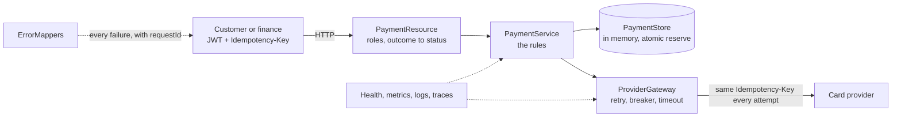

# 🔍 Project 2 - Guided review

This is the tour I would give a teammate who has to take over the service. Read it with the code open. Everything marked **verified** was reproduced by running it on Quarkus 3.40.1.1 (the experiments are in "Break it yourself"; the numbers of the tour come from running the packaged jar).

> [!NOTE]
> Paths are relative to `app/src/main`. The package is `lab.payments`. One question runs through the whole service, and the code is organized around it: **after this failure, can the customer's money have moved?**

## 🗺️ How to read it (about 90 minutes)

| Step | Open | Look for |
|---|---|---|
| 1 | `PaymentStatus.java`, `ProviderException.java` | The vocabulary: six states, and five kinds of failure sorted by what they tell us about the money |
| 2 | `ProviderClient.java` | The contract with the provider; why a 402 is turned into an exception that is *not* a failure of the provider |
| 3 | `ProviderGateway.java`, `ChargeContext.java` | Retry, breaker and timeout in one place; why `ChargeContext` counts attempts **before** the call |
| 4 | `PaymentService.java` | The rules: the four ways a charge ends, reconcile, refund |
| 5 | `PaymentStore.java` | "Reserve this idempotency key" as one atomic step |
| 6 | `PaymentResource.java`, `PaymentRequest.java` | A thin HTTP layer: roles, the outcome-to-status table, validation that refuses a raw card number |
| 7 | `ErrorMappers.java`, `ApiError.java`, `RequestIdFilter.java` | One error shape for everything, with the request id |
| 8 | `ProviderSettings.java`, `ProviderClientFilter.java`, `ProviderReadinessCheck.java`, `MetricsConfig.java` | Secrets that fail at startup, health that stays up on purpose, metrics without identifiers |
| 9 | `resources/application.properties` | Read it as a document: every line is a decision, and every `%test` line says what the tests change |
| 10 | `app/src/test/...` (start with `ResilienceTest`, `IdempotencyTest`, `CircuitBreakerTest`) | What is tested and with which tool |

## 🧠 Decisions and why

| Decision | The alternative | Why this one | From |
|---|---|---|---|
| Money is a `long` in **minor units** with an allow-listed currency | `BigDecimal`, any ISO code | No rounding questions in a showcase. A real service must know each currency's exponent (the yen has none) | lab 14 |
| The card never enters: only a provider **token**, matched by a pattern | Accept a number "to tokenize it ourselves" | Keeps this service out of the costliest part of card-data compliance. A raw number is a 400, is not echoed in the answer and never reaches a log (`LoggingTest`) | labs 05, 25 |
| The idempotency key is **per customer**, with a **fingerprint** of the content | A global key; or no check on the content | Two customers may choose the same key. And a client that reuses a key with another amount must be told (422), not handed the first payment as if it were the second | - |
| The provider's key is the **payment's id**, not the customer's key | Forward the customer's key | The customer's key is theirs to reuse and to choose badly; ours is unique by construction. If a payment is never sent and its key is freed, a new payment gets a new provider key | - |
| `PaymentStore.reserve` is one atomic step and a `PENDING` payment is visible | Check, then insert | The check-then-insert race is the classic double charge. Experiment E shows ten simultaneous requests charging several times without it | lab 10 |
| After a failure: **never sent** (forget it, free the key) or **may have been processed** (`UNKNOWN`) | Treat every error as "failed"; or as "unknown" | The first double-charges customers who pay again; the second blocks customers who could simply retry. `ChargeContext` is what lets the service tell them apart | lab 23 |
| `ChargeContext` counts an attempt **before** the call and un-counts it only on a refused connection | Count after the call | A timeout interrupts the call: whatever runs after it may never run. Experiments B and C break both directions | - |
| `UNKNOWN` answers **202**, never a 5xx | 500 or 504 | A client that sees a 5xx pays again with a new key. 202 says "accepted, outcome pending", and the same key later returns the settled payment | lab 04 |
| **Retry only because** the provider is idempotent, with the **same key** on every attempt | No retry; or retry with a fresh key | A retry with a new key charges again: with a key per attempt the card was charged **three** times in experiment A | lab 23 |
| Declines, rejections and 404s are **not** in `retryOn` nor in the breaker's `failOn` | The defaults (everything counts) | A decline is an answer: retrying it is pointless and counting it opens the breaker because customers have bad cards (experiments F and G) | lab 23 |
| The breaker covers **charges only**; window of the last **20 attempts** | One breaker for every call; a window of 4 | Refund and lookup are rare, finance-driven and must work when charging is shut off. A window of 4 let one bad payment open the breaker in my first jar run (see the traps). The tests shrink it to 4 by configuration | lab 23 |
| The gateway's own `@Timeout` (2 s) is **shorter** than the client's read timeout (5 s) | Only the client's timeout | The fault tolerance decides first, so the failure is classified by the code that knows what a timeout means | lab 23 |
| **Readiness stays UP** while the breaker is open; the state is data and a metric | DOWN when the provider is down | Every instance would say DOWN together: the whole service leaves rotation and reading payments, which needs no provider, stops too. A provider outage must degrade the writes only. The alert is on `ft_circuitbreaker_state_current{state="open"}` | lab 24 |
| `reconcile` is a **manual** endpoint and `payments.unknown` is a gauge | A scheduled job that settles by itself | I chose visibility first: what to do with a payment the provider never saw (`FAILED`) is a policy, and a scheduler in a cluster runs on every instance (lab 13's caveat). The next step is automatic, with the gauge as the alarm | lab 13 |
| Refund is idempotent by `refund-<payment id>`; refunding a `REFUNDED` payment returns it | A 409 on the second refund | A client whose answer was lost must be able to ask again. `aRefundWhoseAnswerIsLost...` loses the answer on purpose | - |
| Roles `customer` and `finance` from a verified JWT; closed by default (`deny-unannotated-endpoints`); somebody else's payment is a **404** | Roles in the body; open by default; 403 for others' payments | The token is the only source of identity. A 403 would confirm that the id exists | labs 19, 20 |
| `quarkus.http.auth.proactive=false` **and** a pre-matching request-id filter | The defaults | See trap 2: without both, a 401 or a 403 carries no `X-Request-Id`. The cost: authentication runs only when the identity is needed (the official guide says so); here every endpoint is annotated and `deny-unannotated-endpoints` keeps it so | lab 19 |
| The provider's key is a `@ConfigMapping` with `@NotBlank`, **no default** | `@ConfigProperty` read in the filter; a development default in `application.properties` | The application must not start without it. Trap 1 is the version that did not | labs 02, 22 |
| `quarkus.jackson.fail-on-unknown-properties=true` | Ignore what is unknown | A misspelled field is a client bug; it also blocks sending `customer` in the body (experiment S) | lab 14 |
| One error shape with `requestId`; validation messages list field names and never the value | Framework defaults | Support finds the log lines and the trace with the id the customer quotes. A customer who pastes a card number in the wrong field must not see it echoed | labs 05, 25 |
| Log levels: a decline is `INFO`; `UNKNOWN` and "not sent" are `WARN`; a provider rejection is `ERROR` | Everything `ERROR`, or nothing | A decline is a normal Tuesday; an `UNKNOWN` payment is a customer who does not know whether they paid; a rejection means our credentials or contract are wrong | lab 25 |
| Metric tags are `outcome` and `operation`, **never an id**; one gauge for what waits for a human | A tag per customer or payment | Every distinct tag value is a time series stored forever (experiment P) | lab 24 |
| A span `payment.create` with `payment.id` and `payment.outcome`; one client span **per attempt** | Only the automatic spans | Retries become visible in the trace, and "not attempted" is a trace with no client span at all | lab 25 |
| **In-memory** store | PostgreSQL | P1 already covered the database, and a store in memory keeps this project on blocks 6-7. The price is written in the next section: the idempotency guarantee holds in one instance only | - |

## 🪤 Traps I hit while building it

> [!WARNING]
> Each of these was a real failure in this project, not a hypothetical.

1. **A fail-fast that was not.** The comment in `application.properties` said the application refuses to start without the provider's key, but the key was read **per request**, so a production start without it would have failed at the first customer's payment. `ProviderSettings` is now a validated `@ConfigMapping`. **Verified** on the jar: without `PAYMENTS_PROVIDER_API_KEY` it exits at startup with `SRCFG00014: The config property payments.provider.api-key is required but it could not be found`.
2. **A 401 or a 403 with no request id.** The filter of lab 25 did nothing for a refused request: `@RolesAllowed` is checked before the ordinary request filters, and a rejected token is answered by the HTTP layer, before any filter of the REST layer runs. Two changes were needed, each one proved by an experiment: a **pre-matching** filter (experiment I) and lazy authentication (experiment H). Without the first, the 401 without a token, the 403 and the 404 had no id; without the second, the 401 of a forged token had none.
3. **One bad payment opened the breaker.** My first window was 4 attempts, as in lab 23. In the first run of the jar a single payment whose provider timed out three times, after a good one, left the readiness data at `"circuit":"OPEN"`. The breaker counts **attempts**, not payments: a payment retried twice is three attempts, and a good payment before it is one more entry in the window. The annotation now says 20; only the tests shrink it.
4. **A decline is a success for the breaker.** Declines and 404s are not in `failOn`, so the breaker counts them as successes. That is right (customers with bad cards must not open it) and it changes the arithmetic: in my own tests the order of a decline and a failing payment decided whether the breaker had opened.
5. **The worst case is slow.** A provider that charges and then goes silent makes `POST /api/payments` take about **6.3 seconds** (three attempts of 2 seconds, plus two pauses of 100 ms; measured on the jar). The clients' own timeout must be longer than that, or they will repeat the request: harmless, because of the idempotency key, but it is traffic you chose to create.
6. **Prometheus lines can carry an exemplar.** With OpenTelemetry in the application the text format puts a comment after the value (`... 1.0 # {span_id="...",trace_id="..."} 1.0 1793...`). The `Ops.sample` of lab 24 compared the whole line and found nothing: it now ignores what follows the value.
7. **A gauge of the fault tolerance can keep an old value.** `ft_circuitbreaker_state_current{state="open"}` stayed at `1.0` after the tests reset the breaker with `CircuitBreakerMaintenance.resetAll()`, and `state="closed"` is not `1.0` at rest. The metric tests compare **transitions** (open then closed again), never a starting value.
8. **A test helper that wiped the provider's memory.** `Provider.reset()` also forgets every charge, so a refund test that called it between the payment and the refund got a 404 from the provider. A fake that remembers (that is what makes it idempotent) must be reset deliberately.
9. **A test that passed for the wrong reason.** The first version of the "unreachable provider is retried" test asserted that the provider had received 0 calls, which proves nothing about retries (nothing can reach a closed port). I removed it. The behavior that matters is covered by the one where an attempt *may* have charged and the next ones are refused (`aRefusedConnectionAfterAnAttemptThatMayHaveCharged...`), which needs the fake to close its port in the middle of a call.
10. **The catch-all mapper did not swallow the security exceptions.** I expected the `Throwable` mapper to turn a 401 or a 403 into a 500 (it is the most general one). It did not: the security layer answers first. Verified by `AuthenticationTest` and `ErrorContractTest`.

## 💥 Break it yourself

Copy the project to a scratch folder (never edit it in place), change one thing, run **the named test**, and read the failure. Then undo. Results are what I got.

| # | Change | Run | What happened (verified) |
|---|---|---|---|
| A | In `ProviderGateway.charge`, send `UUID.randomUUID()` as the key instead of `idempotencyKey` | `ResilienceTest#aDroppedConnectionIsUnknown` | Red: the provider charged **3** times instead of 1 (every attempt was a new payment for it). `aFirstAttemptThatTimesOutIsRetriedAndStillChargesOnce` answers 202 instead of 201 |
| B | Make `ChargeContext.mayHaveBeenProcessed` always `false` | `ResilienceTest#aTimeoutAfterTheProviderChargedIsUnknownAndTheMoneyDidMove` | Red: **503** instead of 202. The customer is told "nothing was charged, retry" while the provider has charged. 10 of the 14 tests of the class fail |
| C | Make it always `true` | `ResilienceTest#whenTheProviderCannotBeReachedNothingIsRecordedAndTheKeyIsFree` | Red: **202** instead of 503. A payment that never left the machine is recorded as `UNKNOWN` and its key stays taken |
| D | Remove `store.release(payment)` | the same test | Red: the customer's list still shows a `PENDING` payment that will never settle |
| E | Remove `synchronized` from `reserve` and pause 40 ms between reading and writing | `IdempotencyTest#tenSimultaneousDuplicatesChargeOnce` | Red in **5 of 5** runs: several different payment ids for the same key |
| F | Add `ProviderException.Declined` to the breaker's `failOn` | `DeclineTest#manyDeclinesDoNotOpenTheBreakerBecauseCustomersHaveBadCards` | Red: `Expected status code <402> but was <503>`: declined cards opened the breaker and the next customer is turned away |
| G | Add `Declined` to `retryOn` | `DeclineTest#aDeclineIsAskedOnceAndNeverRetried` | Red: the provider received **3** calls instead of 1 (and 37 instead of 13 in the test with twelve declines) |
| H | Remove `quarkus.http.auth.proactive=false` | `AuthenticationTest#everyAnswerCarriesTheRequestId` (forged token) | Red: `Expected header "X-Request-Id" was not is not null, was "null"`; the response has only `www-authenticate=Bearer` and an empty body |
| I | Make the request-id filter an ordinary (not pre-matching) filter | the same test | Red in **4** cases: the 401 without a token, the forged token, the 403 and the 404 |
| J | Remove the gateway's `@Timeout` | `ResilienceTest#aTimeoutAfterTheProviderChargedIsUnknownAndTheMoneyDidMove` | Red: **201** instead of 202. Nothing cuts the call, so the request waits for the slow provider and takes its answer; the customer is told `CAPTURED` after a wait the service never decided to allow |
| K | In `ProviderGateway.refund`, use a random key per attempt | `ReconcileAndRefundTest#aRefundWhoseAnswerIsLostIsRetriedWithTheSameKeyAndRefundsOnce` | Red: **2** refunds instead of 1: the customer is paid back twice |
| L | Loosen the `cardToken` pattern to `[A-Za-z0-9_]{8,64}` | `PaymentCreationTest#aRequestThatBreaksTheContractIs400AndNamesTheField` (a raw card number) | Red: **201** instead of 400: a raw card number is accepted as if it were a token |
| M | Make the fingerprint ignore the amount | `IdempotencyTest#theSameKeyWithADifferentRequestIs422AndTouchesNothing` | Red: **201** instead of 422: a client that retries a key with another amount is silently given the first payment |
| N | Make the readiness check `DOWN` when the breaker is open | `HealthTest#readinessStaysUpWhileTheBreakerIsOpen...` | Red |
| O | Log the whole `PaymentRequest` | `LoggingTest#neitherCardsNorCredentialsNorTokensEverReachTheLog` | Red: the record's `toString` carries the card token into the log |
| P | Add the payment id as a tag of `payments.created` | `MetricsTest#everyMetricOfTheApplicationCarriesItsNameAndNoMetricCarriesAnIdentifier` | Red (and two other metric tests, which can no longer find their sample) |
| Q | Remove `quarkus.security.jaxrs.deny-unannotated-endpoints` | `AuthenticationTest#anEndpointNobodyAnnotatedIsClosedEvenForAnAuthenticatedUser` | Red: the test-only endpoint nobody annotated is reachable |
| R | Remove the ownership filter in `PaymentService.get` | `OwnershipTest#somebodyElsesPaymentDoesNotExist` | Red |
| S | Remove `quarkus.jackson.fail-on-unknown-properties` | `OwnershipTest#theOwnerCannotBeChosenByTheClient` | Red |
| T | Remove the `Retry-After` header from the mapper | `CircuitBreakerTest#anOpenBreakerAnswers503...` | Red |
| U | Make `PaymentResource` answer 500 for `UNKNOWN` | `ResilienceTest#theUnknownStatusIsNeverTurnedIntoAnErrorTheCustomerCouldActOn` | Red (10 tests of the class) |

Also try without a copy, against the packaged jar (see the README): reconcile an `UNKNOWN` payment, then send the same `Idempotency-Key` again and read the answer: it is the payment, settled, with `Idempotent-Replayed: true`.

## 🚧 What this service does not have (on purpose)

| Missing | Why | Where it comes |
|---|---|---|
| A database | Payments and idempotency keys live in memory: a restart forgets them and **two instances would not share keys**, so the guarantee of the ten simultaneous requests holds in one instance only. A real store needs a unique `(customer, key)` and the payment in the same transaction | labs 08-11 |
| Keys that expire | Providers keep an idempotency key for about a day. Here a key lives as long as the process | a product decision |
| An automatic reconciliation | `payments.unknown` is the alarm and a person presses the button | lab 13 (`@Scheduled`), with a policy |
| Webhooks from the provider | Real providers tell you the outcome later; reconcile would then be the fallback | - |
| A bulkhead | One slow provider can hold every worker thread for 2 seconds. Lab 23 shows `@Bulkhead` and what it refuses | lab 23 |
| A real identity provider | Tokens are verified against a public key in the jar (a throw-away test pair). Production would use the identity provider's key set | lab 21 |
| TLS, secrets management | The jar speaks plain HTTP and the provider's key comes from an environment variable | lab 22 |
| Rate limits, pagination | A list returns everything the caller may see | gateway, lab 15 |
| Audit trail, refund amounts, partial refunds | Out of scope; a refund is whole | a product decision |
| Container image, CI, Kubernetes manifests | Only the jar is checked | block 9 |
| Alert rules | The signals exist (`payments_unknown`, the breaker state, outcomes per kind). The rules are the next person's job | block 9 |

**Observed in the packaged jar:** the public key is inside (`publicKey.pem`) and no private key is (checked with `unzip -l` over every jar of `target/quarkus-app`). In `prod` the console prints JSON with `requestId`, `traceId`, `spanId` and `sampled` as top-level fields, and the operations endpoints answer on port 9000 only.

## 🧪 How the tests are built

| Class | What it protects |
|---|---|
| `AuthenticationTest` | tokens (forged, wrong issuer or audience, expired), roles, security before validation, the closed default, an id on every answer |
| `OwnershipTest` | whose payment is whose, scoped lists, no owner chosen by the client |
| `PaymentCreationTest` | the shape of a payment, what the provider is sent, validation (twelve invalid bodies), the idempotency key itself |
| `IdempotencyTest` | replay, reuse, per-customer keys, ten simultaneous duplicates (five repetitions) |
| `DeclineTest` | a decline is final, is not retried, never opens the breaker |
| `ResilienceTest` | retries, `UNKNOWN`, "not sent", the mixed case, reconciling afterwards |
| `CircuitBreakerTest` | opening, failing fast, recovery, what keeps working while it is open |
| `ReconcileAndRefundTest` | the two things finance does, including answers lost on the way |
| `HealthTest`, `MetricsTest` | liveness, readiness, outcome counters, the gauge, the breaker metric, no identifier in any tag |
| `LoggingTest`, `TracingTest` | levels, no secret in any line, ids that point at each other, one span per attempt |
| `ErrorContractTest` | one shape for fourteen kinds of failure, and nothing internal in any of them |

**The fake provider** (`ProviderStubServer`, a plain JDK HTTP server started by a `QuarkusTestResourceLifecycleManager`) is **idempotent like a real one**; that is what makes "charges once" a thing the tests can count. Its behavior comes from the card token (a different token per scenario) or from control endpoints (fail the next N calls, delay, close the port, close it in the middle of a call, lose a refund's answer). The test helper `Provider` drives it over HTTP because the stub lives in another class loader than the tests. `tools/ProviderStub.java` is the same class for running the jar by hand; they are kept identical except the name, the `main` and a paragraph.

Conventions worth copying: every test starts from nothing (`PaymentsTestBase`: empty store, fresh provider, closed breaker); every negative test first proves the **valid** request works; nothing compares message text (only status, `code`, header and field names); the tests never import production DTOs; the money question is asserted at the provider (`Provider.charges()`), not only in the answer; concurrency runs five times; **the tests change the breaker only through configuration** (`%test.quarkus.fault-tolerance...`), never in the code. The suite has 154 tests, takes about a minute and was green three runs in a row. Each of the experiments above was run with one change at a time.

## ❓ Questions to challenge me (bring them to the feedback session)
1. A customer's request times out on their side after 5 seconds, but the payment goes through. What do they see, what should their client do, and what in this API makes that safe?
2. `UNKNOWN` is a 202. A mobile app shows "payment received". Is that honest? What would you change in the contract if the app needs a final answer in the same call?
3. The store is in memory. Walk through what breaks with two instances behind a load balancer, and design the unique constraint that fixes the double charge. In the same transaction, what else must be written?
4. Readiness stays UP when the provider is down. Name a case where you would make it DOWN, and what the platform would then do to the whole service.
5. The breaker counts attempts, and a decline counts as a success. What would you set the window and the ratio to, and what would you measure to decide?
6. Reconcile asks the provider by the payment's id. What if the provider's lookup is eventually consistent and answers "never heard of it" for a charge made a second ago? What does `FAILED` then mean, and what protects the customer?
7. Which of the 154 tests would you delete first if the suite became too slow, and which never? Which scenario of the fake provider would you add next?
8. The refund takes no amount. What changes in the idempotency key if partial refunds exist?
9. A support agent has the request id of a failed payment. List every place where they can follow it: where is it, and where is it **not**?
10. A 401 now carries a request id because authentication is lazy. What would you check before adding a public endpoint to this service?
